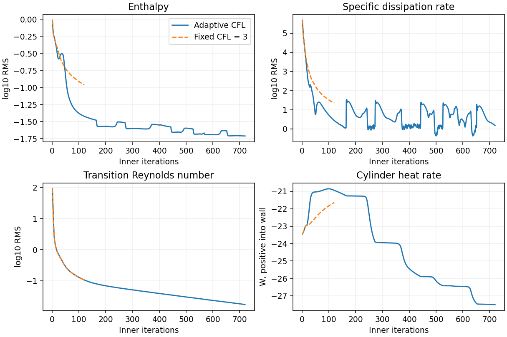

# 单时刻覆盖与圆柱首步对照

自绘模型的 19,752 个原面中，9,725 面同时有工程壁压和热流，占 0.846754 / 1.964629 m²（43.10%）。本轮新增 0 m²，两量都通过独立验证的面积仍为 0 m²。66 mm 加热圆柱是独立的低速风洞算例。它在中央迎流区有 220 / 2160 面的工程结果，面积占 13.27%。本次比较结束，优先级回到同一冻结工况的原面缺项。[自绘模型分区](../v263/RESULTS.md) · [圆柱工程结果](../v279/RESULTS.md) · [下一项](NEXT_DECISION.md)

## 同一物理步的比较

基线为 v279 提交 `9208316dac5911f1e29fa7a6ba8fd526524603e3`。复用其冻结的完整初场、网格、工况、物理步与官方 SU2 8.6.0 二进制，网格有 69,120 个六面体。两个终态对应相同的 80.619 µs 物理时间增量。下表列出求解器的原始 log10 RMS，首步验收要求九项同时小于 −8。[合同](PLAN.md) · [准确输入](evidence/inputs.json) · [配置](evidence/case.cfg)

| 原方程 | 固定 CFL 第 120 次 | 自适应第 120 次 | 自适应第 720 次 |
|---|---:|---:|---:|
| 压力 | −4.667 | −5.125 | −5.413 |
| 跨向速度 U | −4.163 | −4.607 | −5.079 |
| 速度 V | −2.987 | −2.973 | −3.830 |
| 速度 W | −3.513 | −4.604 | −4.949 |
| 焓 | −0.965 | −1.424 | −1.712 |
| 湍动能 k | −4.126 | −4.476 | −3.760 |
| 比耗散率 ω | +1.353 | +0.436 | +0.184 |
| 转捩间歇因子 | −2.949 | −2.960 | −2.917 |
| 转捩雷诺数 | −0.970 | −0.975 | −1.763 |

固定方案含写终场共用时 36.828 s。自适应方案的逐行可见性记录在 36.687 s 有 66 行，在 36.906 s 有 67 行。这一时间区间内焓为 −1.187 至 −1.197，ω 为 +1.374 至 +1.358。等耗时比较包含程序启动和诊断输出成本，旧算例仅有总耗时记录。自适应实际耗时 306.343 s，采样内存峰值约 742 MiB。两条历史的首行九分量相等，两个终点均为 **0/9 达标**。未开始第二个物理步。[完整比较及终态](evidence/trial.json) · [逐次原生历史](evidence/history_00001.csv.gz) · [时间采样](evidence/visible.csv.gz)

## 为什么结束这组参数试验

720 次中流动、SST、LM 三组线性系统均达到配置的相对残差 0.001，且均未耗尽 16 次线性预算。局部 CFL 在第 120 次全域为 48，终点全域为 1。末 30 次内迭代中，圆柱热监视极差为 0.01046 W，跨中前、侧、后表压相对入口探针的极差依次为 9.25、9.51、10.33 Pa。上述窗口处于同一物理时间步内部。判定依据仍是九个原方程及场量检查。[数值与探针](evidence/trial.json)

固定版本的 `AdaptCFLNumber` 用流动及 SST 的线性误差、局部欠松弛与残差历史控制调整。LM 的线性和非线性残差未直接进入这组判据。SST 随流动更新局部 CFL，LM 保留初始化的局部 CFL。标量实际隐式时间步取流动时间步乘以标量与流动局部 CFL 之比，再用于对角项。已核对所用源码文件与官方标签归档相同。这说明三组方程采用的调整方式不同，现有记录仍不足以单独归因某次 CFL 回落。[SU2 8.6.0 控制逻辑](https://github.com/su2code/SU2/blob/7048fd35f56d4bf52e586429d6746a36a10255f8/SU2_CFD/src/solvers/CSolver.cpp#L1903) · [标量时间步和隐式组装](https://github.com/su2code/SU2/blob/7048fd35f56d4bf52e586429d6746a36a10255f8/SU2_CFD/include/solvers/CScalarSolver.inl#L465)

另从全体节点保存的线性系统右端量定位各方程末端峰值。九项重新统计的 log 最大值和 RMS 与原生历史的差均小于 5 × 10⁻¹⁰。ω 的最大点 35217 靠近入口与风洞上壁交接处，焓的最大点 37072 在上游中跨，转捩雷诺数最大点 38349 位于出口与下壁交线。安装端、近圆柱和下游尾迹的分区峰值也已逐量保存，分区可以重叠。这些结果定位末帧误差，因果机制尚未证实。[各方程节点与坐标](evidence/locations.json)

## 原面与工作台

复核了 73,800 节点、全部主量和两列转捩辅助量。末帧圆柱壁节点流体温度为 303.149679–303.150289 K，给定壁温为 303.15 K。保留这项偏差及未收敛身份。用给定壁温重建圆柱侧法向热流，1656 个非共享节点与原生值最大相差 1.41 × 10⁻⁹ W/m²。144 个安装交线节点独立取圆柱侧通量。原生壁面监视为 −27.50002421 W，重建的同一对偶面积积分为 −27.500024205 W。映射到 2160 个显示三角面后积分为 −27.53461 W。上述均为诊断积分。已算工程面向空气放热 5.88454 W，整壁工程功率未知。[逐面诊断](evidence/trial_faces.csv) · [圆柱原生终场记录](evidence/trial.json)

MATLAB 的「输入模型 → 计算 NASA 圆柱换热对照 → 给定边界工况」可以在默认工况下切换固定和自适应 CFL 归档。探针、截面和导出注明方案、内迭代数及源帧。实际工作台回调依次核对固定、自适应、切回固定、改变壁温，原工程场和面积一致。对本地和发布版网页脚本，各核对了同一中跨截面 720 条压力记录和 720 条热流记录，含原面编号、值、单位、来源和资格。未进行实体鼠标测试。[本机自适应诊断云图](../../../outputs/v280_validation/gui01/workbench/index.html) · [工作台回执](evidence/workflow.json) · [截面核对](evidence/sections.json)

初次离线检查错误地假定壁节点流体温度等于给定壁温，现将其偏差单列。第二次检查在大热流处遇到 VTK 文本有效位数限制，改为 1800 节点逐个按输出精度精确比对。第三次检查在归档步骤遇到本机 Python 的 gzip 接口差异。三次均保存原记录，随后复读同一终场通过，无额外 CFD 重算。[首次检查](evidence/audit01.txt) · [VTK 表示核对](evidence/audit02.txt) · [归档兼容](evidence/audit03.txt)

成功的离线审核内部用时 3.89 s，MATLAB 工作台测试含启停用时 28.66 s。开发、阅读与归档未单独计时。大场位于 `outputs/v280_validation/adapt01`，已按列名重排并核验的重启文件位于 `outputs/v280_validation/audit04/restart_with_lm_00001.csv`，未从此帧继续推进。初场等共同输入与 v279 共享硬链接。Git 保存可读原面结果、历史、运行脚本及文件清单，大场仅在 E 盘。29 个保护文件、54 个工程文件和两对候选均已核对。[本地资产](evidence/local_assets.json) · [MATLAB 进程回执](evidence/gui_process.json)
