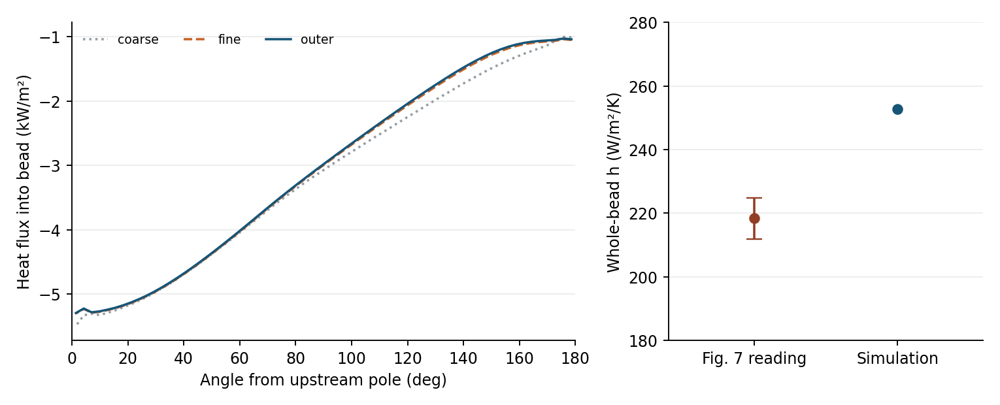

# B 型热敏珠全表面压力、热流与风洞实验对照

相对 v281，名义 B 型热敏珠新增 **5,216 面、3.08983026 × 10⁻⁶ m²**。在 3.0 m/s 的空气中，全部原三角面均得到同工况壁压与给定壁温下的对流热流。整珠向空气放热 **9.38210 mW**。按论文表 1 的面积换算，计算平均换热系数为 **252.7 W/(m²·K)**，比图 7 的实验读数 **218.4 W/(m²·K)** 高 **15.7%**。论文没有逐面壁压与热流测量，两者联合独立验证的面积为 **0 m²**。自绘模型本版新增 **0 面、0 m²**，其工程交集仍为 43.10%。[扩域终场](evidence/outer.json) · [实验与网格差值](evidence/comparison.json) · [自绘模型台账](../v281/RESULTS.md)

## 查看和运行

在 MATLAB 项目根目录运行 `rocketAeroHeatWorkbench`，在「输入模型」侧栏选择「B 型热敏珠 → 查看已算原面」，点「打开热敏珠全表面结果」。云图默认显示有符号入壁热流。切换到「相对环境壁压」可直接看到以 Pa 计的绕流压差。三维页可点选面元、查看截面，旁边「区域结果与验证」可导出全表面成对的壁压与热流。导出的 `face_id` 从 1 开始，对应原生 `wall.csv` 的 `faceID + 1`。[本机离线三维页](../../../outputs/v282_validation/ui02/export/workbench/index.html) · [工作台导出的完整原面表](../../../outputs/v282_validation/ui02/wall_pair.csv)

同一菜单选「从冷初场计算」可在项目内生成网格、求解并导出新的离线页。归档浏览只需要 MATLAB 和随版本发布的 198 kB 压缩文件。重新计算还需 Windows、项目固定的 SU2 8.6.0，以及 MATLAB 可启动的 Python、NumPy、SciPy 和 psutil。本机数值环境为 Python 3.7.7、NumPy 1.21.6、SciPy 1.7.3、psutil 5.9.8。MATLAB 命令入口如下。[完整 MATLAB 文件](../../../runThermistorBeadCase.m) · [原面和工况归档](../../../cases/thermistor_b/surface.zip) · [项目求解器安装程序](../../../scripts/installSU2Runtime.py)

```matlab
[bead, report] = runThermistorBeadCase();           % 读取归档，返回逐面场和覆盖台账
[bead, report, page] = runThermistorBeadCase([], 'solve');   % 新建工况目录并从冷初场计算
```

## 试件、边界和实验量

坪内、佐藤的表 1 给出 B 珠面积 3.094 mm²、偏心率 0.53、特征长度 0.3430 mm、引线直径 0.0540 mm。用前两量建立光滑旋转长椭球，半长轴 0.55255 mm、半短轴 0.46856 mm。重建几何的特征长度 2V/S 为 0.32848 mm，比论文值小 4.23%。本次假定来流沿长轴，整个珠面等温，未建两条引线。论文对引线和辐射散热作了修正，引线对气流的影响、实际方位和制造形状都可能影响比较，尚无证据给这几项分别分配误差。[原论文，表 1、图 7](https://doi.org/10.1299/kikai1938.25.810)

研究设定为上游 293.15 K、101325 Pa，壁温 305.15 K，沿 −X 来流。以横径为参考，Re 为 180.10，Pe 为 127.38，Ri 约 4.10 × 10⁻⁵。计算采用恒物性、不可压、层流强迫对流，忽略浮力。原三角面几何总面积为 3.089830 mm²，三维体网格的壁面由弦面组成。前者用于逐面覆盖和功率积分，论文的 3.094 mm² 用于实验系数的分母。[物性、几何与运行合同](PLAN.md)

图 7 取 3 m/s 系列中约 12 K 的测点。原 PDF 第 6 页、印刷页 815 以 230 dpi 渲染为 1901 × 2690 像素，在左上角坐标 (1064,1479) 裁取 627 × 457 像素。读得温差 12.11 K、系数 187.88 kcal/(m²·h·K)。按 4184 J/kcal 换算为 218.36 W/(m²·K)。测点中心取 ±2 像素，刻度定位取 ±0.75 像素，所得系数范围为 211.9–224.8 W/(m²·K)。即便取上端，计算仍高约 12.4%。这是读图范围，该测点的独立实验不确定度未知。[读点坐标与单位换算](evidence/comparison.json) · [复算脚本](compare_bead.py)



## 逐面结果与算法

| 量 | 扩域网结果 | 来源 |
|---|---:|---|
| 壁面绝对压力 | 101321.35–101332.00 Pa | SU2 三维层流壁节点相对压力，经非负面内权重平均，再加上游静压 |
| 入壁热流 | −5299.38 至 −1021.78 W/m² | 强等温对流扩散方程的壁节点反力，按原三角面守恒分配。负号表示珠体向空气放热 |
| 首层流体节点温度 | 304.7583–305.0744 K | 同一终场首层流体节点的温差标量换算为 K，再映射至对应原面 |
| 给定壁温 | 305.15 K | 整珠等温边界输入 |
| 固体壁温、边界层外缘温度、恢复温度 | 未求 | 此工况未运行固体热响应，也未独立提取外缘或恢复状态 |

截面为 30° 的三维域在两个方位单元上推进，用两侧对称条件重建整周。迎流端附近原生面 5185 的放热通量绝对值最大，背流端附近面 14 最小。粗网的首层距离为 3.748 µm，两套细网为 1.874 µm。闭合的原面网格共有 7,824 条边，每条边由两个反向的三角形边共享。[极值面、质心与近壁尺寸](evidence/local_assets.json)

二维初算为三维动量场提供初值。最初的二阶轴对称温度越界。改用一阶后，细网和扩域的远场节点单侧重建与壁面放热仍不符。三维原生弱等温焓边界也使扩域场的壁节点最高达到 305.15324 K。最终采用原生强约束温差标量 θ=(T−T∞)/ΔT。恒密度、恒物性、无源条件下，该标量满足同一热对流扩散方程。壁面 θ=1，远场来流 θ=0，全域关闭裁剪。原焓场单列作诊断。扩域标量的全域温度为 293.15–305.15 K。[求解与被拒尝试](PLAN.md) · [弱焓和强标量的温界](evidence/outer.json)

| 量 | 粗网 12D | 细网 12D | 扩域 20D |
|---|---:|---:|---:|
| 子午 × 径向单元 | 40 × 30 | 64 × 42 | 64 × 48 |
| 整珠放热，mW | 9.71843 | 9.43184 | 9.38210 |
| 按论文面积的平均 h，W/(m²·K) | 261.75 | 254.04 | 252.70 |
| 六个分量末 20 次中最大的 log₁₀ RMS | −10.80 | −10.90 | −10.90 |

从粗网到细网，平均 h 按粗网归一减少 2.95%，以细网归一的差为 3.04%，接近合同的 3% 敏感性指标。个别原面热流变化可达 14.08%。从 12D 细网到 20D 扩域网，平均 h 变化 0.53%，逐面热流最大相对变化 2.15%。三网均采用相同的角向离散，这组数据不能估计角向误差。强标量的热稳定性按两个相隔 20 次迭代的终点反力积分核对。扩域网相对变化为 2.06 × 10⁻⁸。[粗网](evidence/coarse.json) · [细网](evidence/fine.json) · [扩域](evidence/outer.json)

原面热功率与原生壁反力按构造守恒。另从同一扩域输入态，在不改强边界装配的观察构建中读取壁面与远场项。整珠壁面放热为 9.38209948 mW，远场显热流出为 9.38209217 mW，相对差 **0.0000779%**。逐节点壁反力与官方程序读数的最大差为 3.66 × 10⁻¹⁹ W。第一次离线比对遗漏全局编号排序，按编号重读同一现场后通过。守恒为数值一致性证据，实验平均值的 15.7% 差异仍保留。[独立热量账](evidence/energy.json) · [观察程序](observe_bead.py)

## 复现与检查范围

开发基线为 v281 提交 `7037c427ed8cb51df479565b9731add71816fcd5`。19 次受监督的原生运行含早期对照，总计 227.13 s。扩域正式结果所需的六个阶段合计 112.17 s，三维强标量阶段用时 51.61 s。该阶段最后保存的迭代编号为 1187，先于 2000 次的首个周期保存间隔。扩域初场、最终原生场、早期对照和观察构建留在 E 盘。开发与读图未单独计时。[原生回执](evidence/native_receipts.json.gz) · [本机资产与运行信息](evidence/local_assets.json)

MATLAB 主工作台实际渲染了全部原面，检查了探针、热流方法、温度身份、给定和未知值、成对 CSV 与返回原输入。三套已算终场经加强的来源核对重读后，逐字节复现相应原面表。新计算入口的六阶段输入逐一与原生运行对照。MATLAB 启动 Python 载入了求解入口，整条新按钮路径此次以保存终场核对输入和输出，未重复跑一套相同流场。既有 CM-011 的二维与三维读入各重放 14,140 面，逐值一致。工作台在含并发前端修改的实际工作区测试，相关脚本散列见进程回执，发布仅纳入本任务文件。原 29 项文件、54 项工程文件和两对候选已校验。[工作台结果](evidence/view.json) · [工作台进程](evidence/view_process.json) · [六阶段输入](evidence/entry.json) · [复读回归](evidence/replay.json)
