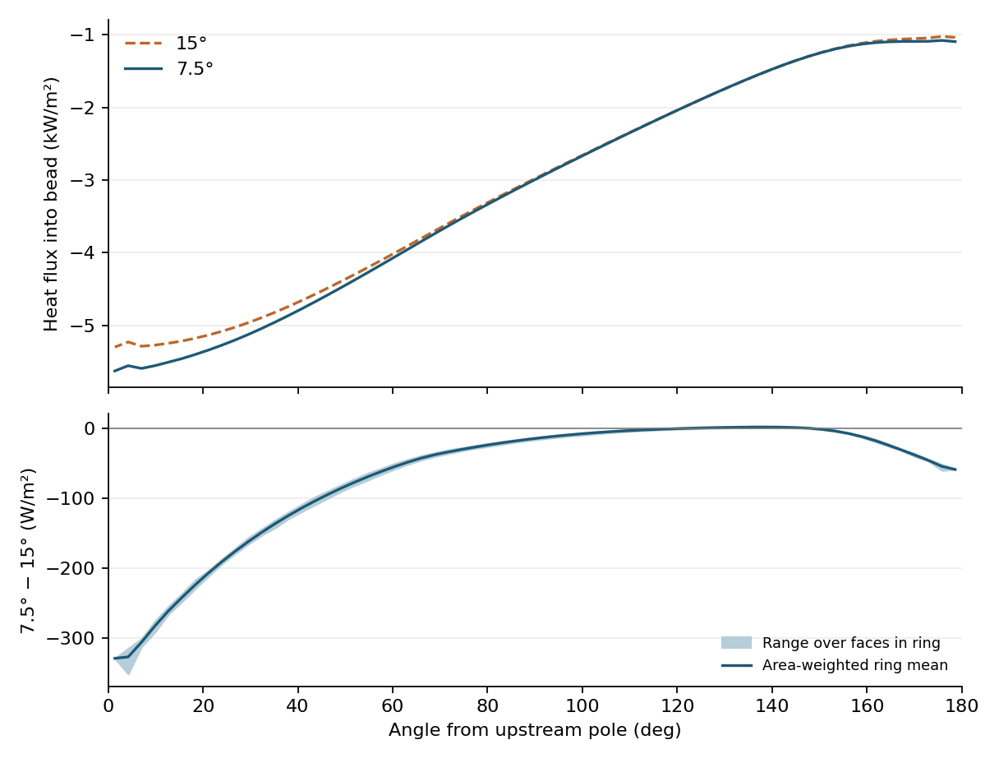

# B 型热敏珠的周向网格敏感性

同一工况和同一批 5,216 个原面上，把周向单元从 15° 细化至 7.5°，整珠平均换热系数由 **252.70 增至 256.11 W/(m²·K)**，变化 **+1.35%**。相对于图 7 的实验读数 218.36 W/(m²·K)，偏高程度由 **15.73% 增至 17.29%**。这一档周向细化使计算值略微远离实验，不能解释原有高估。两网均已算出压力与热流，相对 v282 新增覆盖 **0 面、0 m²**，本版补齐了角向敏感性的定量证据及逐面差值显示。自绘模型新增 **0 面、0 m²**。[逐面比较摘要](evidence/comparison.json) · [实验读点与不确定度范围](../v282/evidence/comparison.json)

| 工况结果 | 15° | 7.5° |
|---|---:|---:|
| 30° 扇区单元数 | 6,144 | 12,288 |
| 整珠向空气放热，mW | 9.38210 | 9.50885 |
| 放热通量峰值，W/m² | 5,299.38 | 5,626.95 |
| 峰值原面编号，从 0 起 | 5185 | 5210 |
| 首层流体温度，K | 304.7583–305.0744 | 304.7366–305.0719 |
| 壁面绝对压力，Pa | 101321.35–101332.00 | 101321.32–101331.87 |

变化最明显的是迎流端。放热通量峰值增大 **6.18%**，仍在 +X 极点附近。两网在同一原面上比较，最大热流差出现在原生面 **5203**（工作台面 **5204**），入壁热流从 −5216.73 变为 −5567.47 W/m²。整表面热流差的面积加权 RMS 为 **71.54 W/m²**，同面壁压差的面积加权 RMS 为 **0.188 Pa**。两网比较给出此档分辨率的敏感性，局部热流与壁压的独立联合验证面积仍为 **0 m²**。[基准网](../v282/evidence/outer.json) · [细网](evidence/refined.json)



## 数值检查

采用 v282 的 3.0 m/s、293.15 K 空气与 305.15 K 等温名义珠体。64 × 48 子午与径向网格、1.87425 µm 首层间距、20D 外域、长轴沿气流和物性均相同。两网共有射线上的节点坐标逐值相同。12 个扇区合成的弦面壁面积从 3.07691 增至 3.08899 mm²，结果始终映回同一套面积为 3.089830 mm² 的闭合原面。实验系数使用论文表 1 的 3.094 mm² 作分母。[计算合同与输入散列](PLAN.md) · [新网格](evidence/geometry.json)

官方 SU2 8.6.0 在新网格上重新推进了三维动量与强等温标量。前驱和强标量终场的迭代编号分别为 1494 和 2312。强标量另存了编号 2000 的周期场。六个方程末 20 次中最差 log₁₀ RMS 为 −10.955。强标量温度范围为 293.15–305.15 K，弱焓诊断的最高温度为 305.150206 K。又推进 20 次后，整珠壁热积分的相对变化为 1.39 × 10⁻⁸。给定壁温、首层流体温度和未知的固体壁温继续分列。[最终物理量和残差](evidence/refined.json) · [原生运行回执](evidence/native_receipts.json.gz)

对同一强终场和未改强边界装配的观察程序，原生壁面放热 **9.50884727 mW**、远场显热流出 **9.50883465 mW**，相对差 **0.000133%**。逐节点反力与官方程序的最大差为 2.38 × 10⁻¹⁹ W。前驱和强标量求解用时 123.95 s 和 176.42 s，三次反力／延续步骤合计 5.26 s。原生运行家族采样峰值约 180 MiB。观察对象编译与链接另计 8.52 s，两次观察步另计 2.92 s。开发与归档未单独计时。[独立热量账](evidence/energy.json) · [本机资产与用时](evidence/local_assets.json)

## 在工作台比较两网

运行 `rocketAeroHeatWorkbench`，在「输入模型 → B 型热敏珠」选择「查看 7.5° 网及差值」，然后点「打开热敏珠全表面结果」。默认热流为 7.5° 网的原值。变量菜单另有「入壁热流差」和「壁压差」，两者的方向都是 **7.5° 减 15°**。可点选原面、查看周向曲线，并从「区域结果与验证」导出当前变量或主壁压／热流。切换菜单可看 15° 基准，也可选择从冷初场重新计算。选择计算后，按钮会明确显示「从冷初场计算热敏珠」。[打开本机细网云图](../../../outputs/v283_validation/ui02/export/workbench/index.html) · [逐面热流差](../../../outputs/v283_validation/ui02/delta_heat.csv) · [截面导出](../../../outputs/v283_validation/ui02/section.csv)

```matlab
[bead, report, page] = runThermistorBeadCase([], 'archive7p5');  % 读取细网及同面差值，导出离线页
[bead, report, page] = runThermistorBeadCase([], 'solve7p5');    % 从程序内部生成网格并计算
```

细网归档新增 143 kB，仅保存逐面表和数值摘要，几何与工况复用原归档。工作台以发布版网页资源完成真实 WebGL 渲染，逐面核对两种主场和两种差值。X = 0.172 mm 截面导出的 121 条原面交线均与细网热流差对应。检查包括原面探针、选项保持及 5,216 行主场导出，最终界面检查用时 37.91 s。两种冷启动入口分别重建六阶段输入并与真实运行逐字节比对，回放没有重复进行物理推进。直接物理计算只进行了本计划登记的新网格。已核对原 29 个保护文件、54 项工程文件和两对候选。基线为 v282 提交 `32f5e648aa314a18324247ffcd4431eb4b9329a6`，其余并发文件独立保留。[UI 与探针回执](evidence/view.json) · [页面输入与进程](evidence/view_process.json) · [细网入口](evidence/refined_entry.json) · [基准入口](evidence/baseline_replay.json)
