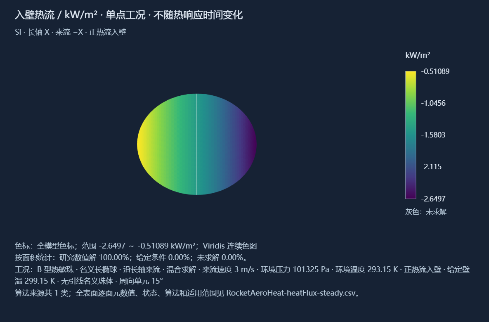

# B 型热敏珠随给定壁温变化的全表面结果

在同一股 **3 m/s、293.15 K** 的空气中，B 型热敏珠的给定壁温现可在 **293.15–305.15 K** 范围内连续调整。15° 网格在壁温从 305.15 K 降至 299.15 K 时，整珠放热由 **9.38210 mW** 降至 **4.69105 mW**；壁温等于空气温度时，全部 **5,216 个原面**的热流为零。压力仍有绕流分布。299.15 K 和 293.15 K 两个新增冻结工况各首次交付 **5,216 面、3.08983026 × 10⁻⁶ m²** 的同面壁压与热流。原 305.15 K 工况和自绘模型均新增 **0 面、0 m²**。两个温度工况的面积分别记账。[15° 工作台结果](evidence/ui_15.json) · [7.5° 工作台结果](evidence/ui_7p5.json)

| 给定壁温 | 壁面与空气温差 | 15° 网格整珠放热 | 7.5° 网格整珠放热 |
|---|---:|---:|---:|
| 305.15 K | 12 K | 9.38210 mW | 9.50885 mW |
| 299.15 K | 6 K | 4.69105 mW | 4.75442 mW |
| 293.15 K | 0 K | 0 mW | 0 mW |

表中放热以从珠面流向空气为正。三维云图、面元表与有符号热功率继续用入壁为正的约定，因此 299.15 K 的 15° 工况在工作台显示 −4.69105 mW。

## 使用方法

在 MATLAB 项目根目录运行 `rocketAeroHeatWorkbench`。选用 B 型热敏珠并生成体网，在「添加边界条件」选择空气工况、输入「给定壁温 / K」并确认。选择「使用已算场求当前壁温结果」即可从匹配网格的归档取得当前物理场，选择冷启动则重新计算无量纲流动和温差场后换算到给定壁温。编辑壁温会撤销旧结果和边界确认。

```matlab
[bead, report, page] = runThermistorBeadCase([], 'archive', [], [], 299.15);
```

[本机 299.15 K 三维页](../../../outputs/v285_validation/ui15_verified/half_workbench/index.html) · [本机零热流三维页](../../../outputs/v285_validation/ui15_verified/zero_workbench/index.html) · [299.15 K 逐面结果](../../../outputs/v285_validation/ui15_verified/wall_299.15.csv)



## 算法与量的身份

模型沿用 v282 和 v283 的几何、速度、强等温标量边界及恒定物性，密度 1.180 kg/m³、动力黏度 1.842 × 10⁻⁵ Pa·s、比热 1006 J/(kg·K)、热导率 0.0262 W/(m·K)。无体热源，温度不会通过浮力、密度或黏度反馈到动量方程。在这些假设下，热对流扩散方程和壁反力对给定温差是线性的。令 s = (Tw − 293.15 K) / 12 K，则逐面有

* q = s q₁₂，热功率按同一原面面积积分；
* T₁ = 293.15 K + s (T₁,₁₂ − 293.15 K)，其中 T₁ 是首层流体节点温度；
* 压力直接取同一网格的动量方程结果。

换算保留参照帧、反力和原面表的指纹，另存当前壁温、物性和缩放系数。两种网格的差值按同一目标壁温计算。Tw 是边界输入，固体壁温继续显示为未知。零温差时整珠功率和逐面热流都有计算值 0；用功率除以面积和温差定义的 h 此时未定义。论文图 7 原测点的实验偏差仅在对应的 305.15 K 参照工况显示。新温度结果获得数值交叉核对；逐面壁压与热流的独立实验联合验证面积仍为 0 m²。[参照工况的实验对照](../v282/RESULTS.md) · [周向网格误差](../v283/RESULTS.md)

## 直接求解的交叉核对

在同一 15° 三维网格上保持 12 K 的单位，从内部冷标量初场开始，将官方 SU2 8.6.0 的原生强边界分别设为 0.5 和 0.0，各自实际推进。原弱焓只作诊断。两个工况的强终场分别保存于迭代编号 1130 和 50，末 20 次六个分量均满足原残差门槛。分别读取壁反力，继续 20 次后复读；用未改原装配的观察程序在同一输入态读取强壁项和远场项。[事前合同](PLAN.md) · [逐项数值证据](evidence/native.json)

| 直接求解对照 | 299.15 K | 293.15 K |
|---|---:|---:|
| 原生壁面放热 | 4.69105019 mW | 0 mW |
| 原生远场流出 | 4.69104286 mW | 0 mW |
| 逐面热流与换算值的最大绝对差 | 0.0108423 W/m² | 0 W/m² |
| 首层流体温度最大绝对差 | 8.01 × 10⁻⁷ K | 0 K |
| 绝对壁压最大差 | 0 Pa | 1.07 × 10⁻⁸ Pa |

6 K 温差下，两种算法逐面热流的最大相对差为 **0.00209%**，总功率的相对差为 **0.00000954%**。直接求解的壁面与远场热量相对差为 **0.000156%**。零温差的独立计算得到全域等温、全壁零反力和远场零显热，差额按绝对瓦数核对。7.5° 使用其独有参照场换算，逐面复验了两网差值；本轮独立改变原生标量边界的计算只在 15° 网上进行。

## 界面与复现

两档体网各在主窗口切换三个壁温。检查覆盖原面号、全表面热功率、给定温度与未知温度的状态、面元探针、成对导出和实际 WebGL 色标。零温差时，色标只显示 **0 kW/m²**，PNG 使用单一颜色和一个刻度；X = 0.172 mm 截面的 121 行也全为有效零值。自定义色标仍保留用户设定的上下限。首次把单值图例接到既有页面时，回执未读到零值图例，调整模型数据接收后两档均通过。在 E 盘同时保留早期回执和最终结果。[工作台导出的零热流 PNG](evidence/zero_heat.png) · [零热流截面](../../../outputs/v285_validation/ui15_verified/zero_section.csv) · [导出回归](check_export.js)

基线为 v284 提交 `9a5abd77d40893de6c93d1220e0c0a300866b2c2`。8 次原生计算及反力读取合计 55.25 s，4 次额外观察步合计 3.78 s。最终两批工作台检查分别为 33.92 s 和 37.73 s。开发和归档未单独计时。原生文件和可直接打开的完整网页留在 E 盘，发布小型验证证据、导出图和完整源文件。29 项保护文件、54 个工程文件与两对候选已核对。[原生终态回执](evidence/native_receipts.json.gz) · [本机证据与散列](evidence/local_assets.json)
