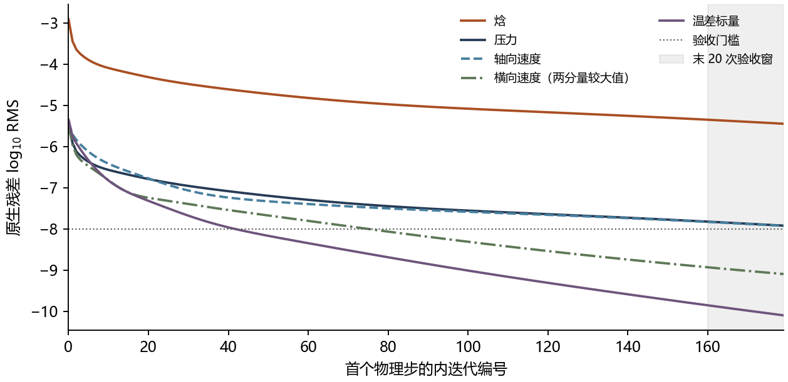

# B 型热敏珠在 6 m/s 下需要完整周向域

本轮相对 v286 新增可验收的壁压与热流 **0 面、0 m²**。6 m/s 名义珠体的全部 5,216 个原面、3.08983026 × 10⁻⁶ m² 仍待求解。全周首个物理步已有真实保存场，180 次内迭代后压力、轴向速度和焓未达验收门槛。已排除原 30° 镜面对称扇区在该速度下作为全表面交付域。3 m/s 的已验数值结果仍在工作台可用。[首步核对](evidence/first_step.json) · [3 m/s 工作台](../v286/RESULTS.md)

## 实验测了什么

坪内、佐藤图 7 的 B 型珠体在 6 m/s、温差约 **10.09 K** 处，整珠平均换热系数读得 **251.52 kcal/(m²·h·K)**，即 **292.32 W/(m²·K)**。中心取原裁图左上起算的 (117.5, 239) px。沿用原刻度定位范围，温差读图范围为 8.98–11.20 K，系数范围为 285.06–299.79 W/(m²·K)。该点的实验不确定度未知。计算取名义温差 10 K，采用无引线、沿长轴来流的光滑等温珠体。论文的测量量只支持比较整珠平均换热。[原论文，印刷页 815](https://doi.org/10.1299/kikai1938.25.810) · [读点记录与精确图源](evidence/measurements.json)

## 为什么换成全周网格

珠体长短轴之比为 1.17925，以横径 0.937123 mm 为尺度的雷诺数为 **360.20**。Chiarini、Gauthier、Boujo 研究了均匀来流沿无滑移长椭球长轴时的首次对称破缺。作者图 5 的长椭球曲线在本长短轴比处给出临界雷诺数约 **241**。同一曲线在轴比 1 和 4 处与论文表格分别吻合至 212.67 和 999.66。241 是对图线的读取，该论文没有测量这颗实际热敏珠，也没有给出此工况的脱涡频率。[发表论文](https://doi.org/10.1017/jfm.2025.10402) · [作者版图 5](https://arxiv.org/html/2504.17925v1#S3.F5)

该失稳模态沿一周有一次变化（m=1），可使一侧尾迹不同于另一侧。30° 扇区的两个镜面会排除这一自由度。球体实验和数值研究还观察到进一步的周期脱涡，但其非定常起点只适用于研究中的球体。本轮采用全周三维时间推进，尾迹能否达到稳定偏转、周期态或其他状态须由较长计算判断。[球体研究](https://doi.org/10.1017/S0022112098003206)

## 实际建网与首步

沿用原 64 个母线分段、48 层、20D 外域和 7.5° 周向分辨率，合并 0/360° 接缝。全域共 **147,456 个单元、148,274 个节点**，3,072 个接缝面均有两个相邻单元，外部边界仅含壁面和远场。逐格有向体积为正，总体积与母线一阶矩独立积分的相对差约 1.05 × 10⁻¹³。体网弦面面积 3.088993 mm²，原显示面三角网的分母仍为 3.089830 mm²。原两档扇区经工作台建网入口重新生成，网格和节点文件分别与 v285 采用的指纹一致。[几何核对](evidence/mesh.json) · [扇区回归](evidence/sector_regression.json)

SU2 8.6.0 的不可压层流和强温差标量在 6 m/s 对应的 Re、Pe 下实际推进。3 m/s 归档只提供无量纲初猜形状；新初态在尾迹环带加入一次周向扰动。求解器时间步为 0.05 D/U，对应实际 **7.809 µs**。初场、所有内迭代残差以及 148,274 节点的终点完整场均已保存。全周轴向速度一次谐波的最大幅值由 0.000990 U 变为 0.000783 U。这一步可观察到非轴对称响应，持续增长或脱落周期尚无证据。[原生进程](evidence/native_process.json) · [逐次残差](evidence/inner_history.csv.gz)

| 原生 log₁₀ RMS | 末 20 次最大值 | 小于 −8 |
|---|---:|---|
| 压力 | −7.823 | 否 |
| 轴向速度 | −7.831 | 否 |
| 横向速度 V、W | −8.931、−8.931 | 是 |
| 焓 | −5.350 | 否 |
| 强温差标量 | −9.854 | 是 |

末帧绝对压力为正，强标量在 [0,1] 内，珠面标量等于 1、速度为零。这些检查与残差分别判断。末窗中偏离门槛最大的是焓。6 m/s 的原面热流、与实测 h 的偏差以及平均功率均尚未交付。



## 本机成本与复现

全周建网和初场准备用时 51.11 s、峰值 0.18 GiB；正式首步单线程用时 **124.72 s**，进程树采样峰值 **1.12 GiB**，完整场与日志新增约 71 MiB。终态文件审核 2.86 s，原两档网格回归 6.69 s，开发和归档未单独计时。单步使用的内存适合本机。若每步代价不变，跨过一个 D/U 需 20 步，约 42 分钟，这个换算只用于预算；达到残差和尾迹统计要求的成本尚未测得。

基线为 `53b4a1f894a9b1237e651ce14d50fb8a52a40ae6`。首次启动因稳态输出命名开关而在配置解析阶段退出，耗时 0.16 s。保留原始配置和回执，第二个目录使用原生非定常步号保存。两次运行共用已核验的网格和起始场。原生退出、保存终点、残差接受、尾迹成形分别记账。[原始拒绝](evidence/configuration_rejection.txt) · [事前合同与更正](PLAN.md) · [本地文件指纹](evidence/local_assets.json)

复现需要已绑定的 v283 强标量参照场，本地位于 `outputs/v283_validation/strong01`。另机可从 v283 的冷启动入口重建后，对照脚本内列出的五项 SHA-256。建网与首步分别运行以下命令，目录名须未被使用。本轮完整网格、初场和终场留在 E 盘，小型证据随版本发布。[输入生成程序](../../../scripts/thermistorFullRing.py) · [终态审核](audit_step.py)

```powershell
python docs/validation/v287/run_first_step.py prepare grid_repeat
python docs/validation/v287/run_first_step.py solve step_repeat --prepared grid_repeat
python docs/validation/v287/audit_step.py outputs/v287_validation/step_repeat outputs/v287_validation/step_repeat/audit.json
```
