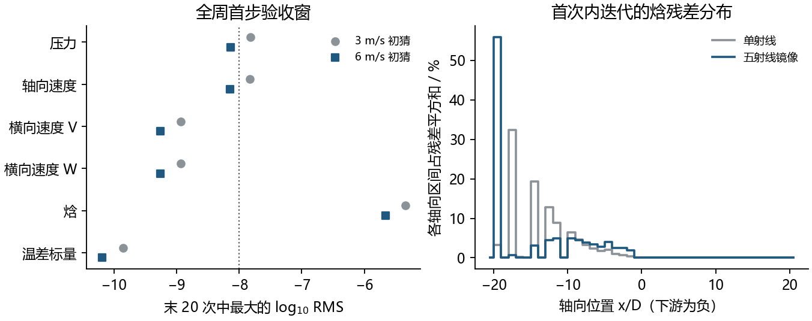

# 6 m/s 热敏珠启动对照：五个分量通过，焓仍超限

与 v287 相比，民用 B 型热敏珠在 6 m/s 下新增已验收的同面壁压与热流 **0 面、0 m²**。5,216 个原面、3.08983026 × 10⁻⁶ m² 仍待求解。用该速度自身的基流启动后，压力和轴向速度首次通过原首步门槛，焓的残差约减半，仍高于门槛约 **217 倍**。数值程序正常结束，有完整终点帧，本工况尚无可交付的全表面热流或实验偏差。3 m/s 珠体和自绘模型新增 **0 面、0 m²**。[当前首步](evidence/first_step.json) · [上一版首步](../v287/evidence/first_step.json)

## 同一网格和时间步，更换基流

沿用 6 m/s 空气、293.15 K、101325 Pa、名义等温壁 303.15 K 和原恒物性。用原三维镜面扇区将动量、焓、强温差标量推进到此工况的定常受约束基流。在第 1,506 次内迭代结束，末窗六个分量均低于 −8，全部壁节点速度为零，强标量满足温界。该场仅作为全周启动输入。随后按原方法旋转第一条射线并加入同一微小尾迹扰动。以旧源复算时，148,274 个节点组成的初场文件与 v287 逐字节相同。[基流检查](evidence/base.json) · [传递核对](evidence/transfer.json)

将初始场交给同一个 147,456 单元全周网格。实际配置、时间步 0.05 D/U（7.809 µs）、单线程、180 次内迭代和每项验收容差均相同。表内是末 20 次中最差的原生 log₁₀ RMS，越低越好。两次物理启动历程不同。

| 分量 | v287，3 m/s 初猜 | v288，6 m/s 初猜 | 当前低于 −8 |
|---|---:|---:|---|
| 压力 | −7.823 | −8.137 | 是 |
| 轴向速度 U | −7.831 | −8.142 | 是 |
| 横向速度 V | −8.931 | −9.255 | 是 |
| 横向速度 W | −8.931 | −9.255 | 是 |
| 焓 | −5.350 | **−5.664** | 否 |
| 强温差标量 | −9.854 | −10.191 | 是 |

同速初猜的末帧压力为正，强温差标量位于 [0,1]，壁面无滑移且标量为 1。全周轴向速度最大一次谐波由 0.000990 U 变为 0.000780 U。这一短步只检验数值启动。基流计算 112.56 s，含旧种子回放的映射 2.38 s，全周原生计算 **129.55 s**，合计 **244.49 s**；复用已有体网。v287 的全周原生计算为 124.72 s。两次全周首步进程树峰值分别约为 1.07 GiB 和 1.12 GiB。各步骤的成本分开记录。[完整进程与输入回执](evidence/processes.json.gz) · [全周逐次残差](evidence/first_history.csv.gz)

## 焓残差出现在哪里

扇区五条射线之间，轴向速度差最大达 0.001755 U。为判断只用第一条射线的影响，另用镜像延拓全部五条射线：压力、温度按原方位保存，速度转回当地坐标并反射切向分量。两种初始场的一次周向扰动幅值相同。全周域自身没有镜面边界。[镜像传递检查](evidence/mirror.json)

各做一次内迭代，读取同次原生历史与全域每个节点的方程右端。单射线观察逐项复现了完整试验的第一行。五射线镜像让首次压力和焓 RMS 都降至单射线的约 27%，不足以触发登记的十倍收益门槛。按合同结束这项对照。[事前判据](TRANSFER_CHECK.md) · [逐项数据](evidence/rhs.json)

| 首次装配诊断 | 单射线旋转 | 五射线镜像 |
|---|---:|---:|
| 焓残差平方和位于轴线的比例 | 90.60% | 91.55% |
| 位于下游的比例（与轴线有交叠） | 99.84% | 99.70% |
| 最强节点的 x/D（珠心为零） | −17.23 | −20.00 |
| 位于最外边界的比例 | 3.25% | 55.89% |

两种初始场中，从节点向量重算的压力、焓 RMS 均复现原生历史。逐节点用起始比焓乘连续性方程右端，与焓右端比较，差量范数分别只有原焓右端的 **0.0115% 和 0.0360%**。原生输运变量的比焓约为 −297 至 −296，其常量部分会随质量通量进入对流项。这个检查定位了首次装配中占主导的贡献；第 180 次内迭代的独立节点右端尚未读取。验收仍使用原始焓残差。[固定版本的三维对流项](https://github.com/su2code/SU2/blob/7048fd35f56d4bf52e586429d6746a36a10255f8/SU2_CFD/src/numerics/CNumerics.cpp#L171) · [节点残差导出](https://github.com/su2code/SU2/blob/7048fd35f56d4bf52e586429d6746a36a10255f8/SU2_CFD/src/output/CFlowIncOutput.cpp#L478)



## 复现和存储

基线为 v287 提交 `c532b775c9964c64bac10d2f750f718f669fff37`。沿用 v283 的 `strong01` 与 v287 的 `first02`，所需输入和原生程序由散列核对。一次基流、一次全周首步、两次单迭代观察均已退出。两次额外原生观察分别为 11.95 和 11.97 s；镜像映射 2.88 s，首步和节点诊断回读分别 3.47 和 8.42 s。开发与归档未单独计时。全场和周期检查点保存在本机 E 盘，GitHub 收录程序、小型核对、原生历史和回执。[本地文件及散列](evidence/local_assets.json) · [基流原生历史](evidence/base_history.csv.gz) · [基流及首步合同](PLAN.md)

```powershell
python scripts/thermistorMatchedBase.py outputs/v288_validation/base_repeat
python docs/validation/v288/matched_step.py prepare outputs/v288_validation/base_repeat outputs/v288_validation/map_repeat
python docs/validation/v288/matched_step.py solve outputs/v288_validation/map_repeat outputs/v288_validation/step_repeat
python docs/validation/v288/matched_step.py audit outputs/v288_validation/step_repeat outputs/v288_validation/step_repeat/audit.json
```
