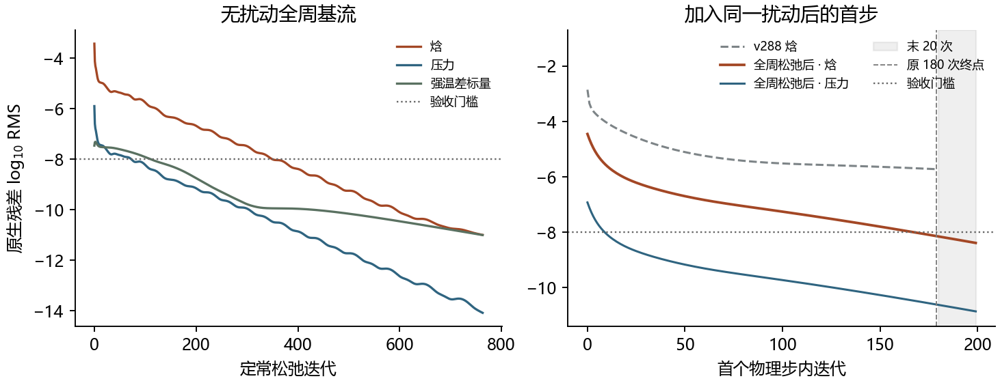

# 6 m/s 热敏珠全周计算首次通过一个物理步

在 293.15 K 空气、101325 Pa、均匀给定壁温 303.15 K 下，B 型名义热敏珠从明确构造的初场推进了 **0.05 D/U，约 7.809 µs**。完整全周网格有 147,456 个单元、148,274 个节点。200 次内迭代复核中，从编号 168 到 187 首次形成六项原生残差均低于 −8 的连续 20 行窗口。保存并回读的是编号 199 的完整终点场。热敏珠的实际尾迹是否发展到周期态，以及实验所测的整珠平均换热，仍待检验。[接受的物理步](evidence/first_step_200.json) · [原生终场文件指纹](evidence/local_assets.json)

相对 v288，6 m/s 工况新增可验收的成对原面壁压与热流 **0 面、0 m²**。当前得到的是可供后处理的原生终场，5,216 原面的强温差壁反力、同一物理步的热量账与保守映射尚未交付。3 m/s 试件和自绘模型也均新增 0 面、0 m²。

## 完整网格解决了哪项误差

从同速五射线镜像初场中恢复原轴向速度。扰动涉及 4,416 个节点，逐点加回可复现原值。去掉扰动后，一次周向模态幅值为零，初次装配仍有 **92.09%** 的焓残差平方和位于下游轴线，原生焓残差为 −3.427。这说明原有大部分误差在加入扰动前就已存在。[初场核对](evidence/calm.json) · [无扰动对照](evidence/control.json)

在完整网格上实际推进所有原生定常方程来准备初场。经过 764 次迭代后，末 20 次压力与焓分别达到 −13.853 和 −10.912。体场温差标量有界，壁面无滑移并保持给定标量。第 400 号周期帧中，下游轴线的焓残差平方和份额已降至 0.062%。在正常终点加回原始扰动增量，保留松弛中自行产生的周向变化。所加轴向 m=1 幅值为 0.000989890 U，松弛场自身的幅值为 2.50 × 10⁻¹³ U。[松弛与周期场](evidence/relaxation.json) · [实际启动种子](evidence/relaxed_seed.json)

## 原合同与补充复核

下表为连续末 20 次中各分量最大的原生 log₁₀ RMS。三次计算的物理时间跨度相同。

| 分量 | v288 扇区基流，180 次 | 全周基流，180 次 | 同一全周基流，200 次 |
|---|---:|---:|---:|
| 压力 | −8.137 | −10.388 | −10.627 |
| 轴向速度 | −8.142 | −10.392 | −10.630 |
| 横向速度 V | −9.255 | −11.409 | −11.685 |
| 横向速度 W | −9.255 | −11.473 | −11.753 |
| 焓 | −5.664 | **−7.915** | **−8.154** |
| 强温差标量 | −10.191 | −12.080 | −12.389 |
| 首步判定 | 未通过 | 未通过 | **通过** |

相同 180 次内迭代下，全周初场使末窗最差焓 RMS 降至 v288 的约 **1/178**。第 180 次结束时，已有连续 12 行全部达标。为确认持续性，按另行登记的合同从同一初始物理状态重算，只改内迭代上限。200 次运行的原生历史文件完整包含前次的逐字节相同前缀。此复核推进的仍是第一个物理步。官方程序在上限处正常结束；本项目用独立的原六分量 −8 连续窗及全场要求验收。[180 次原始结果](evidence/first_step_180.json) · [补充合同](WINDOW_CHECK.md) · [200 次历史](evidence/window_history.csv.gz)



接受帧的绝对压力为 101309.76–101351.98 Pa，强温差标量在 [0,1] 内，壁面速度为零、壁温差标量为 1。根据全体节点重新计算的末次六项 log₁₀ RMS 与原生日志最大差为 2.43 × 10⁻⁹ 以内。接受终点的焓残差平方和中，约 99.51% 属于 m=1，轴线仅占约 0.000106%。这些是方程误差与初始扰动的数值诊断，此时的尾迹历程尚短。[节点残差与模态分解](evidence/modes.json)

## 成本、来源与复现

无扰动探测 12.75 s，全周松弛 473.06 s（2 线程），原首步 135.14 s，200 次复核 152.53 s（两次首步均为 1 线程）。四次原生运行合计 **773.48 s**，均有终态且子进程已退出。复核首步进程树峰值约 1.13 GiB。沿用 v288 的 6 m/s 扇区基流，历史准备成本为 112.56 s。准备、映射与审核详见独立回执，开发与归档未单独计时。大型初场、周期场与全部终场留在 E 盘。[实际资源回执](evidence/processes.json.gz) · [原合同](PLAN.md)

无扰动探测和定常松弛的两份初版几何说明继承了 v287 的父场标签，松弛说明也保留了旧扰动幅值。实际求解器输入已分别用 SHA-256 绑定，二者均使用 v288 同速基流构造的无扰动种子。更正清单保留原说明、原始源码和准确来源；发布入口已修正新运行的元数据。本轮所报压力、残差及物理步使用实际读入文件核对。[来源更正](evidence/geometry_provenance_correction.json) · [执行时的驱动源码](evidence/executed_driver.py.gz)

原始场在 `outputs/v289_validation`。新机先按 v287、v288 的报告恢复已绑定的上游资产，再在新的 v289 输出根下依次执行以下入口。每阶段只创建自己的目录，复核重用相同的已确认种子。查看本轮存档可直接读取 JSON 与压缩历史，无须启动求解器。

```powershell
python docs/validation/v289/run_relaxation.py seed outputs/v288_validation/mirror01 outputs/v289_validation/calm01
python docs/validation/v289/run_relaxation.py probe outputs/v289_validation/calm01 outputs/v289_validation/probe01
python docs/validation/v289/run_relaxation.py control outputs/v289_validation/probe01 outputs/v289_validation/control01
python docs/validation/v289/run_relaxation.py steady outputs/v289_validation/control01 outputs/v289_validation/steady01
python docs/validation/v289/check_fields.py ready outputs/v289_validation/steady01 outputs/v289_validation/ready01
python docs/validation/v289/run_relaxation.py step outputs/v289_validation/ready01 outputs/v289_validation/step01
python docs/validation/v289/check_fields.py finish outputs/v289_validation/step01 outputs/v289_validation/finish01
python docs/validation/v289/confirm_window.py run outputs/v289_validation/step01 outputs/v289_validation/window01
python docs/validation/v289/confirm_window.py audit outputs/v289_validation/window01 outputs/v289_validation/window_audit01
```
