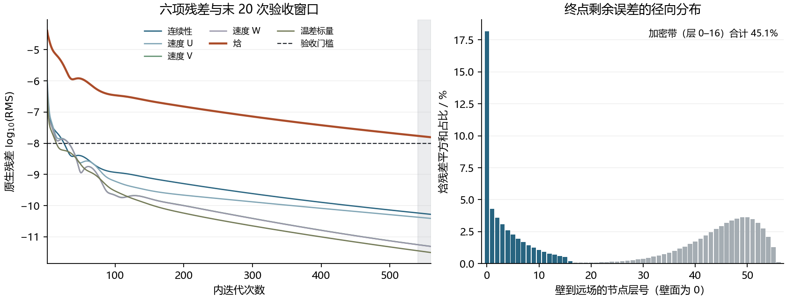

# 6 m/s 热敏珠近壁网格与第一半步

相对 v292，民用 B 型热敏珠本版新增同时有合格数值壁压与热流的原面 **0 面、0 m²**。完成了 48 层至 56 层的嵌套体网、相同启动场传递和第一物理半步的真实推进。第一半步在距初场 **3.904680433 µs** 处保存了完整终场。560 次内迭代后仅焓方程未通过连续末 20 行门槛，因此本轮近壁对照在第一步停止，7.809360865 µs 的加密网壁压、热流差、热峰位置及整珠功率差均未知。3 m/s 试件和自绘模型亦新增 0 面、0 m²。工作台可查看 v292 已验收的 5,216 个原面的时间步长对照。[加密网第一半步](evidence/first_state.json) · [原有同刻结果](../v292/RESULTS.md)

## 两套网格代表的同一初场

沿用 v292 的名义珠体、6 m/s 空气来流与 303.15 K 给定壁温。沿原射线将最内 8 个区间各平分一次，保留原 48 个方位、64 个母线区间及 20D 远场。原点号、原坐标以及 5,216 个显示原面均可直接对应。实际射线沿长椭球的径向；首层距离同时按光滑壁面的局部法向投影量取。[试验计划](PLAN.md) · [网格与初场回执](evidence/grid.json)

| 量 | v292 参考网 | v293 加密网 |
|---|---:|---:|
| 壁到远场区间数 | 48 | 56 |
| 节点数 | 148,274 | 172,482 |
| 体单元数 | 147,456 | 172,032 |
| 首层法向距离 | 1.8491–1.8742 µm | 0.9245–0.9371 µm |
| 壁面、远场边界面数 | 各 3,072 | 各 3,072 |

每个父单元的体积与其子单元之和的最大相对差为 2.11 × 10⁻¹⁴。所有定向中位子体积均为正，内面有两个方向相反的相邻单元。独立几何程序重建的原网逐节点控制体积与 v292 原生装配观测值之最大相对差为 7.82 × 10⁻¹⁴。[网格核对](evidence/grid.json)

24,208 个新中点取原射线两端的线性延拓值。原节点六个解分量逐点相同，新网第二层与原网第一层是同一批物理点。延拓后首层沿射线温度斜率的最大差为原峰值的 5.70 × 10⁻¹⁴。按各自的中位对偶体积积分，初始空气显热增加 24.82 pJ，变化来自加密带。该差额占参考时段壁面放热尺度 83.77 nJ 的 0.02963%，满足事前 1% 判据。[完整初场计量](evidence/grid.json)

## 第一半步的验收与误差位置

| 原生 log₁₀ RMS | 末 20 行最大值 | 第 560 次终点 |
|---|---:|---:|
| 连续性（压力变量） | −10.238 | −10.281 |
| 轴向速度 U | −10.373 | −10.411 |
| 横向速度 V | −11.253 | −11.309 |
| 横向速度 W | −11.256 | −11.311 |
| 焓 | **−7.765** | **−7.809** |
| 强温差标量 | −11.450 | −11.506 |

全 172,482 个节点的原生残差重新计算后，与日志的最大对数差为 3.98 × 10⁻⁹ 以内。压力为正，壁面无滑移误差和强标量误差为零，标量在 [0,1] 内。正式验收要求最后连续 20 行六项均低于 −8，这次没有形成这样的窗口。终场仍可按其原始身份回读。[原生历史](evidence/first_history.csv.gz) · [终态回执](evidence/first_state.json)

终点有 **45.07%** 的焓残差平方和位于加密带（节点层号 0–16），其中 **18.18%** 位于壁节点。周向傅里叶分解中 **98.58%** 属于轴对称分量 m=0；两极合并后的轴线节点只占 **0.0176%**。对同一终点的逐节点右端做最小二乘拟合，焓与连续性右端的方向余弦为 −0.99999867，拟合比例为 −296.701，剩余平方和份额为 2.67 × 10⁻⁶。这量化了最后的两个方程误差高度相关；正式判据始终使用表中的原六分量。[逐层与周向分解](evidence/first_state.json)



## 初场几何一致性与离散方程一致性

为确定误差何时出现，两套网格各从本次对应的原始种子作一次官方读数，只将内迭代上限改为 1。两份历史的首行均逐字节复现各自正式运行，逐节点 RHS 的六项 RMS 也通过回查。比较的是第一次方程装配；探测进程各自保存的更新后状态未用于续算。[读数合同](INITIAL_RHS.md) · [逐点结果](evidence/initial_rhs.json)

在两网共有的节点上，第一次装配的连续性、三项动量和焓的原始右端差异集中在加密带。原第 9–48 层这五项的最大绝对差不超过 1.39 × 10⁻¹⁷，原第 10 层以外逐点相等。加密带在原网只占初始焓残差平方和的约 2.3 × 10⁻¹⁶，在新网占 **34.20%**；其中新中点本身占全域的 **5.13%**。再按节点控制体积折算局部残差率，用体积加权计算的全域焓残差率 RMS 为原网的 **9.62 倍**。初始标量方程的远域读数另列。线性传递保住了原节点值和壁面射线梯度，离散方程在新控制体积上的初始平衡仍有可测变化。[初始方程分布](evidence/initial_rhs.json) · [加密带外逐点核对](evidence/shared_layers.json)

## 成本与恢复

基线为 v292 提交 `5d6793460baad642812850a3ca7f3fcc2ed8ee93`。建网、传递及回读共 17.11 s，第一半步单线程推进 **573.24 s**，进程树峰值 **1.36 GiB**，正常退出。正式终场核对用时 7.59 s。两个定位读数各用时 15.39 s 和 17.36 s，配对核对 5.77 s。加密网固定端点观察器已编译、链接（20.38 s、2.88 s）；此次未对未达标场提取正式壁反力。开发与归档没有单独计时。原体网、种子、完整终场和指纹留在 E 盘，Git 保存小型证据及可复现入口。[各进程与绑定输入](evidence/processes.json.gz) · [本地资产清单](evidence/local_assets.json)

重建须恢复 v289 的原始几何和初场、v292 固定端点的原生控制体积以及固定 SU2 8.6.0 程序。已有本地输出应先核对回执。以下顺序用于全新的相应输出目录；首次推进结束后，应先检查保存终场的 `passed` 再决定是否进入定位或热量核对。

```powershell
python docs/validation/v293/prepare.py outputs/v293_validation/grid01
python docs/validation/v293/run_step.py 1 outputs/v293_validation/first01
python docs/validation/v293/check_state.py 1
python docs/validation/v293/initial_rhs.py coarse
python docs/validation/v293/initial_rhs.py fine
python docs/validation/v293/initial_rhs.py audit
```
