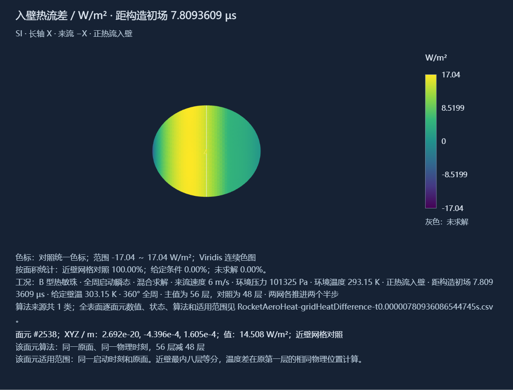

# 民用 B 型热敏珠的近壁网格对照

56 层近壁网在同一启动时刻求出了全部 **5,216 面、3.08983026 mm²** 的压力和热流。相对 v293，首次同时有计算壁压和热流的面积为 **0 面、0 m²**，因为 48 层网在 v292 已覆盖该试件全表面。本次首次获得第二套近壁网格的同刻全表面数值解，量化了压力、热流、功率及共同位置温度对近壁分辨率的敏感性。3 m/s 试件和自绘模型各新增 0 面、0 m²。[逐面数据包](../../../cases/thermistor_b/startup_6ms_nearwall56.zip) · [同刻差值](evidence/comparison.json)

## 工况与物理时间

采用坪内、佐藤实验中的 B 型热敏珠名义尺寸，计算无引线、沿长轴迎流的光滑等温珠体。空气速度 6 m/s、温度 293.15 K、环境压力 101325 Pa，给定珠面温度 303.15 K。比较时刻为距构造初场 7.809360865 µs。公开实验在这一速度附近给出了整珠平均换热系数，逐面压力和热流的联合实验验证面积为 0 m²。[原论文表 1、图 7](https://doi.org/10.1299/kikai1938.25.810) · [测量定义与图读记录](../v287/evidence/measurements.json)

基线为 v293 提交 `8614e8efe150f13b3c2c3e99e9ca4b8599b25b0e`，48 层参考为 v292 在同一时刻的两半步数值场。56 层网只在原网最内八个区间各加一个中点。两网保留相同的外边界、周向节点和原表面三角形。两网温差在同一组物理点上计算，即 48 层网的第一层与 56 层网的第二层。加密网第一层的流体温度单独输出。[试验合同](PLAN.md) · [网格与初场传递](../v293/evidence/grid.json) · [48 层参考场](../v292/evidence/comparison.json)

## 内迭代与实际端点

从加密网原始种子运行官方 SU2 8.6.0，两个实际物理步各为 3.904680433 µs。恢复第一半步时复用了正在运行的进程。第一步配置相对 v293 只修改内迭代上限，前 560 次历史连同表头逐字节相同。第一个完整的 20 次达标窗在第 664 次内迭代结束；第 800 次原生保存的场用于回读和续算。第二步旧态的指纹与第一步已验收保存帧一致。两步所有节点压力为正，壁面速度和强温差边界误差均为零。[第一步状态](evidence/first_state.json) · [第二步状态](evidence/second_state.json)

| 终点 | 最后连续达标次数 | 末 20 次焓 log₁₀ RMS 最大值 | 逐节点六项 RMS 复算最大对数差 |
|---|---:|---:|---:|
| 第一半步 | 156 | −8.301149 | 3.16 × 10⁻⁹ |
| 第二半步 | 283 | −8.585036 | 3.82 × 10⁻⁹ |

## 壁面热流和同阶段热量收支

壁压取全周非定常层流终场的壁节点压力，加环境压力后在各原面内积分平均。入壁热流取强温差标量方程在壁边界的离散反力，按原面积守恒分配。正值表示热量进入珠面。表中“放热”取流出珠面的正值，空气储热率用同一 BDF1 时间层的旧新标量和实际节点控制体积独立复算。[第一步热量账](evidence/first_energy.json) · [第二步热量账](evidence/second_energy.json)

| 56 层计算终点 | 珠面放热 mW | 远场流出 mW | 空气储热率 mW | 放热减流出及储热 nW |
|---|---:|---:|---:|---:|
| 3.904680433 µs | 10.70261915 | 10.72656034 | −0.02394346 | +2.2593 |
| 7.809360865 µs | 10.69725502 | 10.72656035 | −0.02930439 | −0.9432 |

空气储热率为负，对应域内空气显热降低。独立官方壁反力读数与固定端点装配的逐壁点最大差分别占反力峰值的 2.87 × 10⁻⁶ 和 8.16 × 10⁻⁸。两个端点的流动更新与标量更新均在附加读数时跳过，保存的物理终点可单独恢复。[原生过程回执](evidence/processes.json.gz)

## 7.809360865 µs 的逐面对照

加密网绝对壁压为 **101309.779–101351.920 Pa**，入壁热流为 **−6610.370 至 −1150.926 W/m²**。全部原面均向空气放热。56 层网自身首层流体温度为 **302.9071–303.1091 K**，给定壁温为 303.15 K。固体内部温度分布及独立求解壁温未知。[加密网原面范围](evidence/second_energy.json)

| 56 层减 48 层 | 面积加权 RMS | 局部最大绝对差 | 最大差所在工作台面元 |
|---|---:|---:|---:|
| 壁压 | 0.013951 Pa | 0.059163 Pa | 5211 |
| 入壁热流 | 11.0710 W/m² | 17.0397 W/m² | 1851 |
| 共同位置流体温度 | 0.000687 K | 0.001191 K | 5189 |

以 21.24 Pa 动压归一化，壁压 RMS 和局部最大差分别为 0.0657% 和 0.2785%。以 48 层最大放热通量归一化，热流的对应差异为 0.1676% 和 0.2579%。整珠放热由 10.72657234 降至 10.69725502 mW，相对差为 −0.2733%。三项均在事前的比较范围内。两网放热峰均位于工作台面元 **5211**，原始表中 `faceID=5210`，峰位位移为 0。两网比较适用于此次近壁加密、相同初场传递和指定时刻，空间收敛阶及发展后尾迹仍待检验。[两网逐面统计](evidence/comparison.json)

## 在工作台查看

主侧栏选择 **B 型热敏珠 → 查看 6 m/s · 近壁网格对照 → 打开热敏珠全表面结果**。主场为 56 层，默认显示 56 层减 48 层的入壁热流差。可切换绝对压力、表压、热流、实际首层流体温度、共同位置温度及其差值。选中原面可查看量值、算法、资格和对应时刻。[本机离线三维页](../../../outputs/v294_validation/view01/export/workbench/index.html)

实际 MATLAB 侧栏与 WebGL 验收中，鼠标拾取面元 2538；最大热流差面元 1851 可单独定位，下载包含全部 5,216 行。在 X = 0.172 mm 处导出 121 行截面数据，每行都按原面号与原差值复核。离线页和侧栏共用给定壁温、原面值及源帧，原时间步对照也通过回归。此次使用 v293 已发布的前端和本次 MATLAB 改动验收，工作区的并行前端改动另行维护。[界面回执](evidence/ui.json)



## 复现与成本

两次正式推进单线程分别用时 791.86 和 794.14 s，固定端点回放 634.58 和 640.59 s，官方独立壁反力回读 34.84 和 37.19 s。状态复核 6.77 和 6.39 s，热量核算与映射 11.50 和 12.44 s，同刻逐面比较 1.11 s；实际界面验收 66.52 s。数值进程树峰值约 1.36 GiB。开发、阅读和整理证据未单独计时。原始 56 层体网、种子和两次实际终场仍在 E 盘；Git 保存代码、精简逐面包及压缩过程证据。[准确源与终态](evidence/processes.json.gz) · [本机大文件位置及指纹](evidence/local_assets.json)

具备 v293 的网格、初场、观察器及固定运行库时，可用下列命令在新的运行目录复算。脚本按状态与守恒验收逐步放行。日常查看仅需已发布的数据包，MATLAB 可用 `runThermistorBeadCase([], 'nearWall6')` 打开数据；请求第三个输出会生成新的离线三维页。

```powershell
python docs/validation/v294/run_pair.py --root outputs/v294_validation/reproduce01
```
