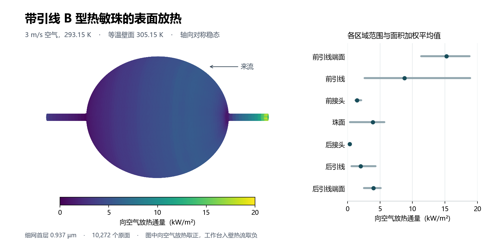

# 两端带引线 B 型热敏珠的全表面换热

在 **3 m/s 空气、293.15 K、101325 Pa 和给定壁温 305.15 K** 下，新建的带线试件全部 **10,272 个原面、3.19665061 mm²** 都取得了壁压和对流热流，缺口为 0 面。珠体和两个接头放热 **11.94750 mW**，两根引线及端面放热 **0.59246 mW**，总计 **12.53996 mW**。与 v296 相比，这是独立带线试件首次取得的全面积结果，光滑珠体与自绘模型分别新增 0 面、0 m²。[逐面原表](../../../cases/thermistor_b/leads3.zip) · [七区结果及终场](evidence/fine_surface.json)

## 几何、计算方法与结果

坪内、佐藤论文图 1 给出了 B 珠的两个视角，可见从两端伸出的引线。表 1 的珠体面积为 3.094 mm²、偏心率 0.53、线径 0.0540 mm。模型用前两项确定长椭球尺寸。每根线的 0.300 mm 暴露直段、0.0270 mm 圆弧接头、平端面，以及两根线均保持珠面温度，均为本次研究假设。圆弧与珠面和引线相切。接触内部面已移除。七个区域在切线处共享真实节点，全部原面闭合、外向且各有唯一编号。[几何与工况合同](PLAN.md) · [原论文](https://doi.org/10.1299/kikai1938.25.810)

| 暴露区域 | 原面数 | 面积 mm² | 向空气放热 mW |
|---|---:|---:|---:|
| 后引线端面 | 336 | 0.002284 | 0.009078 |
| 后引线侧面 | 1,152 | 0.050857 | 0.103469 |
| 后接头 | 576 | 0.008665 | 0.002819 |
| 珠面 | 6,144 | 3.073038 | 11.932220 |
| 前接头 | 576 | 0.008665 | 0.012461 |
| 前引线侧面 | 1,152 | 0.050857 | 0.445118 |
| 前引线端面 | 336 | 0.002284 | 0.034795 |

前端为迎流端。用固定 SU2 8.6.0 求解三维不可压层流、无滑移与恒物性强温差标量，在 30° 扇区施加镜面对称条件，重建轴向对称稳态的全周分布。Gmsh 4.15.2 生成近壁层之外的子午网，旋转后与近壁层共享完整接口。细网含 12,231 个节点、16,264 个体单元和 432 个原生壁面。单元正体积、内外面归属及旋转域体积均已核对。[基准网输入](evidence/base_inputs.json) · [细网输入](evidence/fine_inputs.json)

壁面压力取原生壁节点的无量纲表压乘压力尺度 ρU² 后加环境静压，在各三角面平均。入壁热流取强温差标量的壁节点反力，按对应原面面积权重保守分配。首层温度来自每个壁节点对应的实际第一层流体节点。壁温 305.15 K 单列为输入，固体求解壁温、外缘温度和恢复温度保留未知。按既有正号约定，细网的入壁热流为 −18892.87 至 −275.49 W/m²，绝对壁压为 101321.56 至 101334.34 Pa。最大放热通量出现在迎流端引线侧面，工作台面元 **207**，靠近平端边缘。

## 数值核对与反向流动

两网由各自冷态启动，分别在原生迭代编号 2033、2039 保存正常终点。两次的末 20 行六项原残差均低于 −8。原表、终场、加 20 次后的终场与两次壁温释放读数均绑定各自的实际文件。细网的壁面与远场同阶段热量差为 **11.54 nW**，相对整件放热为 **0.0000920%**。同一终场继续 20 次，整件放热相对改变 4.00 × 10⁻⁹。[基准网热量账](evidence/base_surface.json) · [细网热量账](evidence/fine_surface.json) · [原生回执与历史](evidence/native_receipts.zip)

首层从 1.874 µm 减为 0.937 µm，最靠壁两个间隔加密，外区及原面保持一致。整件和珠部放热分别改变 −0.00116% 和 −0.00112%。两网热峰均在 207 号面。前端面功率变化 +0.537%，其逐面热流最大差为 118.87 W/m²，值得与总功率分开看。这个试验检查了近壁离散。外区网格、周向分辨率和实际引线热边界的误差仍待量化。[七区两网对照](evidence/comparison.json)

将原生摩擦系数向量、首层流速分别投影到沿流向的母线切向，两网均有 **1,536 个原面、0.118263 mm²** 同时反向，覆盖后引线、后接头和背流侧部分珠面。细网这些面共放热 **0.09817 mW**，几何范围 X = −0.6761 至 −0.5126 mm。两网分类逐面一致。该范围是离散的近壁反向区，分离线与再附线的精确位置及非对称尾迹仍待验证。SU2 壁面文件中的 Y_Plus 字段全为零，另从原生摩擦系数的幅值及首层节点到原面的实际法向距离估算，细网首层 y+ 范围为 0.00214 至 0.08376。[逐面诊断](evidence/nearwall_faces.csv.gz) · [两网流向与 y+](evidence/nearwall.json)

## 与实验可比较的量

论文图 7 给出扣除引线散热后的整珠平均换热。用珠面加两个接头的放热、论文名义面积 3.094 mm² 和 12 K 温差换算，得到 **321.79 W/(m²·K)**。实验约 12.11 K 温差处的读数为 **218.36 W/(m²·K)**，读图范围 211.9 至 224.8 W/(m²·K)，单点测量不确定度未知。本次计算比中心读数高 **47.37%**，逐面壁压与热流的联合实验验证面积为 **0 m²**。[实验读点和面积口径](../v282/RESULTS.md) · [对照结果](evidence/comparison.json)

原光滑珠体 7.5° 网放热 9.50885 mW，本次珠部高 25.65%。两者还采用了不同的外区网格和面元映射，这个差值尚不能归因于引线。[下一项配对控制](NEXT_DECISION.md)

## 在工作台使用

MATLAB 项目根目录运行 `rocketAeroHeatWorkbench`。选择 **选用带引线 B 型热敏珠 → 生成带引线试件体网 → 设置边界条件 → 确认带引线试件热边界**。计算页可选择读取同网格已算结果或从冷态计算。结果页可切换热流、压力、首层温度、沿流向壁面摩擦系数、近壁反向流动和首层 y+ 估算。选择区域或拾取原面可以核对来源，截面、逐面 CSV 和离线页面沿用原工作台。冻结均匀壁温适用于全部暴露表面。

验证在 Windows、MATLAB 和 v296 的 Python、NumPy、SciPy、psutil 环境中进行。建网用项目固定的 Gmsh 4.15.2 和 SU2 8.6.0，可分别运行 `python scripts/installGmshRuntime.py` 和 `python scripts/installSU2Runtime.py` 安装。新算还需固定 SU2 构建工具及源码归档，用于同阶段热量审核。可用 `RAH_THERMISTOR_SU2_BUILD` 指定含 `su2.zip`、`source`、`toolchain` 和 `build-v117` 的已安装目录。计算前会识别缺失的工具与不符的体网。[安装依赖说明](../v296/INSTALL.md)

程序经实际侧栏从冷态新算一次，约 **200.61 s** 后打开科研结果页。生成的逐面表与细网参考文件逐字节一致。最后的回归从归档打开全部 10,272 面，逐区拾取七处局部峰，并从上述侧栏新算的真实速度和剪切帧独立提取反向区。原面、单位、功率、变量来源、未知温度和两种 CSV 均已核对。热流导出换算回 SI 的最大数值差为 1.82 × 10⁻¹² W/m²。本机离线页面含新增诊断，可直接查看。[本机三维页](../../../outputs/v297_validation/ui03/workbench/index.html) · [工作台与导出回执](evidence/workbench.json)

开发基线为 v296 提交 `c870db1a7ef3b4560a935a1c872077268a2a3334`。基准网与细网正式原生推进各用 181.59 和 198.50 s，两项独立运行有重叠。上述侧栏计时另含该次原生推进、观察器构建、热量核对、显示与导出。最终界面对照另用 31.61 s。开发、读图和整理时间未单独计量。原始体网、冷初场、周期和终点场及观察器均在 E 盘 `outputs/v297_validation` 或对应侧栏运行目录中。随 Git 发布米制几何、逐面表、来源指纹和小型回执。

共用界面回归另从侧栏读取了原 6 m/s 光滑珠体的既有计算，核对 5,216 面、探针和更换网格后的结果失效，用时 26.95 s。[实际界面及新算原始回执](evidence/interface_receipts.zip)
