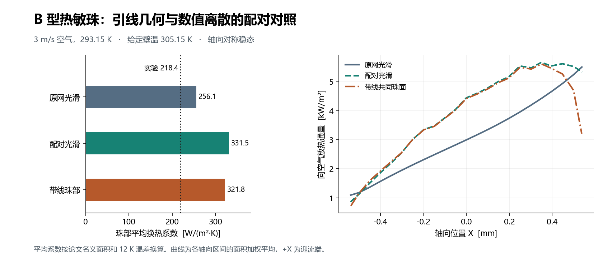

# 光滑热敏珠配对控制与引线的影响

在 3 m/s 空气和 305.15 K 给定壁温下，光滑珠体由原结构网改用配对混合网，放热增加 **2.79986 mW（+29.44%）**。沿用混合网方法、保留切口外的原单元后，加入引线使珠体含接头的放热减少 **0.36120 mW（−2.93%）**。若把引线及其端面的对流也计入，整件放热比配对光滑珠体增加 **0.23126 mW（+1.88%）**。这三个数分别回答数值方法、珠部换热和整件热负荷的问题。[三项功率与来源](evidence/comparison.json)

| 试件和方法 | 与实验比较的放热 mW | 珠部平均 h，W/(m²·K) | 相对图 7 |
|---|---:|---:|---:|
| 原结构网，光滑椭球 | 9.50885 | 256.11 | +17.29% |
| 配对混合网，光滑椭球 | 12.30870 | 331.52 | +51.83% |
| 配对混合网，带线珠体及接头 | 11.94750 | 321.79 | +47.37% |

系数都使用论文表 1 的名义面积 3.094 mm² 和 12 K 温差。图 7 在约 12.11 K 温差处的平均 h 读数为 218.36 W/(m²·K)。带线模型的两根等温引线及端面另放热 0.59246 mW。其长度、圆角、热边界均为名义设定，试验没有逐面壁压与热流数据。联合实验验证面积为 **0 m²**。[实验口径](../v282/RESULTS.md) · [带线几何](../v297/RESULTS.md)

## 哪些面可以相减

新光滑控制的 6,624 / 6,624 个三角面均有壁压、入壁热流和首层温度，面积 3.08912303 mm²。它是同一已计算光滑试件的另一种离散。带线试件仍以 10,272 面为分母，原光滑试件仍以 5,216 面为分母。与 v297 相比，既有试件首次取得壁压和热流的新增覆盖为 **0 面、0 m²**。本版补上了辨别引线作用所缺少的同方法光滑解。[控制原面与逐面数值](../../../cases/thermistor_b/paired3.zip)

两种几何中央完全重合的 6,144 个三角面共 3.07303800 mm²，三个坐标顶点、绕序、面积均逐一配对。该部分由光滑 12.26030 mW 降到带线 11.93222 mW，差 −0.32808 mW。光滑的两极冠占 0.0160850 mm²，放热 0.04840 mW；两个接头占 0.0173303 mm²，放热 0.01528 mW。极冠被接头替代的净效应为 −0.03312 mW。两部分合计复现珠部差值。引线及端面没有一一对应的光滑三角面，比较字段保持未知，其自身的主结果仍可查看。

共同珠面上，带线减光滑的入壁热流差的面积加权 RMS 为 369.25 W/m²，壁压差为 0.1371 Pa。壁剪切和首层流速同时反向的公共面积在两种模型中均为 0.092646 mm²，公共面上的分类逐面一致。新光滑网全表面有 816 面反向，包含后极冠。两种光滑解再按相同的三角面内积分规则守恒传到原 5,216 面，入壁热流差 RMS 为 1051.00 W/m²，壁压差 RMS 为 0.4185 Pa。原结构网与混合网在这套原面上辨认出的反向面积分别为 0.258702、0.092562 mm²。[逐面配对与反向范围](evidence/comparison.json)

## 计算与审核

基线为 v297 提交 `c1eb8eebcf41d43b88052b14fa6b9e95f188fdae`。原 v283 光滑场和 v297 带线场沿用已有的合格终点，本次新增一次光滑冷态推进。采用同版 SU2 的三维不可压层流与强等温标量、30° 对称扇区和 4 个周向单元。来流 293.15 K、101325 Pa，外半径 20D，首层 0.937 µm。配对体网含 11,148 个节点、15,824 个单元，新旧带线对照的原生配置逐字节相同。保留切口外全部 10,780 个旧单元，全域共 11,732 个单元的真实节点坐标及有序连接相同。两端局部网格随极冠形状重建，因此几何差值仍含当地离散影响。[准确输入、正体积与共同单元](evidence/inputs.json)

首次网格审核错误地要求新旧网中所有顶点均在 0.45D 半径外的单元集合完全相等。实际切口沿旧三角边折线形成，切口内重新剖分新增了 44 个顶点均在半径外的三维单元。重读同一网格证实应保留的全部旧单元都在新网中，单元和切口没有改动。

正式计算在原生迭代编号 3231 保存正常终点，初场、每 500 次的周期重启与壁面场及终点留在 `outputs/v298_validation/smooth01`。末 20 行六项原残差全部低于 −8。压力为 101321.56 至 101331.39 Pa，入壁热流为 −6284.73 至 −691.06 W/m²，首层流体温度为 304.947 至 305.121 K。给定壁温 305.15 K 与未知的固体壁温分别记录。额外推进 20 次，整珠放热相对改变 6.38 × 10⁻⁹。独立装配的远场与壁面热量差为 13.68 nW，占壁面放热的 0.000111%。首层 y+ 根据实际首层法向距离和壁面摩擦系数估算，范围为 0.00446 至 0.07793。[光滑终场](evidence/surface.json) · [原生回执](evidence/receipts.zip)

网格准备 1.33 s，单线程正式推进 266.75 s，进程家族采样峰值约 156 MiB。两次反力读取和 20 次延续合计 4.24 s，观察器编译及链接 6.30 s，两次独立单步核对 2.20 s。工作台计时另列，阅读、开发和归档未单独计时。大型体网与场文件保留在 E 盘。

## 科研工作台

选择 **带引线 B 型热敏珠** 或 **B 型热敏珠、3 m/s、7.5°、给定 305.15 K**，按五步侧栏取得主结果。在结果页点 **查看配对热流差**，可直接定位最大绝对差面元。字段的名称给出相减次序。热流主值和光滑对照支持统一色标，差值支持对称色标。带线的 4,128 个非公共面仍返回未知，光滑旧网的 5,216 面均可比较。变更壁温到 299.15 K 后，属于冻结 305.15 K 的对照自动撤销。[带线几何三维页](../../../outputs/v298_validation/wired_ui03/workbench/index.html) · [原光滑几何三维页](../../../outputs/v298_validation/smooth_ui03/workbench/index.html)

实际截面 X = 0.172 mm 在两种原面上分别输出 96、121 行，逐行回查原面号及差值，完整场另按全部原面导出。配对光滑解的复算入口为 `python scripts/runThermistorLeadCase.py prepare <新目录> --first .001 --smooth-control`，目录须位于项目 `outputs` 内。依次以 `solve`、`probes` 执行同一目录，再用 `scripts/thermistorLeadSurface.py` 和 `scripts/thermistorLeadNearWall.py` 读取该目录的实际场。新计算用项目几何及已安装的求解工具生成全部体网和场量。

最终侧栏验收分别用时 41.42 s 和 36.92 s。按钮在带线算例定位到共同珠面 171 号，在原光滑算例定位到 3816 号。两份原面表的导出值、缺项、字段单位和共用色标均已与实际数据逐行核对。[工作台回执](evidence/workbench.json)

同一光滑几何的中段贡献了方法差值的 74.86%。网格读数表明两套网在近壁层外侧的间距明显不同，现有数据还不能把全部差额归给某类单元、某一阶精度或某个流动区域。[轴向分带与法向网距](evidence/spatial.json) · [下一项定向加密](NEXT_DECISION.md)
