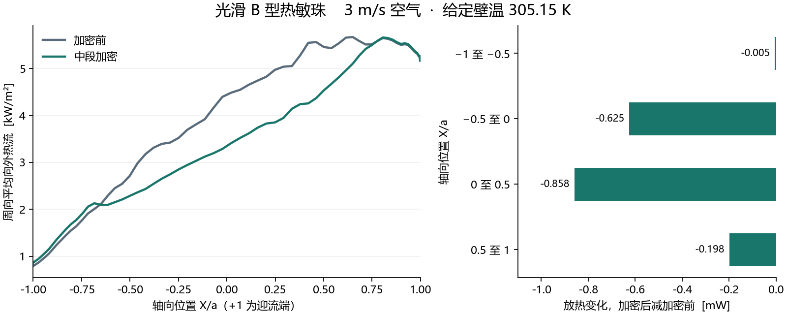

# 中段网距对光滑热敏珠放热的影响

3 m/s 空气中，光滑 B 型热敏珠的中段过渡网加密后，整珠放热由 **12.30870 降至 10.62365 mW**，减少 13.69%。在上一版所用的 5,216 面历史分带上，中段与原结构网的差额由 2.09610 降至 0.58722 mW，缩小 **71.98%**。这说明该工况的放热对中段离散敏感。一个加密等级尚不能确定网格收敛阶或真实局部热流。[同面功率对照](evidence/comparison.json)

| 光滑几何的离散 | 放热 mW | 整珠平均 h，W/(m²·K) | 与实验图读值的相对差 |
|---|---:|---:|---:|
| 原结构网 | 9.50885 | 256.11 | +17.29% |
| v298 配对混合网 | 12.30870 | 331.52 | +51.83% |
| v299 中段加密混合网 | 10.62365 | 286.14 | +31.04% |

三者均按论文名义面积 3.094 mm² 和 12 K 温差计算平均 h。图 7 的 B 型试件读数为 218.36 W/(m²·K)，读图范围 211.90–224.81 W/(m²·K)。该范围只反映图读精度。真实试件带引线，光滑控制为等温名义椭球。实验可对照珠部平均量，逐面壁压与热流联合验证面积仍为 **0 m²**。[实验原文图 7](https://doi.org/10.1299/kikai1938.25.810) · [读图记录](../v282/evidence/comparison.json)



## 哪些单元发生了变化

以 v298 提交 `4d4b21cdbdbaad7888b00a9452d1cc982e14dd88` 为基线。自由流 293.15 K、101325 Pa、3 m/s，壁温给定 305.15 K。6,624 个原三角面、首层节点坐标逐项相同，首层 0.937 µm，外半径 20D，30° 扇区四个周向单元。修改限于过渡区的子午三角形及其旋转扫出的体单元。壁面反力映射、原生 SU2 配置、物性与边界条件均复用上一版。

旧网共有 15,824 个体单元，14,936 个单元的有序顶点和坐标一致，888 个旧单元在局部换成 7,816 个新单元，细网合计 22,752 个。按所有被换单元的顶点计，改动范围为 −0.7841 ≤ X/a ≤ 0.7691，距实际子午壁 0.0150D–0.2038D。后一个上限包含与加密区相邻的过渡单元。迎流起算 60°、85°、120° 三条法向在距壁 0.015D–0.1D 内的最大穿越间距，分别由 0.02358D、0.02888D、0.02249D 降至 **0.00959D、0.00792D、0.00745D**。25°、155° 对照法向的间距相同。[成品网和源文件指纹](evidence/inputs.json) · [事前合同](PLAN.md)

## 全表面与局部结果

6,624 / 6,624 面均有壁压、给定壁温下的入壁热流和首层流体温度，总面积 **3.089123 mm²**。相比 v298，首次同时获得壁压与热流的新增覆盖为 **0 面、0 m²**。本版量出了过渡网距对已有场的影响。绝对壁压 101321.68–101331.41 Pa，首层流体温度 304.9472–305.1186 K，入壁热流 −6304.06 至 −754.31 W/m²。温差标量给出流体温度，固体内部温度未求解。[原面归档](../../../cases/thermistor_b/midbody3.zip) · [压力与热流](evidence/surface.json)

| X/a 轴向带 | 原面数 | 旧混合网放热 mW | 加密后放热 mW | 变化 mW |
|---|---:|---:|---:|---:|
| −1 至 −0.5 | 2,208 | 1.30463 | 1.30004 | −0.00459 |
| −0.5 至 0 | 1,104 | 2.90207 | 2.27738 | −0.62469 |
| 0 至 0.5 | 1,104 | 4.01059 | 3.15277 | −0.85782 |
| 0.5 至 1 | 2,208 | 4.09141 | 3.89346 | −0.19795 |

上表直接按 6,624 面的质心分带。与 v298 原结构网比较时，两套混合解须分别守恒投影到那一套 5,216 面，再用其面心分带，因此跨网中段回落为 1.50887 mW。强标量的独立壁节点反力按面面积守恒分配，节点表压加环境静压得到绝对壁压。壁剪切与首层流速同时反向的 816 面在两套混合网上逐一相同，共 0.100688 mm²。最强放热都在迎流极冠 X/a = 0.99870 的同一母线带，最大值从 6284.73 变为 6304.06 W/m²，工作台代表面号分别为 1103 和 137。首层 y+ 估值为 0.00474–0.07047。[四带与热峰](evidence/comparison.json) · [流向与首层](evidence/flow.json)

## 计算与工作台复核

从独立冷态运行官方 SU2 8.6.0 三维对称稳态不可压层流与强等温标量。原生迭代编号 3142 保存正常终点，初始文件、每 500 次的周期重启和表面文件、正常终点均有指纹。末 20 行六项残差中最大为 −10.9728，全场标量温界、绝对压力和无滑移通过。另加 20 次后放热相对变化 8.87 × 10⁻⁹，独立同阶段远场放热与壁面放热相差 15.98 nW，占 0.0001504%。正式推进用时 300.63 s，单线程，采样峰值 191 MiB。网格准备 1.66 s，三次反力与延续运行共 6.27 s，观察器编译和链接 6.39 s，两次独立单步共 2.99 s。开发、阅读与归档未单独计时。[检查点位置及 SHA](evidence/checkpoints.json) · [原生回执与残差历史](evidence/receipts.zip)

在 MATLAB 运行 `rocketAeroHeatWorkbench`，选择 **光滑热敏珠 · 中段加密**，生成体网、确认边界后可读取同网格已算结果。结果页的 **查看加密前后热流差** 定位到 89 号面，色标为 ±1317.32 W/m²。两份热流绝对值使用共同色标；点选可查看场量、单位、来源和验证状态。已用生产侧栏走通建网、归档、三维渲染、拾取和导出。全表面 6,624 行及 X = 0.172 mm 截面的 96 行差值均已返回源面核对。旧带线分支也已从侧栏复验。两项分别耗时 34.33 s、40.03 s。UI 测试使用 v298 已发布 Web 资源，保留工作区并发的前端和测试修改。[离线三维工作台](../../../outputs/v299_validation/midbody_ui01/workbench/index.html) · [导出核对](evidence/workbench.json)

本轮正式冷态计算从项目求解入口启动。独立复算可在项目根目录运行以下命令，用新目录替换 `fresh_midbody`，所需工具与观察器沿用项目安装说明。完整三维场留在 E 盘，GitHub 发布源码、原面数据包与轻量证据。[安装说明](../v296/INSTALL.md)

```powershell
python scripts/runThermistorLeadCase.py prepare outputs/fresh_midbody --first .001 --smooth-control --refine-midbody
python scripts/runThermistorLeadCase.py solve outputs/fresh_midbody
python scripts/runThermistorLeadCase.py probes outputs/fresh_midbody
python scripts/thermistorLeadSurface.py outputs/fresh_midbody
python scripts/thermistorLeadNearWall.py outputs/fresh_midbody
```

图表初次绘制遇到本机 Matplotlib 版本的布局参数差异，改用兼容的子图布局后生成。物理场和工作台均使用同一份正常终点。[下一项](NEXT_DECISION.md)
