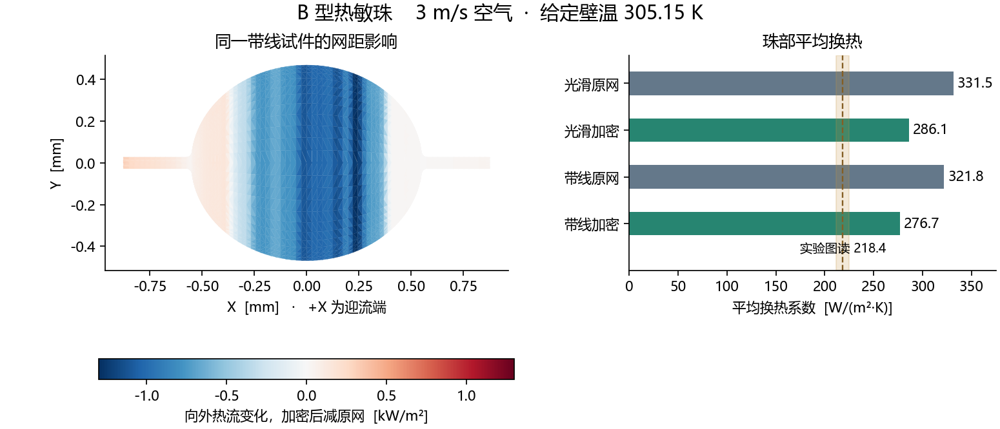

# 带引线 B 型热敏珠的中段网距与引线效应

在 3 m/s、293.15 K 空气、101325 Pa、给定壁温 305.15 K 的同一冻结工况，中段加密使**珠体含两个接头的放热由 11.94750 降至 10.27423 mW（−14.01%）**。两根引线含端面另放热 0.60386 mW，整件合计 **10.87809 mW**。网距相同的光滑控制放热 10.62365 mW。据此，加入引线使珠部少放热 0.34942 mW，同时使整件多放热 0.25444 mW。[四场功率与分区](evidence/comparison.json)

| 试件和体网 | 珠部放热 mW | 整件放热 mW | 珠部平均 h，W/(m²·K) | 相对实验 |
|---|---:|---:|---:|---:|
| 光滑，原混合网 | 12.30870 | 12.30870 | 331.52 | +51.83% |
| 带线，原混合网 | 11.94750 | 12.53996 | 321.79 | +47.37% |
| 光滑，中段加密 | 10.62365 | 10.62365 | 286.14 | +31.04% |
| 带线，中段加密 | 10.27423 | 10.87809 | 276.72 | +26.73% |

坪内、佐藤论文图 7 提供 3 m/s 下的珠部平均换热，已对引线和辐射作修正。以论文名义面积 3.094 mm² 和温差 12 K 计算 h，图读值 218.36 W/(m²·K)，图读范围 211.90–224.81。单点实验不确定度未知。计算几何采用名义引线暴露长度、接头圆角和全体等温边界。两档网距上，模型内的引线对珠部放热影响相差 0.01178 mW，现有证据尚不能确定网格极限或将剩余实验偏差归给某一种原因。[原论文](https://doi.org/10.1299/kikai1938.25.810) · [读点与测量口径](../v282/evidence/comparison.json)



## 全面积结果

相比 v297 的带线网和 v299 的光滑控制，首次获得壁压和热流的原面新增 **0 面、0 m²**。本版在原 **10,272 / 10,272 面、3.19665061 mm²** 上取得独立加密解，补齐四场配对中最后一项。工作台以正热流入壁。绝对压力为 101321.68–101334.41 Pa，入壁热流为 −18924.12 至 −303.14 W/m²，首层流体温度 304.1685–305.1385 K。给定壁温是 305.15 K，固体温度场未求解。逐面壁压与热流联合实验验证面积为 **0 m²**。[全部原面值与编号](../../../cases/thermistor_b/leadsMidbody3.zip) · [终场与区域范围](evidence/summary.json)

| 暴露表面 | 面数 | 原网放热 mW | 加密放热 mW | 加密网反向面数 |
|---|---:|---:|---:|---:|
| 后引线端面 | 336 | 0.00908 | 0.00975 | 0 |
| 后引线侧面 | 1,152 | 0.10347 | 0.11297 | 384 |
| 后接头 | 576 | 0.00282 | 0.00310 | 576 |
| 珠面 | 6,144 | 11.93222 | 10.25862 | 576 |
| 前接头 | 576 | 0.01246 | 0.01251 | 0 |
| 前引线侧面 | 1,152 | 0.44512 | 0.44627 | 0 |
| 前引线端面 | 336 | 0.03479 | 0.03486 | 0 |

迎流端为 +X。最强放热仍位于前引线侧面靠近平端的 **207 号面**，放热通量由 18.893 增至 18.924 kW/m²。后引线、后接头和珠面上的 1,536 个面在两种带线体网上均呈现壁剪切与首层流速同时反向，共 0.118263 mm²，X 范围 −0.67610 至 −0.51264 mm。首层 y+ 按真实首层法向距离与壁面摩擦系数估算为 0.00231–0.08415。[逐区域热峰和流向范围](evidence/comparison.json) · [近壁结果](evidence/flow.json)

带线与光滑模型共有 6,144 个顶点、绕序及面积逐一相同的三角面，共 3.073038 mm²。在加密网下，这部分带线减光滑的放热差是 −0.31591 mW；两个接头替代光滑极冠的净差是 −0.03352 mW。两者相加复现珠部差。引线及接头等 4,128 个带线原面均有本工况主解，几何差字段仅在有对应光滑面的区域取值。[同面与替换区核对](evidence/comparison.json)

## 网格和数值证据

基线提交 `2033ae3ed34eef1febbd51346fe35cee971dec30`。新网含 16,581 节点、23,224 个体单元。15,360 个 v297 旧单元的有序顶点坐标一致，904 个旧单元换成 7,864 个单元。改变的顶点位于 −0.7841 ≤ X/a ≤ 0.7690、距壁 0.0150D–0.2038D 内，接头起于 |X/a|=0.9942。全部壁面与首层节点逐点一致。处于 |X/a|≤0.5 内的 532 个被替换父单元及 5,592 个新单元，在两种几何中完全配对。整个改动范围共匹配 848 个父单元与 7,704 个新单元，靠近两端的局部剖分仍有差异。60°、85°、120° 处的最大法向穿越间距由 0.02358D、0.02888D、0.02249D 降至 0.00959D、0.00792D、0.00745D，与加密光滑控制一致。[成品网读数及来源](evidence/inputs.json) · [事前合同](PLAN.md)

固定 SU2 8.6.0 三维不可压层流、30° 对称扇区和强等温标量，原生壁节点反力按原面积守恒分配；绝对壁压取节点表压平均后加环境压力。独立冷态推进在原生迭代编号 1972 保存正常终点。末 20 行六项残差中最高 −10.9534，压力正性、无滑移及全域温界通过。另加 20 次放热相对变化 5.20 × 10⁻⁹。独立同阶段远场与壁面放热相差 13.29 nW，占整件放热的 0.0001221%。初场、每 500 次的周期体场及表面和正常终点均已核查。网格准备 1.67 s，正式单线程计算 203.0 s，进程家族采样峰值 198.45 MiB。两次反力读取和 20 次延续共 6.58 s，观察器编译及链接 5.66 s，两次独立单步 3.25 s。开发、阅读和归档未单独计时。[全部回执和残差历史](evidence/receipts.zip) · [大型场位置与恢复指纹](evidence/frames.json)

## 工作台与复算

运行 `rocketAeroHeatWorkbench`，选择 **选用带引线 B 型热敏珠**。在网格页的 **带线试件体网** 选择 **中段加密**，生成网格、确认边界，再读取同网格已算结果或从冷态计算。结果页的 **查看网距影响** 会在七区中定位加密前后热流差最大的 127 号面。**查看引线影响** 在 6,144 个共同珠面中定位到 1669 号面。两种差值各有对称色标，三种绝对热流共用比较色标。

本轮正式冷态从项目求解入口运行。MATLAB 生产侧栏实际走通建网、确认、回读、WebGL 渲染、探针及导出；切回原网后，旧场和边界确认已撤销，随后成功回读 v297 原场。两套导出各含 10,272 行全表面与 X=0.172 mm 的 96 行截面，已按面号逐行核对数值和缺项。工作台验证耗时 65.88 s，使用 v299 已发布 Web 文件，保留工作区并发修改。导出审计初次加载到另一历史目录的同名模块，改由审计程序直接读 CSV 后，在原导出上通过检查。[本机离线三维页](../../../outputs/v300_validation/wired_ui01/workbench/index.html) · [工作台及导出回执](evidence/workbench.json)

完整体网与检查点留在 E 盘。新的独立目录可用以下命令从几何开始重建。[运行依赖](../v296/INSTALL.md) · [下一项](NEXT_DECISION.md)

```powershell
python scripts/runThermistorLeadCase.py prepare outputs/fresh_wired_midbody --first .001 --refine-midbody
python scripts/runThermistorLeadCase.py solve outputs/fresh_wired_midbody
python scripts/runThermistorLeadCase.py probes outputs/fresh_wired_midbody
python scripts/thermistorLeadSurface.py outputs/fresh_wired_midbody
python scripts/thermistorLeadNearWall.py outputs/fresh_wired_midbody
```
