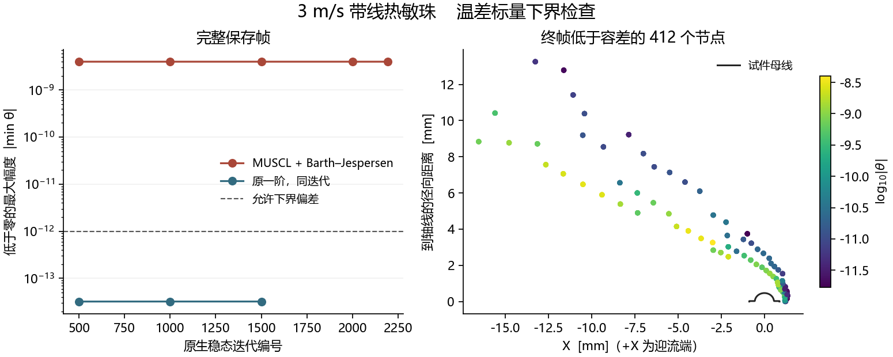

# 同网格温差输运对照

在 3 m/s 带引线 B 型热敏珠上，SU2 的 **MUSCL 标量重构配 Barth–Jespersen 限制器未通过全域温界**。五个完整保存帧上，低于容差的是同一批 412 / 16,581 个流体节点，占 2.485%。最大偏低约 **4.79 × 10⁻⁸ K**。偏差很小，但持续到原生正常终点；本次关闭这一个具体配置。[逐帧审计](evidence/frames.json) · [越界节点及坐标](evidence/out_of_bounds.csv.gz)

本版首次获得合格壁压与热流的新增覆盖为 **0 面、0 m²**。有效主结果仍为 v300 的 10,272 / 10,272 面、3.19665061 mm²。305.15 K 给定壁温下，珠部含接头放热 10.27423 mW，整件放热 10.87809 mW，珠部平均换热高于实验图读值 26.73%。新方案在壁热读取前被拒，因而其热流、七区功率及实验偏差均为未知。[已验收的原面与实验对照](../v300/RESULTS.md) · [现行工作台](../../../outputs/v300_validation/wired_ui01/workbench/index.html)



## 试验条件与方法

从 v300 提交 `1567cea7b73f8bd688e9a6f26051bef1b59dd7d5` 起步。空气 293.15 K、101325 Pa，全部暴露面给定 305.15 K。直接复用 23,224 单元的体网、节点映射与同一冷初场。原面、几何、冷态和物理工况的 SHA 均与 v300 一致。保留原一阶流场离散、物性、远场、壁面、CFL 和收敛设置。温度由强等温的被动标量换算，θ = (T−293.15 K)/12 K。允许区间为 [0,1]，数值容差 10⁻¹²。

新配置开启 `MUSCL_SPECIES`，指定 `SLOPE_LIMITER_SPECIES= BARTH_JESPERSEN`、`LIMITER_ITER= 999999`、`RAMP_MUSCL= NO`。标量裁剪保持关闭。执行前复核了官方 Windows 程序与官方压缩包内的可执行文件，亦核对本机源文件与固定源码包逐字节一致。v8.6.0 的这一限制器特化调用带数值 epsilon 的 Venkatakrishnan 函数。标量边通量独立读取重构梯度；此处保持流场重构关闭。配置的限制器覆盖整个实际迭代窗口。配置名称本身无法保证最终全域离散解满足极值界限。[输入与固定源指纹](evidence/inputs.json) · [官方限制器实现](https://github.com/su2code/SU2/blob/v8.6.0/SU2_CFD/include/limiters/CLimiterDetails.hpp) · [事前合同](PLAN.md)

## 残差、温界和流场分别核对

| 保存迭代 | 全域最小 θ | 低于 −10⁻¹² 的节点 | 高于 1+10⁻¹² 的节点 |
|---:|---:|---:|---:|
| 500 | −3.9928841 × 10⁻⁹ | 412 | 0 |
| 1000 | −3.9937151 × 10⁻⁹ | 412 | 0 |
| 1500 | −3.9936232 × 10⁻⁹ | 412 | 0 |
| 2000 | −3.9936174 × 10⁻⁹ | 412 | 0 |
| 2193（正常终点） | −3.9936171 × 10⁻⁹ | 412 | 0 |

终点最低温为 **293.1499999521 K**，原生节点 11857，坐标为 (−2.994, 3.011, 1.247) mm。越界节点中，15 个落在远场边界，237 个不属于任何边界标记，其余包含对称面节点；不同边界标记可以重叠。壁面和首层节点均无越界。终场壁面无滑移，绝对压力为正。以同一迭代 500、1000、1500 作直接对照，两种算法保存的**全部节点压力和三个速度分量相同**。v300 这三个帧的最小 θ 约 −3.22 × 10⁻¹⁴，处于容差内。[节点与边界归属](evidence/frames.json)

候选终点为 2193，一阶终点为 1972。独立两终点的最大绝对压力差为 1.88 × 10⁻⁹ Pa、最大向量速度差 2.88 × 10⁻¹⁰ m/s。流体温度差最大为 **2.509 K**，位于尾迹轴线 X = −2.4895 mm；第一层流体节点上的最大温差为 0.08443 K。这些是两个数值场的差异，实验只给出平均换热。

候选末 20 行原始六项最大残差分别为 −16.1231、−15.8953、−16.8436、−17.0781、−11.5198、−10.9533，全部通过 −8 门槛。温界失败阻断了后续壁反力、20 次延续、热稳定与独立远场热量账。未将原生弱焓监测热量当成强标量的壁面热流。未修改面元主结果或科研界面。越界原因尚未分解到重构、扩散与边界通量各自的贡献。[原生配置、历史与终态回执](evidence/receipts.zip)

单次官方程序冷态推进耗时 230.84 s，单线程，进程家族采样峰值 194.20 MiB。源码阅读、输入准备和归档不计入该时长。完整冷态、周期体场与表面、正常终点留在 E 盘 `outputs/v301_validation/scalar01`。逐帧审计记录保存文件 SHA。回放此一次试验可在项目根目录使用以下命令，结果目录取新名称。[下一项](NEXT_DECISION.md)

```powershell
python docs/validation/v301/transport_case.py prepare outputs/replay_scalar_bj
python docs/validation/v301/transport_case.py solve outputs/replay_scalar_bj
python docs/validation/v301/record_transport.py outputs/replay_scalar_bj outputs/replay_scalar_bj_audit
```
