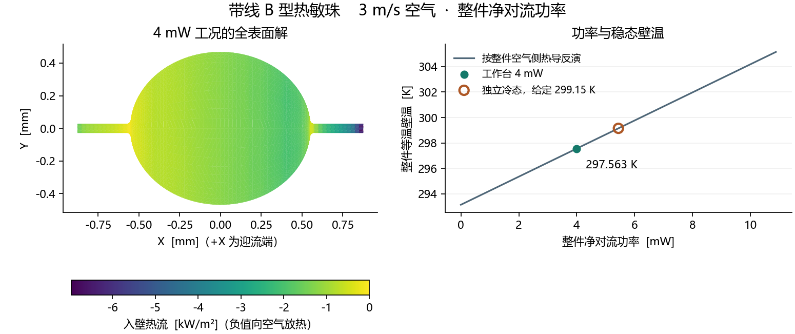

# 带线热敏珠的整件净对流功率与稳态壁温

在 3 m/s、293.15 K、101325 Pa 空气中，输入 **4.00000 mW** 的整件净对流功率，求得带线 B 型热敏珠的稳态等温壁温 **297.562541 K**。珠面与两个接头向空气放热 **3.777955 mW**，两根引线及其端面放热 **0.222045 mW**。七区功率合计与输入相差 8.67 × 10⁻¹⁸ W。[10,272 面完整数值及方法](evidence/power4mW.zip) · [工作台核对](evidence/workbench.json)

本次 **4 mW 新边界工况** 首次同时获得壁压、热流和集总求解壁温的原面为 **10,272 面、3.19665061 × 10⁻⁶ m²**，覆盖全部暴露表面。同一几何在先前 305.15 K 给定壁温工况已覆盖这些面；按既有几何面号计算，新覆盖 0 面、0 m²。实验只提供参照工况的珠部平均换热；本次逐面联合实验验证面积为 0 m²。

## 输入与每个场量的含义

净功率是传给空气的对流份额，包含珠面、接头、引线和端面。用实验电功率代入时，还需知道辐射及通过安装支座导出的份额。模型假定整件等温、恒物性、轴向对称稳态；材料内部温度梯度和真实接头热阻未知。

复用 v300 已验收的三维不可压层流与一阶强温差场，按同一网格的总反力得到空气侧热导 **G = 10.87808570 mW / 12 K = 0.90650714 mW/K**。壁温由 **Tw = T∞ + P/G** 求出。每个三角面的有符号热流和首层流体超温按当前温差与 12 K 的比值换算。壁压沿用同一恒密度解。4 mW 下，绝对壁压为 101321.68–101334.41 Pa，入壁热流为 −6958.62 至 −111.47 W/m²，首层流体温度为 297.20163–297.55833 K。最强放热在迎流侧引线的 207 号面。[参照工况及独立热量账](../v300/RESULTS.md)

| 暴露区域 | 原面数 | 4 mW 工况向空气放热，mW |
|---|---:|---:|
| 后引线端面 | 336 | 0.003586 |
| 后引线侧面 | 1,152 | 0.041540 |
| 后接头 | 576 | 0.001140 |
| 珠面 | 6,144 | 3.772216 |
| 前接头 | 576 | 0.004599 |
| 前引线侧面 | 1,152 | 0.164100 |
| 前引线端面 | 336 | 0.012819 |

全体面使用同一个求解壁温。探针保留给定壁温的未给定状态、首层流体温度、压力和热流各自的来源，参照场的原生收支单独记录。零功率时壁温等于来流 293.15 K，热流在每个面为零。此网允许的功率范围为 0 至 10.878085695936079 mW。负数、非有限值、复数、向量和超过上限的输入均在求解前拒绝。305.15 K 给定壁温模式仍可切回原有网距及引线对照。

## 独立冷态核验

以 v301 提交 `8aeb277d9239b5d96c7d87b23e35664614b2b7f1` 为起点，复用 v300 的 23,224 个体单元、16,581 个节点、10,272 个原面与首层映射。将强标量壁值从 1 改为 0.5，量纲仍取 12 K；弱焓壁边界及冷初场同步调整，在 **299.15 K** 下作一次独立冷态求解。原生迭代 1854 保存正常终点。初场、每 500 次的完整场、终点及 20 次延续均检查全域温界、正压、无滑移和壁温。两个残差窗的六个分量均低于 −8。[准确输入、保存帧及逐区误差](evidence/half.json)

独立壁反力给出 **5.439043104 mW**。把该功率输入 MATLAB 工作台得到 **299.150000283 K**，相对设定壁温差 2.83 × 10⁻⁷ K。将独立场与半倍参照场逐面比较，热流最大绝对差 0.09817 W/m²，最大相对差 0.0057404%；首层温度最大差 3.10 × 10⁻⁶ K，压力最大差 5.75 × 10⁻⁹ Pa。独立远场与壁面同阶段收支相差 13.37 nW，相对差 0.0002459%，再推进 20 次后放热相对变化 1.05 × 10⁻⁸。这些数字衡量同一物理模型内的数值一致性。参照工况的珠部平均换热相对论文图读值仍高 26.73%。[原生及工作台回执](evidence/receipts.zip) · [实验测量口径](../v282/RESULTS.md)

官方 SU2 8.6.0 单线程推进 196.28 s，进程家族采样峰值约 200 MiB；两次壁反力读取和 20 次延续共 6.52 s。复用同一网格已验收的观察器，原程序与观察器的两个独立单步共 3.50 s。大型场保存在 `outputs/v302_validation/half01`。源码开发、阅读和归档未单独计时。复算与检查入口见 [单次原生算例](half_case.py) 和 [半温差审核](audit_half.py)。

## 科研工作台

运行 `rocketAeroHeatWorkbench`，选择 **选用带引线 B 型热敏珠 → 中段加密 → 生成试件混合体网**。在边界页选择 **整件净对流功率**，单位 W；4 mW 输入 **0.004**。确认后点 **用已算参照场求壁温**。冷态重算选项会先新算参照场，再按同一功率关系求壁温。

本轮分别验收了独立原生冷态与生产侧栏回读参照场这两条路径。4 mW 工况的 WebGL 渲染、207 号面探针、全表面压力/热流和壁温 CSV、X=0.172 mm 处两张各 96 行的真实截面表均已按面号核对。归档包含 SI 数值、字段方法、冻结条件和参照来源。输入改为零后，旧场与边界确认撤销，重新计算得到全表面物理零；切回给定壁温后，求解温度字段恢复未知。带线工作台用时 50.11 s，已有光滑珠体功率功能回归用时 36.03 s。测试使用已发布 v301 Web 资源，并发前端修改原样保留。[本机 4 mW 工作台](../../../outputs/v302_validation/wired_ui01/workbench/index.html) · [实际导出回执](evidence/workbench.json) · [下一项](NEXT_DECISION.md)
