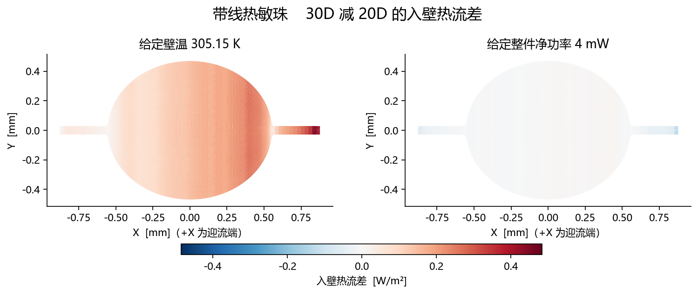

# 带线热敏珠的外边界敏感性

在 3 m/s、293.15 K、101325 Pa 空气中，将外边界半径从 20 倍珠径移至 30 倍，**同一整件净对流功率 4 mW 下，壁温由 297.562541 K 升到 297.562730 K，差 0.00018847 K**。给定壁温 305.15 K 时，整件放热由 10.87808570 降到 10.87762109 mW，变化 −0.00427%。两种热边界下最强放热均在迎流端引线的 **207 号面**。[七区与热峰对照](evidence/comparison.json) · [两种工况的原面表](evidence/face_comparison.zip)

| 同一试件和工况 | 20D | 30D | 30D 减 20D |
|---|---:|---:|---:|
| 空气侧热导，mW/K | 0.90650714 | 0.90646842 | −0.00003872 |
| 给定 305.15 K 的整件放热，mW | 10.87808570 | 10.87762109 | −0.00046461 |
| 给定 4 mW 的集总壁温，K | 297.56254108 | 297.56272955 | +0.00018847 |
| 给定 4 mW 的迎流引线峰值放热通量，W/m² | 6958.62 | 6958.77 | +0.14 |

本版新增合格壁压与热流覆盖为 **0 面、0 m²**。两域均在既有全部 10,272 个物理原面、3.19665061 mm² 上取得壁压、热流和首层流体温度。30D 参照工况珠部含接头放热 10.27378 mW，按论文名义面积换算平均 h 为 276.71 W/(m²·K)，较论文图 7 中心读数高 26.72%。20D 到 30D 的变化远小于这项平均换热差异。实验没有同时测量各面的壁压和热流，逐面联合实验验证面积为 0 m²。[30D 原生表面结果](../../../cases/thermistor_b/outer30.zip) · [实验读数与定义](../v282/RESULTS.md)

工况沿珠体长轴来流，名义几何和等温边界具有轴对称性。两次求解均采用 30° 对称扇区，按周向对称关系映射到完整表面。4 mW 指整件传给空气的净对流功率，报告的壁温来自整件等温热平衡。坪内、佐藤图 7 的珠部平均换热系数读数为 218.36 W/(m²·K)，图读范围为 211.90–224.81 W/(m²·K)，原实验单点不确定度未知。[原论文](https://doi.org/10.1299/kikai1938.25.810) · [网格与实验口径](../v300/RESULTS.md)



## 七个区域与局部差异

下表列出**相同 4 mW** 条件下各区向空气放热。工作台热流以入壁为正。固定总功率使各区变化相加为零，各区本身的变化仍可由原面读出。

| 区域 | 面数 | 20D 放热，µW | 30D 放热，µW | 变化，nW |
|---|---:|---:|---:|---:|
| 后引线端面 | 336 | 3.585875 | 3.585978 | +0.103 |
| 后引线侧面 | 1,152 | 41.539703 | 41.540812 | +1.109 |
| 后接头 | 576 | 1.140346 | 1.140369 | +0.023 |
| 珠面 | 6,144 | 3772.215594 | 3772.212069 | −3.525 |
| 前接头 | 576 | 4.599080 | 4.599102 | +0.022 |
| 前引线侧面 | 1,152 | 164.100418 | 164.102437 | +2.018 |
| 前引线端面 | 336 | 12.818984 | 12.819234 | +0.250 |

给定壁温下，逐面入壁热流的最大绝对差为 0.48386 W/m²，位于 213 号面；面积加权 RMS 为 0.15956 W/m²。给定 4 mW 后，两域各自用本域热导反求壁温，最大绝对差为 0.16491 W/m²，位于 208 号面；RMS 为 0.00883 W/m²。两种边界下最大壁压差均为 0.001760 Pa，位于 424 号面。新旧域的壁剪切和首层速度同时反向的 1,536 面逐一相同，共 0.118263 mm²。扩域只检验外边界位置及新增外壳的综合影响。[逐面数据及来源](evidence/face_comparison.zip)

## 网格、冷态与热量核对

以 v302 提交 `856c191cd73d777b028c2cde8a8d1f63b668b9c9` 为起点，直接读取 v300 的 20D 成品 SU2 网格，在原远场面外接五层厚 2D 的同心外壳。原有 16,581 个节点保留坐标与编号，23,224 个单元保留有序连接，全部原面与首层映射相同。新域共 17,366 个节点、23,864 个单元。新增 640 个单元逐一检查正体积，外壳总体积 6597.40458375 D³ 与外封闭面相似缩放所得体积一致。原 128 张远场面逐张核对两侧相反绕序，30D 外边界承担原来流条件。[成品网核查](evidence/shell.json) · [准确输入与源文件](evidence/inputs.json)

新域从独立冷态推进，初场的原域节点等于 v300 冷态，外壳初值取均匀来流。**一次** 305.15 K 参照壁温计算使用官方 SU2 8.6.0 三维不可压层流和强等温标量。壁压由节点表压加环境压力，壁反力按原面守恒分配。4 mW 工况使用同一几何、恒物性和整件等温条件下的线性热平衡，各自以 12 K 温差对应的热导换算；半温差独立核验来自 20D 工况。[功率反演的验证范围](../v302/RESULTS.md)

原生迭代 1974 正常结束，冷态、迭代 500/1000/1500 和正常终场均留存。各帧满足全场温界、绝对压力正性与无滑移。两个终点的六项残差末 20 行均低于 −8；另加 20 次的整件放热相对变化 5.14 × 10⁻⁹。独立同阶段壁面与远场放热差 14.15 nW，占整件放热的 0.0001301%。官方冷态求解 210.64 s、单线程、进程家族采样峰值 204.25 MiB；反力读取和延续共 6.91 s，新观察器编译及链接 6.20 s，两次独立单步共 3.45 s。网格准备命令约 2.47 s；开发、阅读与归档未单独计时。大型场保存于 `outputs/v303_validation/outer01`。[保存帧及 SHA](evidence/checkpoints.json) · [原生与界面回执](evidence/receipts.zip) · [30D 原生收支](evidence/summary.json)

## 工作台与复算

在带线 B 型热敏珠的网格页选择 **中段加密**，并选择给定 305.15 K 或输入整件净对流功率 **0.004 W**。读取当前结果后，点 **查看外边界影响 · 30D 减 20D** 可直接拾取该工况最大绝对热流差的面。云图可切换到 30D 入壁热流、热流差、壁压差或首层温差。两域主热流共用绝对色标，差值采用对称色标。零功率时两域壁温相同、各面热流差为零。20D 支持而 30D 参照场超域的功率仅撤销外域对照。

两种实际侧栏工况、WebGL 渲染与拾取均已验收。每个全表面导出含 10,272 行，X=0.172 mm 截面各 96 行，已回到独立原生表逐行核对。完整导出的 JSON 回执列出这次对照的热边界、两份源帧和七区功率。审核时发现最初的紧凑回执只包含来源哈希，现已加入可直接追查的对照帧，再次运行侧栏与导出核验。测试使用 v302 的 Web 资源及本次修改的 MATLAB 导出模块，保留并发前端工作。[给定壁温的三维页](../../../outputs/v303_validation/domain_ui03/givenWall/workbench/index.html) · [4 mW 的三维页](../../../outputs/v303_validation/domain_ui03/givenPower/workbench/index.html) · [导出核查](evidence/workbench.json)

在项目根目录复算时，用新的输出目录名替换示例中的 `outer_new`。如原有 20D 体网不在本机，可先按 v300 的步骤生成相同带线中段加密算例输入。[20D 生成入口](../v300/RESULTS.md)

```powershell
python scripts/thermistorOuterDomain.py outputs/v300_validation/wired01 outputs/outer_new
python scripts/runThermistorLeadCase.py solve outputs/outer_new
python scripts/runThermistorLeadCase.py probes outputs/outer_new
python scripts/thermistorLeadSurface.py outputs/outer_new
python scripts/thermistorLeadNearWall.py outputs/outer_new
```
