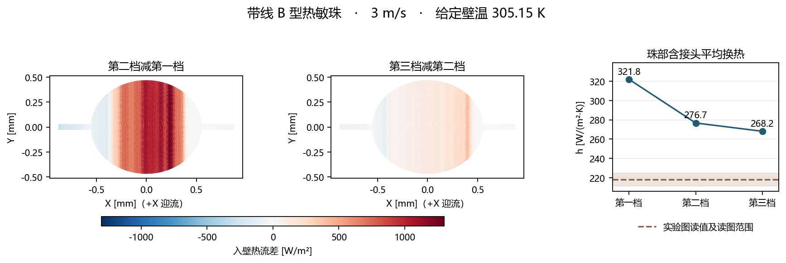

# 带线热敏珠的第三档中段网距

在 3 m/s 空气中，第二次细化使给定壁温 305.15 K 下的珠部含接头放热再降 **3.10%**，第一次下降 **14.01%**。第三档在相同整件净对流功率 **4 mW** 下求得 **297.694199 K** 的均匀壁温，比第二档高 **0.131658 K**。本版新增计算覆盖为 **0 面、0 m²**。三档均有全部 10,272 个原面、3.19665061 mm² 的壁压和入壁热流。[三档原面表](evidence/face_comparison.zip) · [七区及两次变化](evidence/comparison.json)

| 试件结果 | 第一档 | 第二档 | 第三档 |
|---|---:|---:|---:|
| 给定 305.15 K，整件放热 / mW | 12.53996 | 10.87809 | 10.56292 |
| 给定 305.15 K，珠部含接头放热 / mW | 11.94750 | 10.27423 | 9.95593 |
| 珠部平均换热系数 / W/(m²·K) | 321.79 | 276.72 | 268.15 |
| 相对图 7 实验中心读数 | +47.37% | +26.73% | +22.80% |
| 给定 4 mW，集总壁温 / K | 296.977763 | 297.562541 | 297.694199 |
| 给定 4 mW，最大向外放热通量 / W/m² | 6026.45 | 6958.62 | 7171.07 |

坪内、佐藤论文图 7 在 3 m/s 给出珠部平均换热系数 218.36 W/(m²·K)，图读范围为 211.90–224.81，单点实验不确定度未知。计算按相同的珠部名义面积 3.094 mm² 换算。细化后结果更接近实验，但中段网距仍影响珠部放热，三档局部非均匀网格不足以确定连续极限。实验未提供逐面压力与热流，联合独立实验验证面积为 0 m²。[原论文](https://doi.org/10.1299/kikai1938.25.810) · [实验读数](../v282/evidence/comparison.json)



## 全表面结果与计算方法

壁压来自 SU2 8.6.0 三维不可压层流解，壁节点表压按三角面平均后加环境压力。给定壁温时，恒物性一阶温差输运给出壁节点离散反力，按相邻原面面积守恒分配。4 mW 时，各网分别用自身的空气侧热导求解整件等温壁温，以温差比换算热流和首层流体超温。第三档热导为 0.880243 mW/K。该假设给出一个整件壁温，内部温度梯度仍未知。[第三档原面包](../../../cases/thermistor_b/leadsThird3.zip)

| 暴露区域 | 原面数 | 第三档给定壁温放热 / µW | 第三档 4 mW 工况放热 / µW |
|---|---:|---:|---:|
| 后引线端面 | 336 | 9.921 | 3.757 |
| 后引线侧面 | 1,152 | 115.450 | 43.719 |
| 后接头 | 576 | 3.192 | 1.209 |
| 珠面 | 6,144 | 9940.210 | 3764.191 |
| 前接头 | 576 | 12.524 | 4.743 |
| 前引线侧面 | 1,152 | 446.733 | 169.170 |
| 前引线端面 | 336 | 34.888 | 13.211 |

三档均在迎流引线的 207 号面达到整件热峰。给定壁温时，第三档相对第二档的最大绝对热流差为 420.46 W/m²，出现在 1641 号面，面积加权均方根差为 144.25 W/m²。同一 4 mW 下最大差为 212.45 W/m²，出现在 207 号面，均方根差为 34.53 W/m²。后引线、后接头及珠面共有 1,536 面同时出现壁剪切和首层速度反向，占 0.118263 mm²，与第二档逐面一致。第三档首层 y+ 估计范围为 0.00237–0.08431。[近壁证据](evidence/flow.json) · [全表面热量核对](evidence/summary.json)

## 几何核对

基线为 v303 提交 `e7c695d7a84d01947c1dec176887cf2f7eba47b6`。取公开 B 型热敏珠的名义带线几何，3 m/s 沿长轴吹向 −X，空气 293.15 K、101325 Pa，外边界距中心 20 倍珠径 D。三档都用同一 30° 对称扇区和周向分辨率映射到整件表面。保留引线长度、接头圆角和整件等温假设。[试件与实验口径](../v300/RESULTS.md) · [事前合同](PLAN.md)

下表按实际成品网格读取从 0.015D 到 0.1D 的最大法向穿越间距，角度从迎流端量起。

| 位置 | 第一档 / D | 第二档 / D | 第三档 / D |
|---|---:|---:|---:|
| 60° | 0.02358 | 0.00959 | 0.00425 |
| 85° | 0.02888 | 0.00792 | 0.00443 |
| 120° | 0.02249 | 0.00745 | 0.00632 |

第三档有 28,456 个节点和 42,224 个体单元。第二档中 16,620 个单元的有序顶点坐标保持一致，6,604 个父单元被 25,604 个单元取代。改动顶点位于 −0.843 ≤ X/a ≤ 0.857、距壁约 0.0150D 至 0.1389D。选边中点位于 0.015D 至 0.100D，邻接单元的部分顶点延伸至该带之外。原面编号与分区、首层和全部近壁层接口坐标、128 个远场面的有序坐标均已核对。[三档实测网距和改动范围](evidence/inputs.json)

## 数值核对

一次独立冷态在原生迭代 2736 正常结束。冷态、每 500 次的五份周期帧以及正常终场均已核对。所有保存帧的绝对压力为正，壁面无滑移，温差标量最小约 −3.03 × 10⁻¹⁴，位于事前容差内。终点和 20 次延续的六项残差末 20 行均低于 −8。延续后整件放热相对变化 4.64 × 10⁻⁹。独立同阶段壁面放热与远场收支相差 **1.40 nW**，占整件放热 **0.0000132%**。[保存帧与残差](evidence/checkpoints.json) · [原生收支](evidence/summary.json)

建网 2.28 s，单线程冷态推进 577.28 s，进程家族采样内存峰值 293.14 MiB。两次反力读取和 20 次延续共计 12.86 s，独立观察器编译及链接 5.11 s，两个独立单步共计 5.31 s。体场、观察器及检查点在 `outputs/v304_validation/wired01`。开发、阅读和归档未单独计时。[运行回执与历史](evidence/receipts.zip)

## 工作台

在 **选用带引线 B 型热敏珠 → 带线试件体网** 中选择 **第三档中段细化**。生成体网、确认热边界后，按 **读取** 可从随项目发布的小包恢复冻结结果。也可由计算页执行冷态新算。查看结果时按 **对照三档网距**，按钮会选中本工况第三档相对第二档热流差最大的面。变量菜单可切换前两档的绝对热流，以及每次细化的热流差。绝对值共用同一色标，两个差值共用对称色标。

两次实际侧栏操作分别走通了给定 305.15 K 和给定 4 mW。两页各渲染 10,272 面，探针分别落在 1641 和 207 号面。各自的全表 10,272 行及 X=0.172 mm 的截面 96 行均已回到独立表逐行核对。完整 CSV 的配套回执含三份源帧、实际热边界和七区功率。零功率时三档均返回环境壁温和物理零热流。切回第二档后旧结果失效，重新建网所得网格与旧快照指纹一致。侧栏验收用时 70.19 s，使用 v303 的 Web 资源及本版导出器。正式冷态由项目计算后端执行一次。[给定壁温三维页](../../../outputs/v304_validation/three_ui01/givenWall/workbench/index.html) · [4 mW 三维页](../../../outputs/v304_validation/three_ui01/givenPower/workbench/index.html) · [逐行验收](evidence/workbench.json)

## 复算

在项目根目录用新的输出目录名运行下列命令。工作台使用相同的准备与计算后端。三维体场和检查点保存在 E 盘，随源码提供输入哈希、历史和小型原面包。

```powershell
python scripts/runThermistorLeadCase.py prepare outputs/thermistor_third_new --first .001 --third-midbody
python scripts/runThermistorLeadCase.py solve outputs/thermistor_third_new
python scripts/runThermistorLeadCase.py probes outputs/thermistor_third_new
python scripts/thermistorLeadSurface.py outputs/thermistor_third_new
python scripts/thermistorLeadNearWall.py outputs/thermistor_third_new
```
