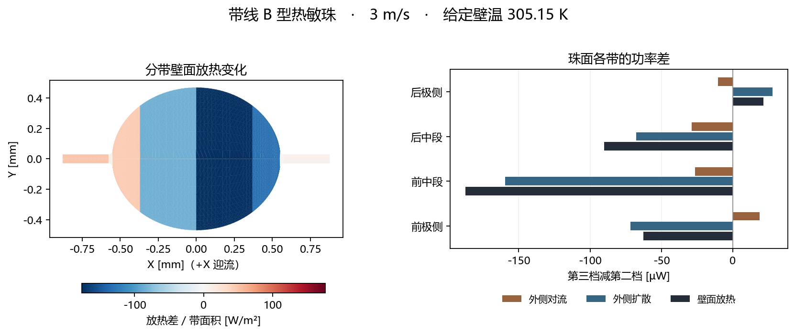

# 两档热敏珠网的分带热量收支

在 3 m/s 空气、给定整件壁温 305.15 K 的同一带线 B 型热敏珠工况下，第三档比第二档的珠部含接头放热少 **318.303 µW**。其中前中段少 **187.118 µW**，占净减少量的 **58.8%**。这 1,536 个原面位于 **X = 0 至 +0.369 mm**，前端迎流。后极侧放热反而增加 **21.400 µW**。十个分带的控制体收支分别闭合，原面功率也逐带复现。[分带原始数据](evidence/budget.json) · [完整面号与带的对应关系](../../../cases/thermistor_b/layerBands.json)

在两档几何相同的近壁控制体外侧，珠部含接头的**净扩散流出变化 −270.908 µW**，净对流流出变化 −47.371 µW。净扩散项相当于珠部放热变化的 85.1%。前中段自身的两项分别为 −159.599 和 −26.629 µW。数值指该位置在两套离散解之间的变化；两网的温度场和速度场均来自各自终态。第三档珠部平均换热仍比公开实验读数高 **22.80%**，这一实验差异的成因尚无独立结论。[两档工况与实验口径](../v304/RESULTS.md) · [原论文](https://doi.org/10.1299/kikai1938.25.810)



相比 v304，壁压和热流的新增计算覆盖为 **0 面、0 m²**。本次在既有 10,272 / 10,272 个原面、3.19665061 mm² 上定位了网距敏感区域，并量出了近壁外侧及各带边界上对应的传热变化。七个原区域保持独立。逐面压力与热流联合实验验证面积为 0 m²。

| 原面带 | 面数 | 第二档放热 / µW | 第三档放热 / µW | 变化 / µW |
|---|---:|---:|---:|---:|
| 后引线端面 | 336 | 9.752 | 9.921 | +0.169 |
| 后引线侧面 | 1,152 | 112.968 | 115.450 | +2.482 |
| 后接头 | 576 | 3.101 | 3.192 | +0.091 |
| 珠面后极侧 | 1,536 | 759.618 | 781.018 | +21.400 |
| 珠面后中段 | 1,536 | 2825.779 | 2735.768 | −90.011 |
| 珠面前中段 | 1,536 | 4359.068 | 4171.950 | −187.118 |
| 珠面前极侧 | 1,536 | 2314.157 | 2251.475 | −62.682 |
| 前接头 | 576 | 12.507 | 12.524 | +0.016 |
| 前引线侧面 | 1,152 | 446.275 | 446.733 | +0.459 |
| 前引线端面 | 336 | 34.862 | 34.888 | +0.026 |

## 取样、方向与独立核对

基线提交为 `bf3796c2eb27e5e15ae2676a781222eeb09a13b4`。用原生 SU2 成品网的真实有序顶点配对，确认两档 3,759 个入组节点、所有 3,024 个与它们接触的体单元，以及 10,535 条入射边的位置和连接相同。控制体包含至名义偏置 0.011D 的七个节点层，外侧对偶面位于通往 0.015D 节点层的边上。实际有向对偶面积在两网的最大相对差为 8.54 × 10⁻¹⁶ 以下。原珠面按后到前的母线编号，每 16 条原带合并为一组。[几何核对](evidence/geometry.json) · [事前合同](PLAN.md)

固定 SU2 8.6.0 的物种输运把对流和扩散合在同一内部边装配。观察器在相同两端状态、梯度及对偶面积上调用原生通量函数，分别读取对流、扩散、两项合计和两个端点的符号。观察值与实际装配后的节点残差逐点核对，同阶段还读取远场及强制壁温施加前后的节点行。两次单步和各自已有的官方程序单步相比，全部输出列的最大绝对差为 1.14 × 10⁻¹³。用原 30° 扇区的 12 倍及相同的 SI 换算恢复整件功率。[固定源文件和进程回执](evidence/receipts.zip)

热量账的正号表示朝控制体外流出。对一带，原面放热等于外侧对流与扩散、带间对流与扩散的净流出之和，加上原面分配修正，再减该组节点的终场残差。分界环节点整体归入下一带，原三角面则沿用已发布的面积权重。两个分法在交界节点引起的差额使用独立矩阵逐项登记。前中段两侧对流交换分别改变 −15.049 和 +15.260 µW，相加只有 +0.211 µW。前中段原面分配修正变化为 −1.375 µW。这样可以逐带复现既有原面放热。[两档完整交换矩阵](evidence/budget.json)

每档的带间成对交换均相消。两档最大的带收支代数误差为 1.57 × 10⁻¹⁸ W，实际带残差相对本带壁功率的最大值为 0.00142%。原面七区的积分分别回到已有壁反力。复现的壁面与远场收支绝对差分别为 13.29 和 1.40 nW。共用观察器的两个对象编译耗时 3.59 和 24.61 s，链接 1.44 s，两次单线程回放耗时 2.33 和 3.70 s。原始逐边表、节点装配及完整单步输出保存在 E 盘 `outputs/v305_validation/sample2a` 和 `sample3a`；开发、阅读和归档未单独计时。

## 工作台与复算

在带线 B 型热敏珠选择 **第三档中段细化**，给定壁温 **305.15 K**，读取结果后点 **查看分带热量账**。云图默认定位到放热变化最大的带。四个变量共用对称色标，均以第三档减第二档的带功率除以该带原面面积显示，单位 W/m²。点选原面可读取带名、整带放热和各项功率变化。原先的“入壁热流”仍按单个三角面、入壁为正显示。4 mW 模式显示自身的求解壁温与原面放热。[本机离线三维页](../../../outputs/v305_validation/ui03/workbench/index.html) · [界面核对](evidence/workbench.json)

第一次界面检查发现多个分项共用的带编号被方法编号覆盖，修正后逐带复查。第二次检查在切换工况后访问了一次已销毁的旧页面，改为读取当前页面。两个原始记录保存在 `outputs/v305_validation/ui01`、`ui02`。几何核对初次写入来源时使用了相对路径，首次生成观察器时一个只读插入点与实际源文字不符，均在求解前更正，现场分别留在 `geometry01`、`build01`。

最终工作台检查用时 55.22 s。使用 v304 已发布 Web 资源及本轮 MATLAB 导出模块，四个变量各检查十个带的探针。按钮定位到前中段的代表面 108；完整表 10,272 行以及 X=0.172 mm 的 96 行截面全部核对。配套 JSON 包含两份终场来源、逐带功率和原面分配修正。切换到 4 mW 后确认当前页面已清除给定壁温的热量账。[最终回执](evidence/workbench.json)

复算使用已保存的 v300、v304 原生终场及各自的官方单步。以下为新的输出目录示例。构建工具沿用 [热敏珠安装说明](../v296/INSTALL.md)。

```powershell
python docs/validation/v305/common_layer.py outputs/v305_validation/geometry_new
python docs/validation/v305/observe_layer.py build outputs/v305_validation/build_new
python docs/validation/v305/observe_layer.py grid2 outputs/v305_validation/second_new --geometry outputs/v305_validation/geometry_new --build outputs/v305_validation/build_new
python docs/validation/v305/observe_layer.py grid3 outputs/v305_validation/third_new --geometry outputs/v305_validation/geometry_new --build outputs/v305_validation/build_new
python docs/validation/v305/band_budget.py outputs/v305_validation/geometry_new outputs/v305_validation/second_new outputs/v305_validation/third_new outputs/v305_validation/budget_new
```
