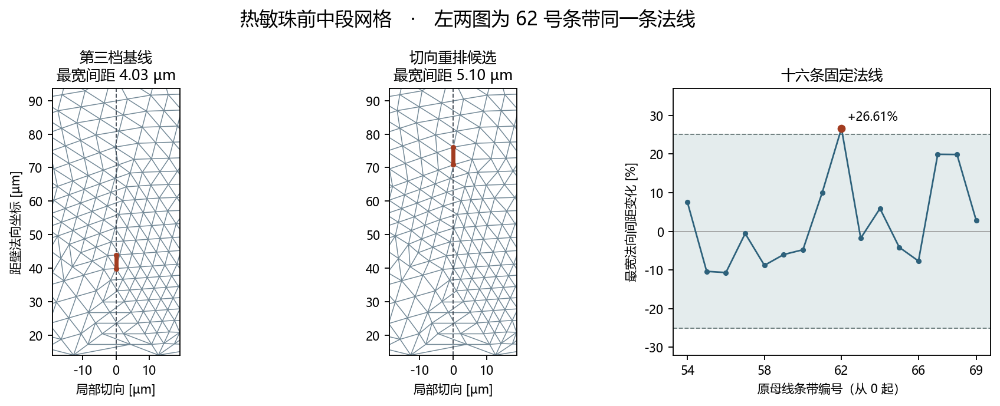

# 带线热敏珠前中段的法向排列试验

**这张候选网停在几何审核。** 在壁面和体网连接均固定的条件下，移动部分子午节点使前中段边的法向排列有所改善。每个三角形最接近壁法向的边，其面积加权平均夹角从 **22.98° 降至 21.07°**，降低 **8.30%**。事前为这次可比性试验选定的降幅为 20%。另有一条测线上的最宽间距增大 **26.61%**，超过预定的 25% 上限。两项中的任一项未达到，均按合同在此结束。[审核决定](evidence/geometry.json) · [事前合同](PLAN.md)

| 由成品网格量取的指标 | 第三档基线 | 切向重排候选 | 判定 |
|---|---:|---:|---|
| 目标区三角形最靠近法向的边，面积加权平均夹角 | 22.98° | 21.07° | 方向改善不足 |
| 目标区全部唯一边中，与法向夹角 ≤15° 的比例 | 7.70%（343 条） | 10.47%（466 条） | 提高 |
| 16 条射线合并的穿越间距中位值 | 0.00198309D | 0.00198320D | 在 ±15% 内 |
| 16 条射线合并的第 90 百分位间距 | 0.00440710D | 0.00439666D | 在 ±15% 内 |
| 各射线区间数相对基线 | — | −4.76% 至 +4.76% | 均在 ±20% 内 |
| 62 号条带的最大间距 | 4.027 µm（0.004297D） | 5.098 µm（0.005440D） | 超出 ±25% |

D 为珠体横径 0.937123 mm。条带编号从 0 起。62 号条带的测线起于 X = +0.20926 mm，沿该原壁段的法向。两网的最大间距出现在不同深度，分别为 0.04257D–0.04686D 和 0.07575D–0.08119D。该测线的区间数从 42 变为 40。其余 15 条测线的最大间距均在约定范围内。[逐条射线数据及物理位置](evidence/rays.json)



## 对应原面与物理解

试验针对 3 m/s、293.15 K 空气、20D 外域、给定壁温 305.15 K 的民用带线 B 型热敏珠。前中段涵盖 X 从 0 到 +0.369 mm 的 1,536 个原面，面积 1.06201775 mm²。全部 10,272 个原面的完整分母为 3.19665061 mm²。数据包提供前中段原面编号、面积、母线条带编号、两网实测边角以及射线上的各段间距。[原面清单与成品网读数](evidence/measurements.zip)

本版新增同时获得壁压和热流的原面为 **0 面、0 m²**。本轮排除了这套固定连接、切向移动节点的具体候选，未启动新流场求解。当前工作台可查看 v304 的第三档物理解和 v305 的分带结果。第三档珠部平均换热比实验图读值高 22.80%，整件净对流功率 4 mW 时的集总壁温为 297.694199 K。候选网对这两项的影响未知。逐面壁压与热流联合实验验证面积仍为 0 m²。[已有三维结果](../../../outputs/v305_validation/ui03/workbench/index.html) · [实验数据口径](../v304/RESULTS.md)

## 网格实际改动与复核

以 v305 提交 `e9b4ac801c056e4ba856f060ed663d44e3d2a0c8` 及已验证的第三档成品为基线。固定连接的稀疏最小二乘沿局部壁切向调整 1,486 个子午节点，按原周向位置延拓后共有 7,430 个三维节点移动。各节点的位移上限按当地最短边设置，边缘区域逐渐减至零。为保护有向面积，统一应用了 0.5 的步长系数。成品网最大节点位移为 0.001310D。[重排参数与源指纹](evidence/placement.json)

两网都有 28,456 个节点、42,224 个体单元。所有有序体连接、边界标记、原壁面、八层近壁节点、首层映射、周向角及远场均已核对。12,240 个体单元的顶点位置发生变化，其余 29,984 个逐点相同。移动节点原先距壁 0.01758D–0.09999D，接触这些节点的过渡单元最远延伸至 0.11952D。全部面锥体积为正，两网总体积均为 2777.80312558D³。几何有效性与方向对照的可比性分别判定。[成品网核对](evidence/geometry.json)

两次独立的间距读取从实网取边。一种解射线与各边的交点，另一种按边两端相对测线的有符号切向坐标插值。逐区间差低于 10⁻¹¹D。另从工作台只准备过体网的目录核对了基线输入指纹，得到相同的角度、间距和拒绝判定。几何准备约 1.8 s，成品审核约 2.0 s，独立交点复核及作图约 2.3 s，均为命令墙钟时间。峰值内存和开发时间未单独采样。候选的完整网格与节点映射留在 `outputs/v306_validation/aligned01`。

## 复算

下面的路径在项目根目录下使用，请为新运行选取空目录。首行只生成匹配的第三档几何和初场。已有相同输入的第三档目录时可直接替换 `outputs/base_new`，跳过首行。审核对这一候选返回退出码 2，并把两项未通过的原始读数写入 `geometry.json`。最后一行据这些读数生成对照图和原面清单。

```powershell
python scripts/runThermistorLeadCase.py prepare outputs/base_new --first .001 --third-midbody
python docs/validation/v306/audit_alignment.py baseline outputs/v306_validation/base_read_new --base outputs/base_new
python scripts/thermistorFrontAlignment.py outputs/base_new outputs/v306_validation/aligned_new
python docs/validation/v306/audit_alignment.py compare outputs/v306_validation/audit_new --base outputs/base_new --reference outputs/v306_validation/base_read_new --candidate outputs/v306_validation/aligned_new
python docs/validation/v306/publish_geometry.py outputs/v306_validation/aligned_new outputs/v306_validation/base_read_new outputs/v306_validation/audit_new outputs/v306_validation/report_new --base outputs/base_new
```
