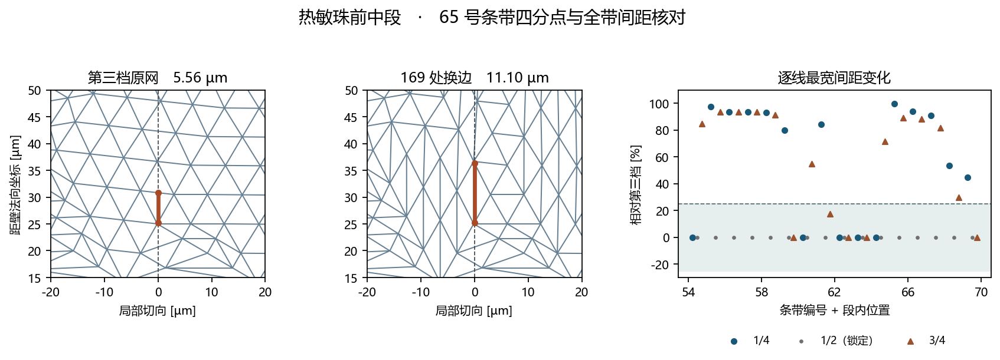

# 带线热敏珠前中段固定节点换边

**169 次换边保住了全部 16 条既有测线的交点，也达到了 20% 方向改善目标，但候选网未通过独立的间距和体单元检查。** 在未参与选边的 32 条测线上，有 22 条的最宽间距变化超过 ±25%，4 条的区间数变化超过 ±20%。65 号条带的 1/4 位置变化最大，最宽间距从 **5.56 µm 增至 11.10 µm**。另有 4 个近退化棱柱违反正面锥体积门槛。本轮停在几何阶段。[完整判定](evidence/geometry.json) · [独立复核](evidence/verification.json)

| 第三档同节点比较 | 原网 | 换边候选 |
|---|---:|---:|
| 节点数 / 体单元数 | 28,456 / 42,224 | 28,456 / 42,224 |
| 最靠近壁法向的边，按子午三角形面积加权平均夹角 | 22.97965° | 18.38325° |
| 与壁法向夹角 ≤15° 的唯一边比例 | 7.70% | 11.48% |
| 32 条交错测线合并的间距中位值 | 0.00202641D | 0.00198949D |
| 同组间距的第 90 百分位 | 0.00443970D | 0.00461900D |
| 65 号条带 1/4 处的最大间距 | 0.00593396D | 0.01184490D |

D 为珠体横径 0.937123 mm。图中阴影是逐条测线最大间距变化的事前允许范围。灰点对应被锁定的段中点。蓝点与棕色三角对应独立测量的两个四分点。合并分位数均合格，空间上分散的超限仍可在逐条记录中查到。[全部 48 条测线的交点与面号](evidence/measurements.zip)



## 上界与实际候选

基线为 v306 提交 `e9c02df7dbebd2222243ba41560c412b73d832a3`，起始输入是 v304 的第三档原网。按 v306 口径在前中段定位 2,959 个子午三角形。在目标三角形之间枚举出 4,375 对可供检查的邻接。四顶点在带内且四边形严格凸的有 4,011 对，进入中点测线相容性上界集合的有 2,979 对，其中 1,314 对的角度收益为正。[输入、预算与停止条件](PLAN.md)

以全部目标三角形的“面积 × 初始夹角”之和为分母。每次换边占用两个原三角形。给每个三角形分配非负整数，使任一换边的相对收益向上取整后均被两个端点的整数之和覆盖。由于同一个原三角形只能用一次，全部整数之和给出该类单轮组合的降幅上界 **40.509914%**。这个界容许更多边界候选，且尚未施加三维面锥和交错测线检查。独立复核使用原坐标的精确整数表示检查凸性，用另一角度公式核对收益，并逐项核对覆盖不等式。[上界证书摘要](evidence/bound.json) · [可复查的逐项整数证书](evidence/measurements.zip)

据此只生成一张候选。在构造时，细分原三角形，用距离函数的变化不超过移动距离这一性质验证四边形整体处于目标带。以四条边界和新旧对角线的交点集合核对原 16 条测线，再按收益降序选取互不占用同一三角形的组合，首次达到 20% 即停止。169 次换边涉及 338 个不同原三角形、1,352 个体单元。其余 40,872 个体单元的有序连接相同。实际方向改善 **20.002034%**，16 条中点测线的交点最大位移为 0D。[构造规则](CANDIDATE.md) · [按成品重新核对的选择清单](evidence/selection_verified.json)

## 未通过的几何条件与热场范围

交错测线中最大间距增幅为 **99.61%**。最大处旧网的无量纲法向区间为 [0.02696, 0.03289]，候选为 [0.02696, 0.03880]。另在 68 号条带的 1/4 位置，区间数由 24 降至 17。独立审核从实网重新求交，以第二种公式逐项核对全部 48 条测线，交点容差为 10⁻¹¹D。

4 个失败棱柱均来自编号 3799 的同一次换边扫过四个周向单元。原四边形按存储坐标严格凸，但换边后一片三角形的双倍面积仅 **4.77 × 10⁻¹⁹D²**，三个点实际上近乎共线。4 个棱柱合计有 8 个面锥体积为零或负值，最小值为 −2.81 × 10⁻²⁰D³。96,008 张内部面配对与绕序均通过，总体积也与基线吻合。选择清单的 `constructible` 只记录方向目标已达到，最终几何判定为 `passed=false`。[失败单元的逐面锥体积](evidence/geometry.json)

与 v306 相比，新增同时获得壁压和热流的原面为 **0 面、0 m²**。该试验针对原始前中段 1,536 面、1.06201775 mm²。已接受的第三档在 3 m/s、293.15 K 空气、给定壁温 305.15 K 下仍覆盖全部 10,272 面、3.19665061 mm²，珠部平均换热比公开实验图读高 22.80%，逐面压力与热流联合实验验证面积为 0 m²。换边候选的换热影响未知。[第三档已有热场](../../../outputs/v305_validation/ui03/workbench/index.html) · [实验比较](../v304/RESULTS.md)

## 复算及现场

候选体网和节点映射留在 `outputs/v307_validation/candidate01`。本次枚举及求上界耗时约 0.33 s，成品独立几何审核命令约 2.1 s，证书与全部测线复核约 1.8 s。没有进行新的传热迭代。峰值内存与开发时间未单独采样。

首次构造命令在进入函数前发现入口缺少 `ROOT` 导入。修正后已写出唯一的网格和映射，但原 `selection.json` 在写 NumPy 布尔值时中断。该原件留在现场，随后只读核对全部有序体连接、标记及节点，另存纠正的选择记录。首次几何审核因遇到非正面锥而提前退出；更正后的审核保留该失败，并继续检查同一张网的所有测线。

下面的命令在项目根目录执行，输出目录应为空。若本机没有原第三档，可用 `python scripts/runThermistorLeadCase.py prepare outputs/base_new --first .001 --third-midbody` 只准备同指纹基线，并在下列各步附加 `--base outputs/base_new`。本候选的审核按设计返回退出码 2。其后可运行独立复核。

```powershell
python docs/validation/v307/flip_bound.py outputs/v307_validation/bound_new
python docs/validation/v307/build_candidate.py outputs/v307_validation/bound_new outputs/v307_validation/candidate_new
python docs/validation/v307/check_candidate.py outputs/v307_validation/candidate_new outputs/v307_validation/candidate_new/selection.json outputs/v307_validation/audit_new
python docs/validation/v307/verify_decision.py outputs/v307_validation/bound_new outputs/v307_validation/candidate_new outputs/v307_validation/candidate_new/selection.json outputs/v307_validation/audit_new outputs/v307_validation/verification_new
```
