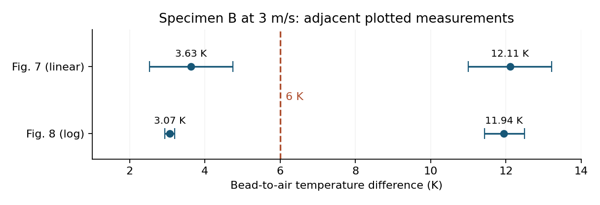

# B 型热敏珠在 6 K 温差下的实验对照

坪内与佐藤的风洞实验在 3 m/s、B 型热敏珠、珠面高于来流 6 K 处没有可辨认的测点。论文在两个坐标尺度上绘出了相邻测点，两侧的读图范围均与 6 K 分开。**本工况的珠部平均换热实验偏差未知。** v308 的 10,272 面、3.19665061 mm² 均保留计算壁压和入壁热流。本版新增覆盖 **0 面、0 m²**，逐面联合实验验证面积为 **0 m²**。本次解决的是如何把相邻测点的适用范围准确传到工作台及导出文件。[原论文，第 815 页](https://doi.org/10.1299/kikai1938.25.810) · [两图标定](../../../cases/thermistor_b/beadExperimentGap.json)

## 原文与读图

第 811 页表 1 给出 B 珠表面积 3.094 mm²、特征长度 0.3430 mm、偏心率 0.53 和引线直径 0.0540 mm。作者用经恒温空气槽标定的热敏珠电阻推算珠温，并扣除测量线路的外部电阻。第 812–813 页给出了电加热量、辐射散热和两根支承细线导热的计算方法。图 7、8 的横坐标是珠面相对来流的温差，纵坐标是珠部平均表面换热系数。工作台用珠面加两端接头的对流放热除以论文名义珠面面积和温差，对应名义等温几何的预测。两根引线及其端面的放热另计。[实验方法和原图](https://doi.org/10.1299/kikai1938.25.810)

| 3 m/s 系列 | 左侧测点温差与读图范围（K） | 右侧测点温差与读图范围（K） |
|---|---:|---:|
| 图 7，线性轴 | 3.63（2.52–4.74） | 12.11（11.00–13.22） |
| 图 8，对数轴 | 3.07（2.94–3.20） | 11.94（11.43–12.49） |

图 8 是作者对同一试件数据的对数重绘，斜向点线连接各速度下的定电流读数。按 3 m/s 行上的测点符号定位，不能将水平线与刻度线或定电流线的任意交叉当作一次测量。两图均从原 PDF 第 6 页以 230 dpi 渲染。沿用 v282 的点心 ±2 像素及刻度 ±0.75 像素，对数图在对数坐标中传播这两项偏差。两图共同确认的测点空档是开区间 (4.742684, 10.998991) K。这是按印刷图辨认点心的范围，论文未给出这些测点各自的仪器不确定度。原有 12 K 工况仍可引用图 7 右侧点的 218.36 W/(m²·K) 读数。[复算脚本](read_figure.py) · [原 12 K 读数](../v282/evidence/comparison.json)

## 工况结果与工作台

| 3 m/s 空气，给定壁温 299.15 K | 第二档 | 第三档 |
|---|---:|---:|
| 珠部含接头向空气放热（mW） | 5.137115 | 4.977963 |
| 珠部平均换热系数（W/(m²·K)） | 276.72 | 268.15 |
| 整件向空气放热（mW） | 5.439043 | 5.281459 |

在工作台选择带引线 B 型热敏珠、相应加密网和 299.15 K 给定壁温，计算后查看「入壁热流」。面积覆盖说明显示计算系数和测点缺口。导出热流全表时，配套 JSON 的 `beadMeanComparison` 保存名义面积、珠部放热、计算系数、来源页及温差范围；匹配实验系数与相对偏差为 `null`。逐面热流仍用有符号数值表示。零热流、功率反算壁温和此前 305.15 K 原生端点各自的字段按原口径使用。[第二档三维页](../../../outputs/v309_validation/medium01/workbench/index.html) · [第三档三维页](../../../outputs/v309_validation/fine01/workbench/index.html)

两个生产侧栏均渲染了全部原面，定位面元 207，并导出了三维页、热流 CSV 与配套说明。逐行核对 CSV 的单位、面积、数值和研究资格，另在离线页中将压力、热流、首层流体温度与 v308 已发布的逐面表对照。珠部使用区域 3–5 的原面积分，七区合计复现整件放热。额外核对了 296.15、301.15、305.15 K 和反算至 299.15 K 的净功率输入，测点空档只随其适用的给定壁温工况显示。[导出核查](evidence/verification.json) · [逐面基线](../v308/evidence/wall299K.zip) · [侧栏终态](evidence/ui_receipts.zip)

基线为 v308 的 `547ae6de07435d74b90bb838ee28e70e31ae2e86`。本次原生求解耗时为零。最终侧栏验收分别用时 54.91 s 和 39.95 s，进程族峰值分别为 2.44 和 2.36 GiB。读图首轮因线性标定乘除顺序与 v282 不同，严格浮点相等检查停止。恢复原公式的运算顺序后逐值复现旧读数。原页图像、原面大表和离线页保存在 E 盘，本次发布包含标定、运行回执和相应代码与记录。[本轮计划](PLAN.md) · [工作台检查](check_gap_ui.m)
