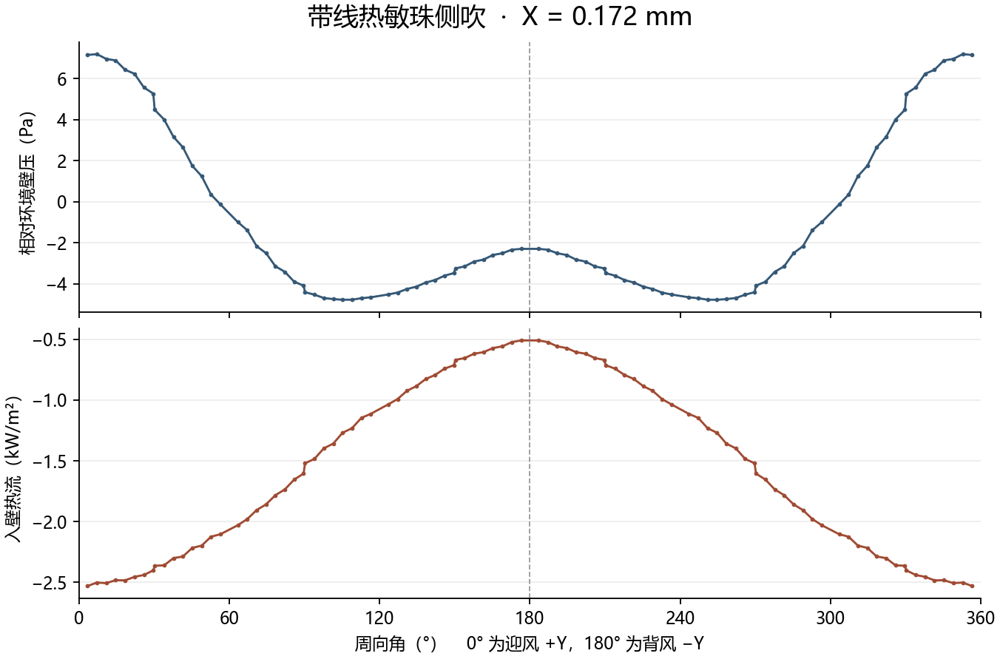

# 带线 B 型热敏珠的 3 m/s 全周侧吹

固定试件长轴沿 +X，空气沿 −Y 以 3 m/s 侧吹，来流 293.15 K、101325 Pa，整壁给定 299.15 K。本工况首次同时算出壁压和入壁热流的原面为 **10,272 / 10,272 面，3.19665061 mm²**。相对 v310 使用同一件几何，新增几何为 0 面、0 m²。全表面向空气放热 **5.743198 mW**，其中珠面和接头为 **5.129277 mW**。侧吹的逐面联合实验验证面积为 **0 m²**。[完整原面与工况包](../../../cases/thermistor_b/sidewind3.zip) · [三维页](../../../outputs/v311_validation/ui02/workbench/index.html)

## 同一截面的迎风与背风差异

在 X = 0.172 mm 处，以下两段的周向中点相隔 180°。压力为相对来流的表压，热流正号表示入壁。热珠向冷空气放热，因此此处入壁热流为负。迎风位置的表压高约 **9.45 Pa**，单位面积放热约为背风位置的 **4.96 倍**。

| 位置 | 原面号 | 方位角 | 表压（Pa） | 入壁热流（W/m²） |
|---|---:|---:|---:|---:|
| 迎风 +Y 附近 | 121 | 3.47° | +7.155 | −2529.51 |
| 背风 −Y 附近 | 5257 | 183.47° | −2.294 | −509.52 |

全表面绝对壁压范围为 101312.86–101337.50 Pa，入壁热流为 −13775.44 至 −482.69 W/m²，首层流体温度为 298.54185–299.13267 K。最大放热出现在前引线端面第 10267 面，质心 (0.87610, 0.02244, −0.00088) mm。这里的“前引线”沿用试件轴向命名，迎风方向由 +Y 辨认。[全部面与截面核对](evidence/verification.json)

| 暴露区域 | 面数 | 向空气放热（mW） |
|---|---:|---:|
| 后引线端面 | 336 | 0.018225 |
| 后引线侧面 | 1152 | 0.289516 |
| 后接头 | 576 | 0.008650 |
| 珠面 | 6144 | 5.112054 |
| 前接头 | 576 | 0.008573 |
| 前引线侧面 | 1152 | 0.287961 |
| 前引线端面 | 336 | 0.018219 |

## 算法与验收范围

第二档的实际子午体网扩展到完整 360°。轴线和接缝共用节点，48 个方位各有独立的速度、压力和标量自由度。成品含 158,180 个节点、278,688 个体单元、5,184 个原生壁片。1,536 个远场面共用半径 20 倍珠体横径的球面外边界。在均匀侧吹参考流中，768 面迎入、768 面流出，积分参考质量流量分别为 0.003900396 kg/s。这个几何检查与实际求解后的能量核对分开。[网格及原面映射检查](audit_mesh.py)

固定的官方 SU2 8.6.0 求解三维不可压、恒物性、层流稳态方程及强等温被动标量。FDS 原生弱远场用内部状态、实际外法向和外侧来流态装配边界通量。壁面无滑移。绝对壁压由同方位壁节点的表压平均后加参考压力。热流取强约束壁节点反力，按相邻真实三角面面积的三分之一守恒分配。全周倍数为 1，温差尺度为 6 K。首层温度取对应本面三个首层节点的标量平均并换算为 K。壁温为给定边界，固体温度独立求解仍为空。[冷态与体网](../../../scripts/thermistorLeadCrossflow.py) · [壁面反力和热量核对](../../../scripts/thermistorCrossflowSurface.py)

冷态第一段完成 400 步并正常保存，此时焓残差末窗最大 −5.886，未通过。以该终帧续算再完成 790 步，六项 log₁₀ RMS 的末 20 行最大值分别为 −13.361、−13.179、−12.724、−13.189、−10.884、−12.245（p、u、v、w、h、强温差标量）。原生终帧 SHA256 为 `324fcdd08155996c0b3119223e34b459651292de205d6d97c61429ceb30a6cdc`。这 1,190 步是稳态迭代。初场、周期场和两段正常终点均保存在 E 盘。

追加 20 步后，壁反力给出的总放热相对变化为 3.08×10⁻⁹。官方单步与同输入观察器的最大状态差为 1.71×10⁻¹³。壁面放热 5.743197834 mW，远场净流出 5.743197625 mW，相对差 **3.64×10⁻⁸**。由原生摩擦系数和实际首层法向距离估算的 y⁺ 为 0.00816–0.14620。本版提供此离散条件下的全表面研究解。侧吹的外域、网格敏感性、流动稳定性和同位置实验误差仍待验证。[原生回执、独立热量账与工作台截面 CSV](evidence/receipts.zip)

## 运行与复现

运行 `rocketAeroHeatWorkbench`，选「带引线 B 型热敏珠」，在网格页选择「360° 全周 · 3 m/s 侧吹」。生成试件体网，确认侧吹边界，可选「读取同网格已算结果」或「从冷态计算当前试件」。在结果页选择「相对环境壁压」或「入壁热流」，拖动 X 截面或拾取原面即可查看真实方位上的局部变化。读取归档会核对随源码发布的数据包。准备体网优先使用本机已有且指纹相符的第二档网；新安装可通过项目固定的 Gmsh 和 SU2 准备该网。冷态新算另需已核验的壁热观察器，或固定 SU2 构建工具目录供程序重建。[MATLAB 入口](../../../runThermistorSidewindWorkbench.m) · [依赖安装](../v296/INSTALL.md)

两段原生主计算分别用时 217.61 s 和 424.95 s，采样到的进程族峰值分别为 1.26、1.27 GiB。两次释放壁行和一次追加 20 步合计 64.96 s，独立一步控制与观察合计 33.28 s。生产侧栏的最终验收用时 34.28 s。实际走通建网、确认边界、读取归档、三维渲染、探针、截面导出与上游切换失效。复现时新算按钮调用同一组已执行的冷态、续算和热流读取程序，本轮使用已有实际计算验收归档按钮。两种变量各有 96 条截线段，独立用三角形与平面求交逐段核对端点、编号和场值。全表另由终帧和原生壁反力重算后逐面比对。

另从固定版本的网格生成器重建第二档扇区，再展开全周。新生成的体网、节点映射、原面、工况、冷态及求解配置六个文件与实际启动输入的 SHA256 逐一相同。

首次启动在 Python 缩进检查处退出，求解器尚未启动。修正后从记录的冷态进行上述求解。首轮导出检查发现表压方法文字沿用了绝对压力说明，已修正并重新验收侧栏。验收脚本初次将 MATLAB 合法化的残差字段名与原 JSON 的带括号字段名直接比较而停止，已按六个原分量逐一映射并核对数值。下载包、运行回执及校验值保留了对应关系。[复核程序](verify_delivery.py) · [输入与预算](PLAN.md)
