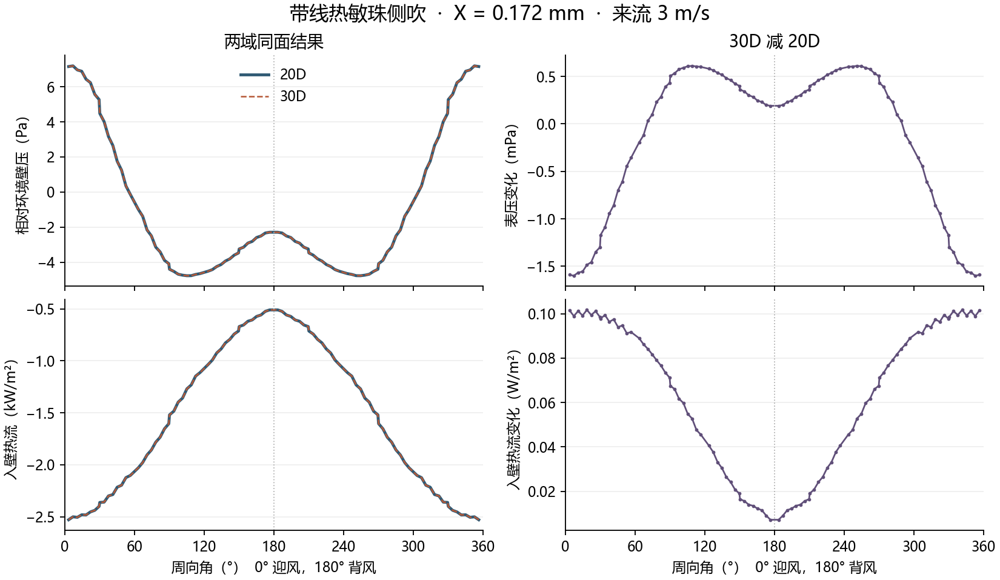

# 3 m/s 侧吹下远场半径对热敏珠放热的影响

在同一带线 B 型热敏珠上，仅将球形远场半径从 20D 扩到 30D，整件向空气放热从 **5.743198 mW** 变为 **5.742926 mW**，减少 **0.27159 µW（0.00473%）**。D 为名义珠体横径 0.93712 mm。两套解的放热峰都位于前引线端面第 **10267** 面。与 v311 的相同侧吹工况相比，新增计算覆盖 **0 面、0 m²**。两域分别覆盖全部 **10,272 面、3.19665061 mm²**。本轮量化了球形外边界位置对同一批原面结果的影响。[逐面数据包](../../../cases/thermistor_b/sidewindOuter30.zip) · [差值与来源](evidence/comparison.json)

## 全表面与局部热峰

空气沿 −Y 以 3 m/s 吹过长轴沿 X 的试件。空气为 293.15 K、101325 Pa，整个试件给定壁温 299.15 K。下表的差值均取 30D 减 20D。热流正向入壁，放热越强，入壁热流越负。首层温度取壁外第一层流体节点。

| 同面比较量 | 全表面差值范围 | 最大绝对差所在原面 | 面积加权均方根差 |
|---|---:|---:|---:|
| 绝对壁压（Pa） | −0.002514 至 +0.001837 | 10068 | 0.000737 |
| 入壁热流（W/m²） | +0.00719 至 +0.57276 | 10267 | 0.10312 |
| 首层流体温度（K） | +0.000000260 至 +0.000020522 | 10065 | 0.000003713 |

第 10267 面的入壁热流从 −13775.439 变为 −13774.866 W/m²。两域峰值面质心间距为 0。按 `−Σ(面热流 × 面积)` 计算各区向空气放热，七区全部小幅下降。珠面面积最大，对整件差值贡献 0.23710 µW。

| 区域 | 原面数 | 20D 放热（mW） | 30D 放热（mW） | 变化（µW） |
|---|---:|---:|---:|---:|
| 后引线端面 | 336 | 0.01822518 | 0.01822460 | −0.00058 |
| 后引线侧面 | 1152 | 0.28951562 | 0.28949956 | −0.01606 |
| 后接头 | 576 | 0.00864995 | 0.00864927 | −0.00068 |
| 珠面 | 6144 | 5.11205391 | 5.11181681 | −0.23710 |
| 前接头 | 576 | 0.00857334 | 0.00857266 | −0.00068 |
| 前引线侧面 | 1152 | 0.28796074 | 0.28794483 | −0.01591 |
| 前引线端面 | 336 | 0.01821910 | 0.01821851 | −0.00058 |

## 周向分布与工作台

在 X = 0.172 mm 处，30D 的迎风、背风近邻表压相差 9.4472 Pa。该截面迎风近邻的单位面积放热约为背风近邻的 4.96 倍。图左使用相同坐标范围叠放两域结果，图右单独给出差值。每条曲线均由切平面与原三角形的 96 条相交线段构成，横坐标取线段中点的方位角。

| 位置 | 原面号 | 周向角 | 20D／30D 表压（Pa） | 20D／30D 入壁热流（W/m²） |
|---|---:|---:|---:|---:|
| 迎风 +Y 附近 | 121 | 3.47° | +7.1554／+7.1538 | −2529.51／−2529.41 |
| 背风 −Y 附近 | 5257 | 183.47° | −2.2936／−2.2935 | −509.52／−509.51 |



运行 `rocketAeroHeatWorkbench`，选「选用带引线 B 型热敏珠」和「360° 全周 · 3 m/s 侧吹」。生成体网、确认边界、读取同网格已算结果，点击 **查看外边界影响 · 30D 减 20D** 即会定位最大热流差所在面。两域表压、热流和首层流体温度按变量共享色标。工作台已实际完成侧栏操作、三维渲染、CSV 导出，以及切回轴向 305.15 K 参照场的核对。独立核验从原生场和壁面反力重建了 30D 的三个场量，按面核对两域差值、10,272 行热流差 CSV、七区积分和四条周向曲线的几何端点与数值。[本机离线三维页](../../../outputs/v312_validation/ui01/workbench/index.html) · [原生回执与截面 CSV](evidence/receipts.zip)

## 算法、运行与证据范围

30D 使用官方 SU2 8.6.0 的三维不可压、恒物性、层流稳态求解和强等温被动标量，沿用 20D 的无滑移壁与弱远场条件。原域内 158,180 个节点及 278,688 个体单元逐项相同。外接五圈后共 165,630 个节点、286,368 个体单元。原球面上 1,536 个面均由两侧单元反向共用。初猜在内域取 20D 终场，外壳过渡至来流，随后重新求解整个 30D 域。终场表压由壁节点平均，绝对壁压加上环境压力。入壁热流由强温差壁节点反力按相邻三角形面积守恒分配。首层流体温度由相同位置三个首层节点的标量平均换算。固体内部温度及独立求解的壁温未知。[网格与求解程序](../../../scripts/thermistorSidewindExtent.py) · [壁面方法](../../../scripts/thermistorCrossflowSurface.py)

30D 原生主计算完成 672 次稳态迭代，耗时 383.0 s，四线程进程族采样峰值 1.34 GiB。末 20 次迭代六项 log₁₀ RMS 的最大值为 −10.886。追加 20 步后的放热相对变化为 1.61×10⁻⁹。独立同阶段核对得到壁面放热 5.742926242 mW、远场净流出 5.742926115 mW，相对差 2.21×10⁻⁸。两次壁反力读取与中间追加步合计 79.84 s，控制和观察器回放合计 47.22 s，工作台验收 67.89 s。开发、阅读和归档耗时未单独计量。[预算](NATIVE.md) · [核对程序](compare_domains.py)

此结果支持对该冻结工况两档远场半径的比较。近壁与周向离散误差、无限远场极限、真实流动的非定常影响及局部预测精度仍待核实。论文报告珠部平均换热，当前侧吹工况的逐面壁压与热流联合实验验证面积为 **0 m²**。名义引线与接头的几何假设沿用带线基线。自绘模型单独记账。[试件与实验定义](../v309/RESULTS.md) · [实验原文](https://doi.org/10.1299/kikai1938.25.810)

## 本机复算

20D 体网和正常终场分别位于 `outputs/v311_validation/cold01`、`outputs/v311_validation/steady02`。30D 初猜、主计算和热量收支位于 `outputs/v312_validation/prepared01`、`outputs/v312_validation/steady01`。大型体场仅保存在 E 盘。发布包包含完整逐面数据及小型回执。20D 来源帧为 `324fcdd08155996c0b3119223e34b459651292de205d6d97c61429ceb30a6cdc`，30D 终帧为 `bee356c531d5609a7d5f59950a57b603cdcb71c72e5ea0a1103e3cb430c1e979`。[发布包指纹](../../../cases/thermistor_b/sidewindOuter30.json)

在项目根目录、具备求解器和观察器的安装上，可用以下命令写入新的输出目录。其他机器可用经同工况壁热与收支核验的本机 20D 终帧，程序记录其实际指纹。本次求解使用的源码快照随回执保存。最终版本重建的六个输入和网壳核对 JSON 与本次原始输入逐字相同。[安装说明](../v296/INSTALL.md) · [20D 复现入口](../v311/RESULTS.md)

```powershell
python scripts/thermistorSidewindExtent.py prepare outputs/v311_validation/cold01 outputs/v311_validation/steady02 outputs/v312_replay/prepared
python scripts/thermistorSidewindExtent.py run outputs/v312_replay/prepared outputs/v312_replay/steady --steps 1000
python scripts/thermistorCrossflowSurface.py outputs/v312_replay/steady
```
