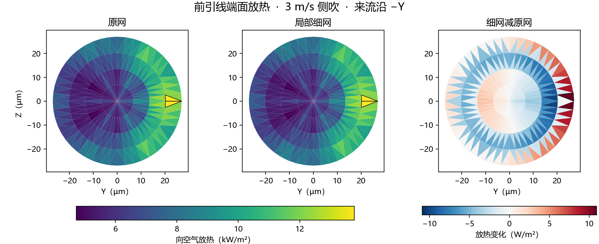

# 20D 热敏珠侧吹的前引线端面近壁对照

把前引线端面的首层距离减半后，**最强放热密度由 13,775.439 降至 13,775.125 W/m²**。两套网的最强区域都是前端面迎风缘的一对共边镜像面。第 10267 和第 209 面的名次交换，细网中两者只差约 9.8×10⁻¹⁰ W/m²。整件放热减少 **1.264 nW**。相对 v311 的 20D 基线及 v312 的外域对照，新增计算覆盖 **0 面、0 m²**。同工况两套近壁网均算出全部 **10,272 面、3.19665061 mm²** 的壁压与热流，本次量化了局部法向网距的影响。逐面联合实验验证面积为 **0 m²**。[原面结果包](../../../cases/thermistor_b/sidewindTipSpacing.zip) · [定量对照](evidence/comparison.json)

| 同一试件、同一热边界 | 原 20D 网 | 前端面细网 | 变化 |
|---|---:|---:|---:|
| 整件向空气放热（mW） | 5.743197834 | 5.743196570 | −0.0000220% |
| 前引线端面放热（µW） | 18.219095 | 18.215785 | −0.01817% |
| 全表面最强放热密度（W/m²） | 13775.439 | 13775.125 | −0.00228% |
| 前两名原面号 | 10267、209 | 209、10267 | 均在前端面迎风缘 |
| 原 10267 面及三个共边邻面的总放热（µW） | 0.500263 | 0.500298 | +0.000035 µW |

两峰面质心的 X、Y 均为 876.1044、22.4423 µm，Z 分别为 −0.8811、+0.8811 µm。三顶点关于 Z = 0 镜像后的最大偏差小于 2.1×10⁻²⁰ m。在各自网格上看两面之差，原网约为 3.14×10⁻⁹ W/m²，细网约为 9.79×10⁻¹⁰ W/m²。现有结果能定位这个双面热区，无法支持其一侧在物理上持续更热。下图左、中共享放热色标，黑线标出这两个面。右图给出端面逐面放热密度变化，黑线标出端面内绝对变化最大的面。



**温度要在相同的位置比较。** 在原热峰面 10267，原首层流体为 298.620177 K；细网离壁更近的第一层为 298.877742 K。在细网中读取原首层的同一组物理节点，所得温度为 298.620281 K，与原网只差 **+0.000104 K**。细网全表面的同位置温差最大绝对值为 0.001291 K。两网绝对壁压的最大绝对差为 0.15880 Pa（210 面），入壁热流的最大绝对差为 15.70759 W/m²（207 面，前引线侧面）。温差、壁压差与热流差的面积加权均方根分别为 0.00004302 K、0.004245 Pa、0.43764 W/m²。[两网全场、邻面、七区与热峰明细](evidence/comparison.json)

## 数值与工作台验收

细网主计算完成 985 个稳态迭代，耗时 440.19 s，采样进程族峰值 1.30 GiB。六项残差末 20 步中最大的 log₁₀ RMS 为 −10.9124。追加 20 步后总放热相对变化 1.07×10⁻¹¹。壁面放热 5.7431965696 mW，远场净流出 5.7431965707 mW，相对收支差 −1.85×10⁻¹⁰。端面的首层 y⁺ 根据实际壁面摩擦系数和法向距离估算，原网为 0.06668–0.13494，细网为 0.03410–0.06865。两次壁反力及中间追加步共用 83.49 s，官方与观察器同态回放共用 45.14 s。开发与归档用时未单独计量。[原生预算](NATIVE.md) · [终帧、能量账与工作台回执](evidence/receipts.zip)

工作台首轮走通两套网的字段与导出。识别出镜像面的名次交换后，界面增加了第二强面及实际差值，并通过第二轮正式侧栏验收（50.20 s）。热流差与同位置温差各导出 10,272 行。在 X = 0.864 mm 的前引线截面，全部 96 条线段的面号、端点和热流均通过独立几何求交复核。已从两套原生终帧与壁行反力独立核对各自壁压、热流、温度和七区功率。两档法向网距给出了观测差值，完整空间收敛阶、周向网距影响和侧吹局部实验误差仍未知。[本机离线三维页](../../../outputs/v313_validation/ui02/workbench/index.html) · [独立核对程序](verify_delivery.py)

## 网格与温度采样

试件为名义带线 B 型热敏珠。沿 −Y 吹入 3 m/s、293.15 K、101325 Pa 空气，壁温给定为 299.15 K。远场半径为珠体横径的 20 倍，周向有 48 个间隔。基线是 v311 正常终场，执行起点为 v312 的 `5b929196c565489dcbe9e319ab1e525f8f18eada`。本轮修改范围为热敏珠近壁网格及其工作台结果。[运行计划](PLAN.md) · [上轮外域对照](../v312/RESULTS.md)

前端面 336 面的首层法向距离从 **0.937123 µm 降到 0.468562 µm**。相邻直引线有 288 个面的首层也发生变化，细网距离为 0.46756–0.77926 µm。每个距离取三个顶点至其对应流体节点的位移在本面法向上的投影均值。受影响的原面位于 X = 0.80110–0.87610 mm。336 个父单元各拆为两个子单元，加入 289 个法向边中点。其余 278,352 个体单元的有序顶点编号与基线逐项匹配。每个内面均由两侧反向共用，拆分后的子单元体积和相对父单元的最大差为 1.23×10⁻¹⁵。[独立读回程序](audit_mesh.py)

原来的首层节点全部保留。细网云图可以分别读取离壁更近的新首层和旧首层位置；两网同位置温差直接取旧首层节点上的温度差。这样可以区分近壁解本身的变化与采样点靠近热壁造成的变化。两套网均采用 SU2 8.6.0 的三维不可压、恒物性层流解；壁压按本面壁节点平均，热流由强等温标量壁节点反力按邻接三角面面积守恒分配，首层流体温度来自该层三个节点的温差标量。热流正向入壁，表格中“放热”取相反数。固体内部温度未知。[细网构造](../../../scripts/thermistorLeadTipSpacing.py) · [壁反力与能量账](../../../scripts/thermistorCrossflowSurface.py)

## 查看与复算

在 MATLAB 运行 `rocketAeroHeatWorkbench`，选择「选用带引线 B 型热敏珠」及「360° 全周 · 3 m/s 侧吹」，生成体网、确认边界并读取结果。点击「前引线端面网距」定位细网热峰，当前云图显示该面相对原网的入壁热流差。切换变量可查压力、近壁温度、算法、网距及适用工况。配套 CSV 按工作台从 1 开始的面号导出。[MATLAB 参照数据入口](../../../attachThermistorTipSpacing.m)

本机基线网和来源帧分别在 `outputs/v311_validation/cold01` 与 `outputs/v311_validation/steady02`。局部细网和原生场位于 `outputs/v313_validation/prepared01` 与 `outputs/v313_validation/steady01`。大型场保存在 E 盘。下列命令使用新的输出目录。20D 源帧须有同工况的壁反力与守恒回执。[依赖安装](../v296/INSTALL.md) · [20D 基线复现](../v311/RESULTS.md)

```powershell
python docs/validation/v313/run_mesh.py prepare outputs/v313_replay/prepared
python docs/validation/v313/run_mesh.py audit outputs/v313_replay/prepared
python docs/validation/v313/run_steady.py outputs/v313_replay/prepared outputs/v313_replay/steady --steps 1000
python scripts/thermistorCrossflowSurface.py outputs/v313_replay/steady
```
