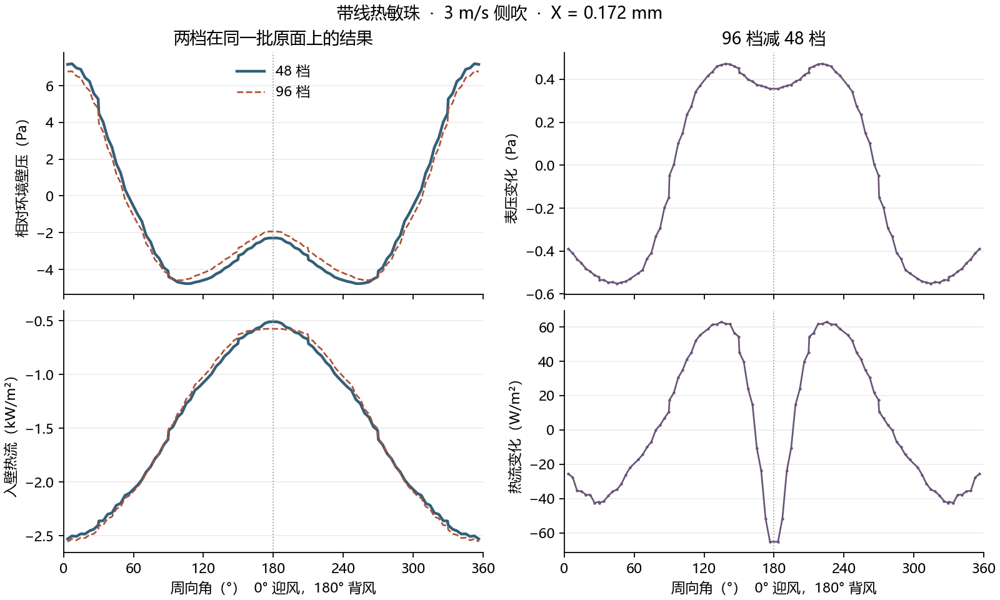

# 带线热敏珠侧吹的周向网距对照

将 20D 带线 B 型热敏珠的流体网格从 48 个周向间隔细化到 96 个后，整件向空气放热从 **5.743197 降至 5.722993 mW（−0.3518%）**。前引线端面迎风缘的两个共边镜像原面仍是最强放热区，原面平均峰值下降 **3.350%**。在 X = 0.172 mm 截面，迎风近邻的单位面积放热增加 **1.01%**，背风近邻增加 **12.77%**。整件功率的变化幅度不足以代表背风局部的网距敏感性。[证据与七区清单](evidence/comparison.json)

两套网均计算了 **10,272 面、3.19665061 mm²** 的壁压和热流。相对 v313，新增覆盖 **0 面、0 m²**。本版量化了此前未检验的周向离散影响，并把两档实际解映射回相同原面。该侧吹工况的逐面壁压、热流联合实验验证面积为 **0 m²**。[96 档结果包](../../../cases/thermistor_b/sidewindAngular96.zip) · [本机三维页](../../../outputs/v314_validation/ui01/workbench/index.html)

## 迎风、背风和引线端面

表压相对 101325 Pa。入壁热流取正，因此下表的负值表示试件向空气放热。每条曲线包含平面实际切出的 96 条原面线段，周向角取线段中点方位。

| X = 0.172 mm | 原面号 | 方位 | 表压 48／96 档（Pa） | 入壁热流 48／96 档（W/m²） |
|---|---:|---:|---:|---:|
| 迎风 +Y 近邻 | 121 | 3.47° | +7.1554／+6.7656 | −2529.51／−2555.03 |
| 背风 −Y 近邻 | 5257 | 183.47° | −2.2936／−1.9377 | −509.52／−574.59 |



前端面第 209 和 10267 面分别位于 Z = +0.8811 和 −0.8811 µm。48 档的排序为 209、10267，96 档为 10267、209，96 档两面只差约 1.85×10⁻⁷ W/m²。两套网的原面最大放热密度为 13775.125 和 13313.687 W/m²。96 档**细三角形**自身的最大平均放热为 13821.292 W/m²，采样面积比原三角面小。工作台在同面积比较时使用原面峰值。

| 向空气放热 | 48 档（mW） | 96 档（mW） | 相对 48 档 |
|---|---:|---:|---:|
| 后引线端面 | 0.018225 | 0.018087 | −0.760% |
| 后引线侧面 | 0.289516 | 0.287346 | −0.749% |
| 后接头 | 0.008650 | 0.008494 | −1.798% |
| 珠面 | 5.112054 | 5.097034 | −0.294% |
| 前接头 | 0.008573 | 0.008404 | −1.975% |
| 前引线侧面 | 0.287963 | 0.285558 | −0.835% |
| 前引线端面 | 0.018216 | 0.018070 | −0.802% |

全表面入壁热流、表压、共同位置首层温度的最大绝对变化分别为 696.38 W/m²（213 面）、1.3521 Pa（5542 面）、0.011811 K（222 面）。面积加权均方根差分别为 47.422 W/m²、0.41911 Pa 和 0.002163 K。将 **48 档原有的节点密度和表压** 线性延拓至弦中点，单独走一遍 96 档的面平均，得到的热流与表压均方根差为 3.4680 W/m²、0.001539 Pa。5257 面在这个读数对照中的入壁热流变化为 +0.0148 W/m²，两套实际求解却相差 −65.07 W/m²。该试验只检验重构对已有节点场的影响；完整的空间误差、非定常影响及实验偏差仍待核实。[逐原面核对](verify_angular.py)

## 计算与工作台验收

三段稳态计算依次完成 440、400、180 步，用时合计 1504.20 s。前两段的焓末窗为 −6.789、−7.932。第三段末 20 步中最大的六分量 log₁₀ RMS 为 −8.356，原生终帧为 `f3d3253abf0f054bad38b874f95faad821291e8aca8803694bf7576ceda45fb4`。追加 20 步后总放热相对变化 1.17×10⁻⁷。同阶段的壁面放热为 5.722992919 mW，远场净流出为 5.722957349 mW，相对收支差 6.22×10⁻⁶。独立观察器与官方一步的最大状态差为 1.71×10⁻¹³。96 档以原生壁节点摩擦和实际法向距离估算的首层 y⁺ 范围为 0.00550–0.14623。[分段记录](STAGES.md) · [原生终态、能量账与工作台回执](evidence/receipts.zip)

建网 11.05 s，独立网格读回 13.88 s，主计算进程族采样峰值 2.53 GiB。官方两次壁反力与中间追加步合计 182.95 s，独立控制和观察器回放合计 96.29 s。工作台验收 89.56 s，已点选 96 档热峰、核对同量共同色标，导出三个差值全表各 10,272 行及四条截线。逐面数值从两套原生终帧和壁反力独立重建，四条曲线的端点、面号和数值均已核对。开发、阅读与归档耗时未另计。[工作台验收入口](check_angular_ui.m)

## 相同几何上的两套网

3 m/s 空气沿 −Y 吹过长轴沿 X 的名义带线 B 型热敏珠，空气为 293.15 K、101325 Pa，表面给定 299.15 K。两套网均采用 20D 外域和 v313 的前引线端面细化。将 48 个周向间隔二分为 96 个时，新节点取原边的弦中点，保持原来的多面体壁面与远场轮廓，以便单独观察周向离散的影响。[输入与比较合同](PLAN.md)

体网从 279,024 个单元、158,469 个节点增至 558,048 个单元、316,821 个节点。原有节点与细网中的偶数子午面逐一重合。10,368 个原生壁片覆盖 20,544 个读数用细三角形。这些三角形与 10,272 个原报告面产生 30,720 个正面积交叠。每个子单元体积占父单元的一半，最大比例偏差 4.28×10⁻¹⁴。对原面逐个核对，最大面积相对误差 1.00×10⁻¹⁴，面积质心最大误差 6.84×10⁻¹⁸ m。[建网程序](../../../scripts/thermistorAngularSpacing.py) · [独立几何与积分核对](audit_angular.py)

## 压力、热流和温度的读数方法

两网采用官方 SU2 8.6.0 的三维不可压、恒物性、稳态层流解。整壁无滑移，强等温被动标量按 6 K 温差换算。细网初猜的原节点来自实际 48 档终帧，新周向节点的初值由两端均值给出。之后全域所有自由度参与求解。[原生预算](NATIVE.md)

- **热流。** 在最终强等温状态释放壁行，独立读取原生节点反力。用相邻细三角面积各三分之一之和把节点功率换成面密度，再将分片线性密度在每个“细面与原面交叠区”上积分。最后除以原面面积，给出正向入壁的 W/m²。所有原面的功率加总回到实际壁面总反力。
- **压力。** 对细网壁节点的表压采用相同的交叠积分。报告的绝对壁压等于原面平均表压加 101325 Pa。两档的压力差沿用相同参考压力。
- **温度。** 在 v313 的每个原三角面对应的三个实际首层节点上读取两套解并取平均。比较的是完全相同的物理位置，包括前引线端面的 0.468562 µm 首层。均匀壁温是输入，独立固体温度场仍未知。

映射的生产实现采用三角形裁剪。独立核验重新枚举两三角形的顶点、边交点，对交叠凸多边形求面积与一阶矩，逐细面核对全部三个线性权重。两种构造的最大差为细面面积的 4.40×10⁻¹⁴。[壁面热量账](../../../scripts/thermistorCrossflowSurface.py) · [独立逐面与截面核对](verify_angular.py)

## 查看与复算

在 MATLAB 运行 `rocketAeroHeatWorkbench`。选「带引线 B 型热敏珠 → 360° 全周 · 3 m/s 侧吹」，生成体网、确认边界后读取同网格已算结果。结果页点「周向网距 · 48 与 96 档」定位 96 档在原面上的最大放热区。变量菜单可切换原面热流、表压、同位置首层温度和各自的差值。48 档参照为「端面细网」。整表 CSV 的配套 JSON 记录两套终帧、积分映射及七区功率。[MATLAB 结果入口](../../../attachThermistorAngularSpacing.m)

本机 48 档已验收体网与终场在 `outputs/v313_validation/prepared01`、`outputs/v313_validation/steady01`。新安装需要已核验的 48 档同工况解与固定的求解器、壁热观察器。其他安装目录可用 `run_mesh.py prepare` 的 `--base`、`--seed` 指定两者。大型体场保存在 E 盘。[48 档复算](../v313/RESULTS.md) · [依赖安装](../v296/INSTALL.md)

本机 96 档输入在 `outputs/v314_validation/prepared01`，分段终场在 `steady01` 至 `steady03`。以下命令在新目录复现本轮。各次续算先核实前段正常、检查点身份、温界与末窗；其他机器实际达到门槛的段数可不同。壁反力从通过末窗的对应终场读取。

```powershell
python docs/validation/v314/run_mesh.py prepare outputs/v314_replay/prepared
python docs/validation/v314/run_mesh.py audit outputs/v314_replay/prepared
python docs/validation/v314/solve_angular.py outputs/v314_replay/prepared outputs/v314_replay/first --steps 440
python docs/validation/v314/solve_angular.py outputs/v314_replay/prepared outputs/v314_replay/second --parent outputs/v314_replay/first --steps 400
python docs/validation/v314/solve_angular.py outputs/v314_replay/prepared outputs/v314_replay/third --parent outputs/v314_replay/second --steps 180
python scripts/thermistorCrossflowSurface.py outputs/v314_replay/third
```
