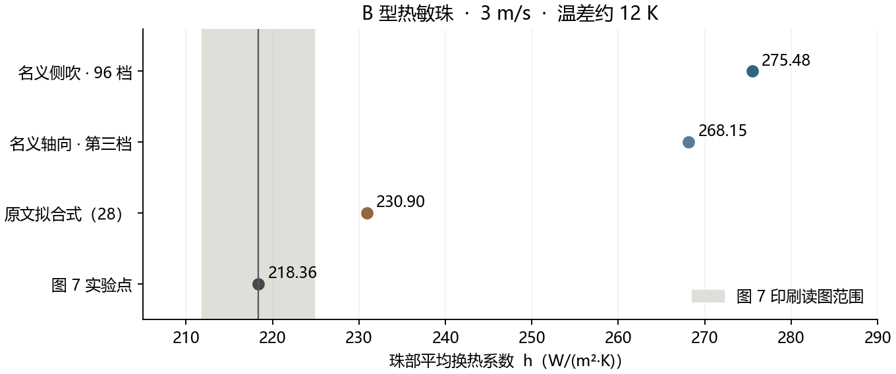

# B 型热敏珠在风洞图 7 测点的珠部换热

在 3 m/s、名义温差 12 K 的 B 型珠测点，96 档侧吹计算得到**珠部平均换热系数 275.48 W/(m²·K)**，比坪内、佐藤图 7 的 218.36 W/(m²·K) 高 **26.16%**。按印刷图读数的上下限计算，偏高范围为 22.54%–30.00%。这组模型给出的珠部换热高于测点的整个读图范围。安装角、实际珠形、引线热边界、数值离散各自贡献多少，目前没有分项证据。[定量对照](evidence/comparison.json) · [实验原文](https://doi.org/10.1299/kikai1938.25.810)

| 3 m/s、约 12 K 测点 | 珠部平均 h（W/(m²·K)） | 珠部放热（mW） | 相对图 7 中心读数 |
|---|---:|---:|---:|
| 图 7 实测读图，取 12 K 换算功率 | 218.36 | 8.10716 | — |
| 名义侧吹，96 档三维层流 | 275.48 | 10.22786 | +26.16% |
| 名义轴向，已验收第三档三维层流 | 268.15 | 9.95593 | +22.80% |
| 原文强迫对流拟合式（28） | 230.90 | 8.57294 | +5.75% |

式（28）使用与论文相同系列数据得到的关联式，此处是该公式在测点附近的复算。物性按 299.15 K 膜温取值，长度雷诺数 65.696。三维解采用既有恒物性空气与名义几何。两种姿态使用的体网也有差别，表中差值不能单独归因于安装角。



与 v314 的 6 K 侧吹工况相比，本版首次在 **12 K 侧吹工况** 给出全部 **10,272 个原面、3.19665061 mm²** 的壁压与热流。按相同几何编号，新增覆盖 **0 面、0 m²**。这一风洞测点提供珠部平均量的一项对照，逐面壁压与热流联合实验验证面积仍为 **0 m²**。[完整测点归档](../../../cases/thermistor_b/windPoint12.zip) · [换算三维页](../../../outputs/v315_validation/ui01/solve/workbench/index.html) · [直接边界三维页](../../../outputs/v315_validation/ui01/archive/workbench/index.html)

## 七区放热与数值检查

整件向空气放热 **11.44598 mW**。其中珠面与两接头贡献 10.22786 mW，两段裸露引线与端面贡献 1.21812 mW。最大放热位于工作台第 10267 面，入壁热流为 −26627.33 W/m²。全表面绝对壁压范围为 101313.684–101336.823 Pa，给定壁温为 305.15 K，首层流体温度为 303.9184–305.1117 K。

| 暴露区域 | 向外放热（mW） |
|---|---:|
| 后引线端面 | 0.036173 |
| 后引线侧面 | 0.574692 |
| 后接头 | 0.016989 |
| 珠面 | 10.194067 |
| 前接头 | 0.016808 |
| 前引线侧面 | 0.571116 |
| 前引线端面 | 0.036139 |

首次将 v314 的 6 K 终帧换算，与在此基础上继续推进 40 步的独立 12 K 边界比较，最大壁压差 0.001920 Pa，超过事前的 0.001 Pa 门槛。热流与温度已过门槛。为区分迭代漂移和温差效应，从同一终帧在原 6 K 边界也推进 40 步。6 K 场自身的最大壁压漂移为 0.001919908 Pa。同位置、同推进步数比较，两条分支的最大压力差为 **1.02×10⁻¹⁰ Pa**，最大入壁热流差为 **2.04×10⁻⁸ W/m²**，共同首层温差为 **2.84×10⁻¹³ K**，整件功率相对差为 **3.81×10⁻¹⁴**。两份分支均从同一已收敛的动力场起步，直接边界核对检验恒物性被动标量的线性与单位处理。它不提供独立冷启动验证。[首次超差与补充合同](MATCHED.md) · [原始回执](evidence/receipts.zip)

12 K 原生终帧的六分量末 20 步最大 log₁₀ RMS 为 −8.451。再推进 20 步，放热相对变化 1.03×10⁻⁷。独立同阶段检查得到试件放热 11.445983237 mW、远场净流出 11.445921491 mW，相对差 5.39×10⁻⁶。两条分支的主推进分别用时 86.12 s（12 K）和 88.91 s（6 K）；各自的两次壁反力与追加步合计 185.03 和 185.82 s，两套官方／观察器回放合计 88.75 和 88.97 s。开发、原文阅读、归档耗时未另计。

实际 MATLAB 侧栏验收用时 42.84 s。两条路径的壁压、热流、给定壁温、共同首层温度、峰值原面与七区功率均从其对应原生场或反力逐项核对。各自的 X = 0.172 mm 截面都验证了 96 条真实截线。确认切回 48 档后旧工况和结果失效。单变量 CSV 配套 JSON 包含原图读数、两份源帧与适用范围，压力／热流联合 CSV 逐行包含换算比例、来源和实验测量口径。[侧栏验收](check_point_ui.m) · [逐面复核](verify_point.py)

## 试件安装与实验测量

坪内、佐藤在水平气流中测量近球形热敏珠。论文第 813 页讨论流体中直立的导线（「直立しておかれた導線」），第 814 页说明 3 m/s 及以上使用吸入式风洞，气流速度经校准皮托管核对。第 811 页图 1 为显微照片，用于辨认珠体与两侧引线。结合这几条证据，名义模型取与引线轴垂直的侧吹。未找到 B 珠长轴相对来流的测得角度或安装公差。第 817 页式（31）的角度是强迫来流与竖直方向的夹角，不能据此给珠体角度赋值。轴向结果作为另一种名义姿态单列。[论文，第 810–814、817 页](https://doi.org/10.1299/kikai1938.25.810)

作者从电流、电压扣除外部电阻后计算珠体发热，第 812 页式（2）给出总电热，式（3）估算辐射，式（5）至（13）处理两根铂铑支线带走的热量。第 811 页表 1 给 B 珠名义面积 3.094 mm²、引线直径 0.054 mm。计算对照量取珠面与两个接头的向外对流功率，除以名义面积及当前温差。整件计算还包括两根外露引线及端面，对它们的对流积分单列。它们的积分与作者扣除的沿支线导热各有独立物理定义。

珠温由热敏珠电阻标定得到。第 818–819 页附录指出电阻反映内部引线之间的平均温度，并估算其与表面温度的差异。文中模型估算的最大约 3% 不能作图 7 单点的仪器不确定度。模型取静压 101325 Pa、空气 293.15 K、整个名义外壁给定 305.15 K。实际固体温度梯度、支架温度及逐面热流的实验误差仍未知。

图 7 的 3 m/s 测点经线性刻度读得温差 12.109 K，范围 10.999–13.219 K；图 8 的同点在对数刻度上为 11.945 K，范围 11.432–12.491 K。本次取两者均支持的 **12.000 K**。珠部平均换热系数取图 7 纵轴读数 218.3569 W/(m²·K)，点宽、线宽和刻度定位给出 211.9001–224.8137 W/(m²·K)。这是印刷图的读取范围。与 12 K 和名义面积相乘可得到对应的等效珠部对流功率。该功率是换算量。[图 7 标定](../v282/evidence/comparison.json) · [图 7、8 测点核对](../v309/RESULTS.md)

## 使用工作台

在 MATLAB 运行 `rocketAeroHeatWorkbench`，选「带引线 B 型热敏珠 → 96 档侧吹 · 图 7 风洞测点」。生成体网并确认 305.15 K 的热边界后，点 **计算 12 K 测点**。计算用同网 6 K 基底的壁反力与首层超温按 12/6 换算，压力来自该基底的恒密度流场。也可点 **读取独立 12 K 原生结果** 查看另一条数值路径。该路径使用 24 K 标量单位和 0.5 的原生壁值。两个按钮绑定不同源帧，各自保留计算方法与热边界。

结果页的表格比较珠部平均量。三维云图、点选面元与 X 截面仍显示逐面计算值。独立热边界的对照使用 20D 全域、558,048 个体单元、316,821 个节点、20,544 个细壁三角形，按交叠积分映射至 10,272 个报告面。正热流入壁，放热以相反符号列出；壁温为给定条件，首层流体温度取两份解共同的节点。本机无 96 档缓存时，网格页可从试件几何重建体网和节点映射。独立重建已获得与 v314 原生启动输入相同的网格和映射 SHA256。[网格入口](../../../scripts/thermistorMeasuredMesh.py) · [测点计算](../../../runThermistorMeasuredPoint.m) · [网距与局部误差](../v314/RESULTS.md)

本机大场在 `outputs/v315_validation/native01`（12 K）及 `six01`（同步 6 K），无缓存建网读回位于 `rebuilt01`。发布包含两套逐面数据、命令、源指纹及小型回执。以下命令在项目根目录将原生核验写入新的目录。异机先按 v314 的步骤取得本机原生终场及其壁热回执。两条路径的确切起步帧与结果独立记录。[依赖安装](../v296/INSTALL.md) · [v314 原生复算](../v314/RESULTS.md)

```powershell
python docs/validation/v315/check_native.py outputs/v314_validation/steady03 outputs/v315_replay/native01
python scripts/thermistorCrossflowSurface.py outputs/v315_replay/native01
python docs/validation/v315/matched_six.py outputs/v314_validation/steady03 outputs/v315_replay/six01
python scripts/thermistorCrossflowSurface.py outputs/v315_replay/six01
python docs/validation/v315/package_point.py outputs/v315_replay/native01 outputs/v315_replay/six01 outputs/v315_replay/package
```
