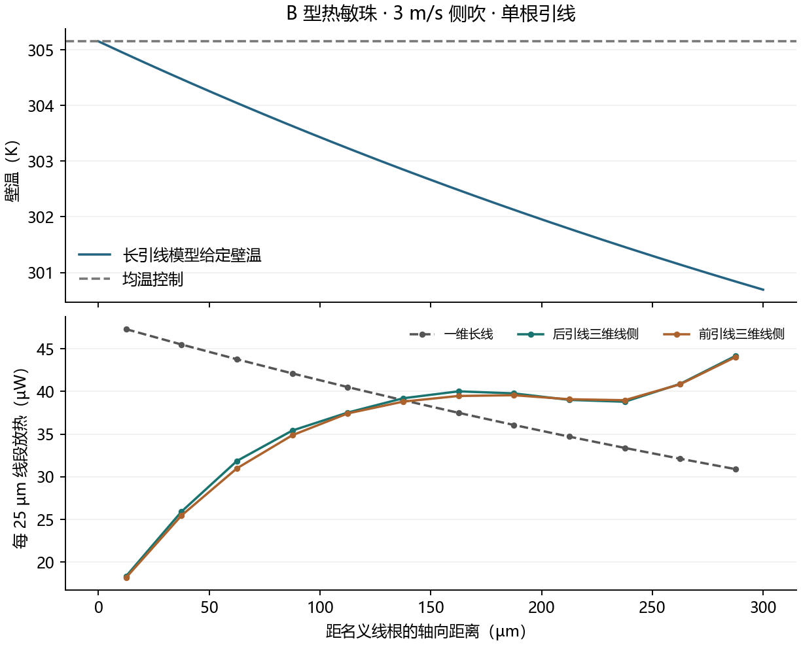

# B 型热敏珠的长引线热边界对照

在同一 3 m/s 风洞测点，珠部及线根给定 305.15 K，引线沿轴向降温到名义线端的 **300.6924 K**。与同起点、同为 640 步的均温三维解相比，整件放热从 **11.44598 降到 11.14834 mW**，珠部含接头放热却**增加了 0.01800 mW**。珠部平均换热系数从 275.47572 升到 **275.96054 W/(m²·K)**。图 7 中心读数为 218.35690 W/(m²·K)，偏高幅度从 26.16% 变为 **26.38%**。在这一模型假设下，改变引线热边界没有解释原先约 2.12 mW 的珠部放热差额。[本机三维页](../../../outputs/v317_validation/ui03/workbench/index.html) · [原生全表面数据包](../../../cases/thermistor_b/longWire12.zip) · [同步对照数据](evidence/comparison.json)

两套新解均覆盖同一 10,272 个原面、3.19665061 mm²。相对 v316 新增几何覆盖 **0 面、0 m²**。本版首次在该工况从逐节点非均匀壁温直接计算完整三维流体温度、壁压和热流，并把给定壁温及每个原面的热流变化接入工作台。逐面壁压和热流的联合实验验证面积仍为 **0 m²**。论文测得珠部平均量，未给出此处两个名义线端的实测温度。[工况与预算](PLAN.md) · [边界方程和原文依据](METHOD.md)

## 根部导热和外表面放热

单根线的一维模型给出根部轴向导热 1.24591 mW，到 0.300 mm 截点仍有 0.78310 mW 沿线传出，两者相差 0.46282 mW。用论文式（13）的舍入系数单独复算，两根线合计根部导热为 2.49201 mW，与按温度梯度算得的 2.49183 mW 一致到原式有效数字。

| 功率，mW | 后引线 | 前引线 |
|---|---:|---:|
| 一维模型的线段侧面放热 | 0.462815 | 0.462815 |
| 三维流体解的线段侧面放热 | 0.430899 | 0.427688 |
| 三维流体解的暴露端面放热 | 0.021967 | 0.021920 |

两根线的三维线侧放热分别比一维孤立长线关联低 6.90% 和 7.59%。差异沿程变化明显，靠近珠根的第一段三维放热约 18 µW，孤立长线模型约 47 µW；靠近端面的最后一段三维放热反而更高。三维热量账闭合说明空气域收支一致。线内导热在本版单向提供温度边界，一维与三维的局部通量差仍保留。端面放热、跨截点的轴向导热及实验扣损分别报告。[分段功率与温度 CSV](evidence/wire_bands.csv)



## 同步数值对照

从 v316 正常终帧 `24ff2472e2467b929bc7ab7752f47bd2f402137504cf2c72408ceeb00d917754` 起步。两条分支的初态逐节点对照，只有真实壁节点的强温差标量按新边界改变。新驱动在同一均温状态执行一步，与官方 SU2 8.6.0 的最大状态差为 1.14×10⁻¹³。引线分支实际推进两段各 320 步，第一段的末 20 步六项残差最大值为 −7.6961，第二段为 **−8.5746**。同位置均温分支用官方程序同样推进两次 320 步。两种终态的原面壁压最大差为 **6.65×10⁻⁸ Pa**。[同起点对照合同](MATCHED.md)

| 区域 | 同步均温放热（mW） | 长引线放热（mW） |
|---|---:|---:|
| 后引线端面 | 0.036173 | 0.021967 |
| 后引线侧面 | 0.574692 | 0.430899 |
| 后接头 | 0.016989 | 0.017811 |
| 珠面 | 10.194066 | 10.210424 |
| 前接头 | 0.016808 | 0.017627 |
| 前引线侧面 | 0.571115 | 0.427688 |
| 前引线端面 | 0.036137 | 0.021920 |

将同态反力守恒分摊到原面，最强放热仍在前引线端面，工作台编号 209，入壁热流为 **−16.4921 kW/m²**。完整压力范围为 101313.6846–101336.8228 Pa，固定首层位置的流体温度为 299.92856–305.10911 K。给定壁温单独按原面显示，三维固体内部温度未知。

新工况追加 20 步后的整件放热相对变化为 **0.00118%**。在同一输入态，壁面放热 11.14834 mW，远场净流出 11.15573 mW，相对差 **−0.06627%**。两条分支各追加 20 步后，珠部放热差从 +18.0005 变为 +18.0064 µW，符号和量级均保留。上一版两种起步在 648 个引线面上的局部容差问题仍有独立记录。对照同起点与迭代位置可以分辨本次边界响应，局部物理精度仍需实验数据。[独立终帧与交叠积分复核](verify_wire.py) · [原生及界面回执](evidence/receipts.zip)

## 工作台与复算

在 MATLAB 运行 `rocketAeroHeatWorkbench`。选“带引线 B 型热敏珠 → 96 档侧吹 · 图 7 风洞测点”，生成网格后在边界页选择**长引线导热分布**。确认后可读取随源码发布的完整计算结果。新算可选本程序生成的 96 档均温冷启动任务作为初猜，留空则由程序准备均温解。暂停在当前阶段保存后生效，接续选同一任务根目录。结果页可读壁压、热流、给定壁温及首层流体温度，切换“引线边界热流差”可与本次起步所用的 v316 均温场作原面对照。上表及独立证据另用同步 640 步均温控制，两个参照的源帧分别保存。

侧栏实测了新建、暂停和重开原生任务，另从侧栏创建的任务接续到第一次数值校验前，复核了编译入口、初场和节点边界指纹。完整数值试验由相同的原生计算入口执行。实际面元探针、切换整段及 12 个线段的热量账、归档与本机结果一致性、边界切换失效均已检验。联合 CSV 的 10,272 行分别核对了壁温、压力、热流、差值和两个源帧；X = 0.730 mm 的 96 条原面截线也逐段核对。[工作台验收](check_wire_ui.m)

引线分支两段主推进合计 **452.25 s**，进程族采样峰值约 2.49 GiB。相同初场的均温单步控制用时 27.77 s，双次反力与追加步约 111.46 s，控制与观察器回放约 54.41 s。同步均温分支的两段主推进合计 728.05 s。最终工作台验收用时 53.38 s。编译各步单列在构建回执，文献阅读、开发及输入准备耗时未独立计量。

本机引线工况在 `outputs/v317_validation/run01`，同步均温工况在 `outputs/v317_validation/matched01`，大型体场只存 E 盘。新设备新算需要固定的 SU2 编译缓存、编译器和观察器依赖，读取已发布的逐面结果只依赖仓库内数据。以下命令在项目根目录复算，最后一行的首个目录换为本机 v316 工况任务根目录。[安装说明](../v296/INSTALL.md) · [原生驱动](../../../scripts/buildThermistorWireDriver.py)

```powershell
python scripts/buildThermistorWireDriver.py outputs/v317_replay/driver
python scripts/runThermistorWireCase.py outputs/v316_validation/run01 outputs/v317_replay/run outputs/v317_replay/driver
```
