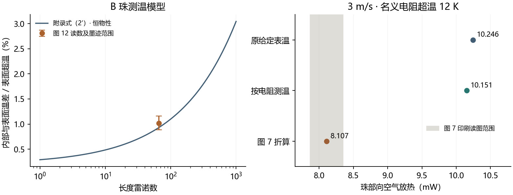

# 电阻测温对 B 珠全表面气动热的修正

在 3 m/s 的 B 珠风洞测点，将 305.15 K 作为名义电阻等效内部温度，论文附录模型给出的珠表面温度为 **305.03942 K**，长引线的名义线端为 **300.62290 K**。珠部含两接头的放热从 10.24586 降到 **10.15145 mW**。图 7 中心读数按名义面积和电阻超温折算为 8.10716 mW。原有差额减少 **0.09442 mW（4.41%）**，仍高出 **2.04429 mW（25.22%）**。[本机三维页](../../../outputs/v318_validation/ui02/solve/workbench/index.html) · [定量证据](evidence/comparison.json)

本版解决了将内部电阻测温直接施加在全部珠面所造成的边界口径问题。两种计算路径均给出 10,272 个原面、3.19665061 mm² 的壁压、对流热流、空气侧壁温边界和共同首层流体温度。相对 v317 新增几何覆盖 **0 面、0 m²**。原论文提供一个珠部平均换热测点，逐面联合实验验证面积为 **0 m²**。[真实修正热边界的原面数据](../../../cases/thermistor_b/resistance12.zip) · [工况与预算](PLAN.md)

## 测温模型与读图核对

原论文第 818–819 页把内部两根引线之间的平均温度记作 \(T_i\)，外表面记作 \(T_w\)。附录忽略电流分布，将外壁与内部发热边界近似为共焦旋转长椭球，以式（1′）的参考换热系数估计内部导热温差。B 珠例子取内外短轴比 2，给出 \(\xi_w=1.80\)、\(\xi_i=1.25\)。8.2 kcal/(m·h·°C) 是文中引用的圆盘热敏体材料测值，按本项目的单位换算为 9.53022 W/(m·K)。实际 B 珠内部几何、电导分布及其自身材料导热率仍有不确定性。[论文附录与图 12](https://doi.org/10.1299/kikai1938.25.810)

令 \(F=3.094\) mm²，\(L=0.3430\) mm，\(C\) 为焦半距。以论文表 1 的面积和附录外坐标确定本次几何常数，

\[
 G=\xi_w^2-1+\xi_w^2\sqrt{\xi_w^2-1}\arcsin(1/\xi_w),\qquad
 C=\sqrt{F/(2\pi G)}=0.310844\ {\rm mm}.
\]

程序将式（2′）写成壳层热阻和外表面对流热导的乘积。壳层径向积分使用自然对数，

\[
 R_{\rm shell}=\frac{1}{8\pi C k_s}
 \ln\!\left(\frac{(\xi_i+1)(\xi_w-1)}{(\xi_i-1)(\xi_w+1)}\right),\quad
 h_a=\frac{k_a}{L}\left(\frac23+0.3\sqrt{Re_L}\right),\quad
 r=\frac{T_i-T_w}{T_w-T_a}=R_{\rm shell}\,h_aF.
\]

主算沿用 v317 的恒物性空气。在 \(Re_L=65.919\) 处，\(R_{\rm shell}=12.6853\) K/W，\(r=0.93008\%\)。按反推表温的膜温 299.0946 K 取项目空气物性，得到 \(Re_L=65.718\)、\(r=0.93200\%\)。若改以表列 \(L=2V/F\) 和同一外椭球坐标定尺寸，焦半距为 0.325156 mm，修正为 0.97291%。两次定尺寸分别使用面积或体积面积比。工作台采用前者，并保留后者作几何敏感性对照。[MATLAB 测温程序](../../../thermistorResistanceModel.m)

图 12 的横轴为对数坐标。在同一雷诺数上，按局部零线、0.02 刻度及曲线墨迹读得中值 **1.018%**，读图范围 **0.889%–1.158%**，包括主算公式值。这个范围仅描述扫描图的读数分辨率。若采用作者对所研究雷诺数范围给出的约 3% 作为情景，剩余放热偏差仍为 1.84028 mW，约 +22.70%。要靠此温差单独解释原偏差，需要 \(r=26.38\%\)。实验单点仪器不确定度未知。[读图标定程序](read_figure.py) · [测点像素与公式核对](../../../cases/thermistor_b/resistance12.json)

## 同一功率的两个平均换热系数

模型反推 \(T_w=T_a+(T_i-T_a)/(1+r)\)。长引线的温度形状保留，全部壁面超温乘 **0.9907848872**。恒物性、相同流场和线性被动标量条件下，首层流体超温、入壁热流和线内轴向导热也分别乘这一系数。实际壁压取原流动解。[全场换算及来源处理](../../../applyThermistorThermometry.m)

| 同一图 7 工况 | 分母温差 | 珠部放热（mW） | 平均 h（W/(m²·K)） |
|---|---:|---:|---:|
| 实验中心读数折算 | 名义电阻超温 12 K | 8.10716 | 218.35690 |
| v317 长引线 | 给定表面超温 12 K | 10.24586 | 275.96054 |
| 测温修正后，按实验口径 | 内部超温 12 K | 10.15145 | 273.41754 |
| 同一修正场，按空气侧表温 | 表面超温 11.88942 K | 10.15145 | 275.96054 |

修正后的整件向空气放热 **11.04560 mW**，峰值工作台面号仍为 209，入壁热流 **−16.34012 kW/m²**。首层流体温度为 299.86609–304.99890 K。工作台分别标明输入的内部温度、推算的空气侧边界和求得的流体温度，三维固体内部各点的温度仍未知。

## 原生边界与工作台验收

独立分支向 10,274 个实际壁节点施加修正后的弱焓温度和强标量值，使用 v317 内部读数驱动推进 20 步。起步采用参照终帧按温度单位作仿射变换的初猜。核对的是新热边界的装配、原生推进及壁反力。六分量末 20 行最大 log₁₀ RMS 为 −8.61776，再过 20 步为 −8.65693。壁面放热 11.04573 mW，远场净流出 11.05241 mW，同态收支差 −0.06047%，追加步总功率变化为 0.00106%。这里使用已发展的热场。v316 的独立冷启动另有完整起步记录。[原生施加程序](native_check.py) · [终态、能量和界面回执](evidence/receipts.zip)

与 v317 从同一源保存的 +20 步及相应壁反力同步比较，全原面最大表压差 4.69×10⁻¹² Pa，最大相对热流差 6.95×10⁻¹⁴，最大首层温差 9.77×10⁻¹⁵ K，整件功率相对差 1.55×10⁻¹⁵。若直接比较工作台的两种入口，快速换算用 v317 主终帧，原生核对晚 20 步，最大热流差为 57.82 W/m²、首层温差为 0.001825 K。此处错位比较未通过原 0.001 K 局部门槛，原始两套数值及同步、错位两份差额均保留。[原生反力和原面交叠独立校核](package_check.py) · [独立原生结果页](../../../outputs/v318_validation/ui02/archive/workbench/index.html)

主推进用时 55.03 s，双次反力与追加步合计 112.33 s，两种同态单步回放合计 56.37 s，进程族采样峰值为 2.49 GiB。最终 GUI 核对用时 47.53 s，文献阅读、开发、归档及输入准备耗时未独立计量。已核对实际侧栏切换、温度状态、两种平均 h、峰值探针、两套各 10,272 行的输出及 X = 0.172 mm 的两套各 96 条真实截线；切回给定表温后旧结果失效，原 v317 入口通过回归。[工作台实测](check_ui.m) · [科研出口独立校验](verify_thermometry.py)

## 操作与来源

在 MATLAB 启动 `rocketAeroHeatWorkbench`，选带引线 B 珠、96 档图 7 测点，生成网格后在边界页选择**电阻测温 · 长引线**。确认后可选择**按电阻测温计算全表面**或**读取修正壁温的原生核对**。在结果页选择“测温修正热流差”可查看相对原长引线参照场的变化。联合 CSV 保留本次场来源、原长引线参照、内部温度、推算表温、均温参照的比例及当前字段的换算比例。

本机原生核对在 `outputs/v318_validation/check01`，图 12 标定在 `outputs/v318_validation/reading01`。原生体场只存 E 盘。GitHub 随源码发布小型全表面数据、指纹与回执。复现需先取得 v317 的对应完整终场、同步追加步和构建目录，再运行本轮的 `native_check.py`、`read_figure.py`、`package_check.py`。[v317 复算条件](../v317/RESULTS.md)
