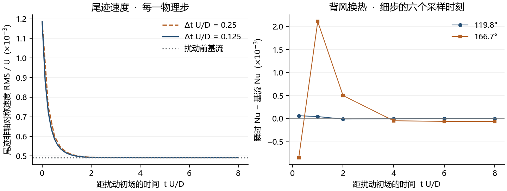

# Short 银球 Test 65 的 82.10 ms 全表面瞬时解

相对 v321，首次获得压力和热流的几何面为 **0 面、0 m²**。12.7 mm 光滑银球已有的 **4,464 / 4,464 面、0.000503553014 m²** 现有同一真实时刻的壁压与热流，可在工作台逐面核对。两种时间步从同一扰动初场分别推进至 82.101806 ms，六个同刻均通过预定的步长差异检查。试验未给逐面壁压，压力和热流联合实验验证面积为 **0 m²**。本版只对银球单独记账。[细步逐面数据包](../../../cases/short_sphere/wake_fine.zip) · [粗步逐面数据包](../../../cases/short_sphere/wake_coarse.zip) · [事前合同与读数补充](PLAN.md)

## 背风侧与实验的差异

Re = 882，来流 1.237488 m/s，空气 310.9944 K。表中 Nu 采用从迎风驻点量起的极角，沿 +Z 子午线按实验位置取样，用当地给定表温的空气导热系数归一化。Short 的测量来自温度梯度探针和整体量热标定。实验未提供与数值扰动同步的瞬时历史或逐站不确定度。[试验定义](../v321/SOURCE.md) · [原论文第二部分表 II、III](https://doi.org/10.7907/6CZB-AW27)

| 位置或量 | 实验 | v321 稳态基流 | v322 细步 82.10 ms |
|---|---:|---:|---:|
| 119.8° 局部 Nu | 5.5 | 13.1628904 | 13.1628906 |
| 166.7° 局部 Nu | 8.8 | 6.9098151 | 6.9097530 |
| 整球放热，按完整球解析面积折合 / W | 0.84267 | 0.98321 | 0.98321 |

实验在背风两站之间回升 3.3 Nu；细步终点下降 6.25314 Nu。119.8° 高估 139.3%，166.7° 低估 21.5%，七站 RMSE 为 5.2656 Nu。实际三角网放热 0.977093924 W，解析球面积折合值比试验量热高 16.68%。全表面热流以入壁为正，细步终点范围为 −3134.72 至 −665.80 W/m²。最强放热出现在距迎风驻点约 2.48° 的 2976 号面。给定壁温和首层流体温度分别提供，固体内部温度及求解壁温未知。[细步本机三维页](../../../outputs/v322_validation/read01/wakeFine/workbench/index.html) · [原始测站表和基流](../v321/RESULTS.md)

尾迹取 −3 ≤ x/D ≤ −0.6、r/D ≤ 1 的非轴节点。把各环速度转到柱坐标、扣除各环的体积加权均值后，非轴对称速度 RMS 从扰动后的 0.00118618 U 降至 0.00049110348 U。独立复算的原稳态基流自身为 0.00049110343 U。先逐节点减去基流、再作同一投影，细步终点的差为 1.46 × 10⁻⁷ U。本段没有得到三个可辨重复周期；在这套网格、初场和时长下，两站的换热差异仍在。实验有两根赤道支管及 1.3% 横向来流湍流度，光滑球模型未纳入两者。空间耗散、支撑影响及更长时间行为尚待区分。[独立复算](evidence/terminal.json)

## 两种时间步与同态热量账

基于 v321 提交 `c926bbb5048bd3b688798644db7f53f7c8796739`，保留 SU2 8.6.0 三维不可压层流、强温界被动标量和 37,290 节点全周网格。两个步长使用逐字节相同的扰动初场，受扰动的 1,090 个节点位于尾迹内部，速度扰动峰值为 0.01 U。BDF1 双时间推进的无量纲步长分别为 0.25 和 0.125，分别完成 32 和 64 个物理步。每步均留存前帧、终帧和原生收敛历史。每步连续最后 20 行、六分量对数 RMS 的最差值分别为 −8.3091 和 −8.7070。[原生历史、配置及收支回执](evidence/receipts.zip)

| 距初场的时间 tU/D | 两步长壁压面积 RMS 差 / Pa | 热流面积 RMS 差 / (W/m²) | 单面最大热流差 / (W/m²) |
|---:|---:|---:|---:|
| 0.25 | 2.6941 × 10⁻⁶ | 0.0038102 | 0.0643495 |
| 1 | 2.1009 × 10⁻⁶ | 0.0035206 | 0.0476560 |
| 2 | 4.8232 × 10⁻⁷ | 0.0021338 | 0.0252583 |
| 4 | 6.3042 × 10⁻⁸ | 0.0002585 | 0.0032471 |
| 6 | 1.0963 × 10⁻⁸ | 0.00002267 | 0.00021569 |
| 8 | 7.5810 × 10⁻¹⁰ | 0.0000022403 | 0.000027980 |

所有同刻比较均通过事前登记的压力、热流和整球功率门槛。终点首层温度的最大时间步差为 2.57 × 10⁻⁸ K。细步终点的远场带走功率为 0.977093597 W，流体储热率为 3.26896 × 10⁻⁷ W。用每个节点的原生体积和相邻两个实际时间层独立积分，得到相同的储热率。十二个接受读数的最大相对热量差为 4.37 × 10⁻⁹，独立释放壁反力的最大峰值归一化差为 5.99 × 10⁻⁷。以上核对只约束当前离散解；空间和实验误差另行评估。[终点逐面与两份 CSV 对照](evidence/terminal.json)

## 读数更正及复现

首次解除壁温约束时误用冻结观察器，粗步 1 和细步 2 的更新残差为负无穷。原始运行留在各自的 `readout/release`。改用普通驱动从对应终帧执行独立释放，保存在 `release_native`。另在细步 64，单线程回放在第 23 次内迭代出现 0.01167455 的标量对数残差差，超出 0.01。保留该回放后，用与原步相同的四线程另行回放；主线程在装配同步点读取数据，51 行六分量记录及比较的终态量逐项一致。独立释放误差为 7.91 × 10⁻¹²。两次更正均复用了原物理时间层。[原始失败与更正回执](evidence/receipts.zip) · [固定端点读数](../../../scripts/shortSphereWakeReadout.py)

在工作台第一步的 **Short 银球 · Test 65** 菜单中，可读取粗、细终点，或从登记基流启动双步长计算。工作台实际新算到 tU/D = 0.25，读取两份 82.10 ms 终点，并回归了稳态入口。独立程序从原生网格、流体帧和壁反力重建了 4,464 个壁面及七站结果；细、粗步末帧的探针场量、全壁 CSV 和 X = 1.37 mm 的 72 面截线与原生数据一致。完整 8D/U 计算经命令行入口完成，首个同刻由侧栏独立完成。WebGL 使用 v321 已发布前端，工作区并发的前端修改未参与验收。[首个同刻](evidence/start.json) · [终点](evidence/terminal.json)

主计算的粗步推进累计 265.37 s、细步 506.19 s，原生进程族最大采样内存约 290 MiB。接受的固定端点读取累计 161.34 s，独立释放 50.86 s，另有两次无效释放共 8.27 s 及一次未过历史核对的回放 15.89 s。两种观察器编译和链接共 17.63 s，峰值约 509 MiB。工作台首个同刻新算验收 139.31 s，终点读取及稳态回归 35.45 s；前者含一个独立小算例。这些时间按进程分别累计；编辑、数据归档和离线复核未单独计时。[分类资源回执](evidence/resources.json)

大型体场在本机 `outputs/v322_validation/run01`，GitHub 随附可直接查看的两个小型归档及核对回执。复算需固定求解环境，运行 `python scripts/runShortSphereWakeCase.py outputs/short65_new --through 8`，新目录名应未被占用；接续同一已接受任务时追加 `--resume`。基流、网格、每步输入及终帧指纹见压缩回执。[运行入口](../../../scripts/runShortSphereWakeCase.py) · [求解依赖](../v296/INSTALL.md) · [下一决定](NEXT_DECISION.md)
