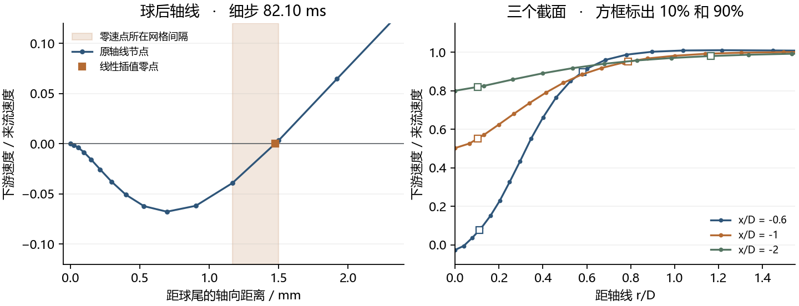

# Short 银球的回流长度与尾迹网距

在 Test 65 的光滑球数值模型中，82.10 ms 时球后轴线上连续 11 个流体节点出现反向速度。以相邻原节点线性插值，反向速度归零处距球尾 **0.11604D，即 1.474 mm**。直接夹住零点的两个节点位于 **1.166 mm 和 1.499 mm**，两点间距约占插值回流长度的 22.6%。实验未测量这里的轴速，表中几何夹区描述的是原网格的取样间隔。[原节点与两份同刻剖面](../../../cases/short_sphere/wakeResolution.json)

相对 v322，新增同时算出壁压和热流的原面为 **0 面、0 m²**。复用了同一球体的 4,464 / 4,464 面、0.000503553014 m² 的瞬时场，放热仍为 0.977093924 W。壁压与热流联合实验验证面积为 0 m²。这次排查排除了“六个指定截面的已算速度恢复带仅由一两条网格线支撑”这一解释；单网的速度恢复带宽及壁面换热仍有空间离散误差。[上版全壁数据与实验差异](../v322/RESULTS.md) · [筛选条件](PLAN.md)

## 网格实际支撑了哪些数据

选与七站取样相同的 +Z 子午面。从三维体单元核对了 1,536 个平面四边形，每个均与两侧体单元相邻。给定 x/D 后，沿实际射线的相邻原节点取线性插值，每条射线只提供一个样点。下游速度采用 −uₓ/U，负值表示朝球尾流回。以 r/D ≤ 0.6 中的最低速度为起点，向外首次达到“最低速度至自由流速度差”的 10% 和 90% 处定义恢复带边界。这个定义也适用于轴线上已经没有回流的下游截面。

| x/D | 带宽 / D | 带内独立射线 | 带内及两端相邻射线的最大横距 / D | 供值边轴向跨度 / D | 带宽 / 最大横距 |
|---:|---:|---:|---:|---:|---:|
| −0.60 | 0.4703 | 9 | 0.0738 | 0.0257–0.0597 | 6.37 |
| −0.75 | 0.5485 | 8 | 0.0822 | 0.0617–0.0886 | 6.67 |
| −1.00 | 0.6837 | 9 | 0.1096 | 0.1064–0.1617 | 6.23 |
| −1.25 | 0.7942 | 8 | 0.1239 | 0.1644–0.2155 | 6.41 |
| −1.50 | 0.8850 | 7 | 0.1362 | 0.2132–0.2854 | 6.50 |
| −2.00 | 1.0622 | 8 | 0.1817 | 0.3250–0.4007 | 5.85 |

表取细步终点；粗步终点的射线计数与筛选结论逐项相同。两种步长的回流长度差为 2.81 × 10⁻¹⁰ D，六个带宽的最大差为 7.25 × 10⁻⁷ D，所有相同射线取样的最大速度差为 1.65 × 10⁻⁷ U。空间布点对两份时间步共同起作用。离球较远时，流向供值边可跨 0.40D，沿流向的小尺度扰动仍可能被漏掉。[独立几何与数值核对](evidence/verification.json)

原生配置及日志确认动量对流用一阶 FDS 迎风，强温界被动标量用一阶标量迎风；两者的 MUSCL 重构均关闭，流动限制器为 NONE，标量无裁切。黏性项用有修正的平均梯度，梯度取逆距加权最小二乘。一阶对流离散可能展宽恢复带。这里的六个计数只支持对当前离散场的描述，未验证周向分辨率、网格收敛或实验中的剪切层厚度。[原生配置与运行记录](../v322/evidence/receipts.zip)

## 与背风测站的联系

取离壁 0.002D（25.4 µm）的真实首层，将速度投影到沿壁极角增大的切向，在包围测站的相邻极角间线性取样。正向从迎风点沿壁指向尾极。首层速度的正负不能单独确立精确分离线。

| 测站 | 首层切向速度 / U | 细步入壁热流 / (W/m²) | 计算 Nu | 实验 Nu |
|---:|---:|---:|---:|---:|
| 119.8° | +0.02587 | −1319.67 | 13.163 | 5.5 |
| 166.7° | −0.01289 | −693.75 | 6.910 | 8.8 |

在本次离散场内，两处第一层流向相反，计算放热强度向尾极下降，风洞测得的局部 Nu 则回升。实验有两根赤道支管，光滑球模型中没有这两处连接。现有证据没有分离支管绕流、支管热边界、入口湍动和数值耗散的贡献。[原论文与测量定义](../v321/SOURCE.md) · [下一项](NEXT_DECISION.md)

## 工作台与复现

在 **Short 银球 · Test 65** 中打开粗步或细步终点，选择 **尾迹空间分辨率**。下拉选择六个子午截面，每次切换同步更新原网采样点、10% 与 90% 标记、横距和流向跨度。两份物理帧分别绑定诊断文件、网格和工况指纹。稳态页面沿用原有内容。实际侧栏验收切换了两档共 12 个剖面，返回三维页读取 2976 号面，并从两档导出七站 CSV。[工作台和过程回执](evidence/receipts.zip)

基线为 v322 `b254c3a5b2c7cbf38ab8095874d558d27b064cbe`。诊断只读既有场。从项目根目录运行 `python docs/validation/v323/run_resolution.py new01`，用未占用的目录名，输出文件位于 `outputs/v323_validation/new01`。初次调用在相对脚本路径规范化处退出，尚未启动诊断；修正路径后，唯一一次原场后处理耗时 1.19 s，采样内存峰值约 57.2 MiB，物理推进步数为 0。独立程序按球壳半径和测线极角在三维空间重新找原节点，并以线性合成速度场校验符号及交点。工作台单独运行 34.11 s，进程族峰值约 2.21 GiB，使用 v322 发布前端。编辑、绘图和归档未单独计时。[后处理程序](../../../scripts/shortSphereWakeResolution.py) · [独立复核程序](verify_resolution.py)
