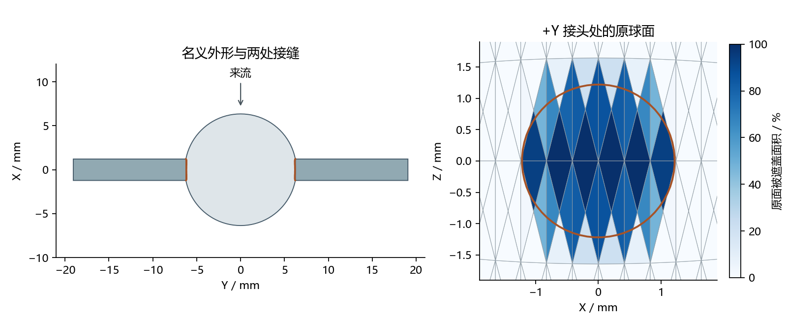

# Short Test 65 双支管装置的外露球面与七站定位

两根赤道支管在原银球网格上合计遮盖 **9.44949 mm²**，原有 **503.55301 mm²** 球面中还有 **494.10352 mm²** 暴露在空气中。4,464 个原球面中，4,376 个完整外露，72 个部分遮盖，16 个完全遮盖。每个切分后的球面三角形都保留父面号，两根管各以 104 条共享边与银球相接。七个试验极角均落在外露球面。[SI 几何、两个接缝、原面账和七站表](../../../cases/short_sphere/supported65.zip)

相对 v323，首次同时算出壁压和热流的原面为 **0 面、0 m²**。本版给出了带支管算例的实际计算边界和逐面面积。压力、热流及支管温度在新装置上均待求。已有 82.10 ms 光滑球瞬时结果另有自己的几何和源帧。[光滑球基线](../v322/RESULTS.md)

## 实验能确定哪些边界

Short 的图 3 标明来流、球赤道、支管、补偿加热器和探针位置。两根管沿赤道同轴、与来流垂直。项目取来流 −X、管轴 ±Y；七站采用沿用的 +Z 子午测线。论文表 III 给出极角，未给每个测站的独立周向坐标。图中管端画有断开符号，不能从图上的可见线长换算试验外伸长度。[Short，第一部分图 3、印刷页 35；第二部分表 III](https://doi.org/10.7907/6CZB-AW27)

第二部分印刷页 60–63 给出银球直径 0.5 in（12.7 mm）、两根不锈钢管直径 0.096 in（2.4384 mm）。实验调节补偿加热器，使赤道上的内部热电偶指示温度相等。测得的量热功率使用 1.0188 面积修正；该过程不提供管末位置、焊脚形状或沿管的壁温分布。Short 引用 Baer 等的装置论文；本轮查到了论文标识，出版方全文入口返回 HTTP 403。尺寸判断限于实际核对的 Short 原页。[Short 试验与温度定义](../v321/SOURCE.md) · [Baer 等，1953](https://doi.org/10.1115/1.4010712)

**名义外形**采用等直圆管和清晰的相交边，截断平面在距球心 Y = ±19.05 mm 处，每侧相对理想球极切平面外伸一个球径。截断位置可调。实体内的埋入部分不生成外壁。人工截断圆盘用来闭合几何，单独记账。

| 分区 | 三角面数 | 面积 / mm² |
|---|---:|---:|
| 外露银球 | 4,624 | 494.103524 |
| +Y 支管外壁 | 13,864 | 98.497847 |
| −Y 支管外壁 | 13,864 | 98.497847 |
| +Y 人工截断 | 64 | 4.662318 |
| −Y 人工截断 | 64 | 4.662318 |

**银球加两管侧壁共 691.099217 mm²**。另有两个人工圆盘合计 9.324636 mm²。将名义外伸长度减半后，每侧管外壁降到 49.873461 mm²，差值等于实际多边形周长乘以 6.35 mm；两处接头、银球外露面积和七个测站的父面号完全一致。[两种长度的独立复核](evidence/verification.json)

## 面积与网格核对

在 v321 原三角平面内，用 64 边正多边形描述管截面，裁出被遮区和外露区。每个父面单独核对原面积、外露面积和遮盖面积。独立程序以管侧半空间逐一裁原三角形，在三个维度中重算遮盖面积；最大逐父面闭合差为 **3.42 × 10⁻²⁰ m²**。理想光滑球与两根解析圆管的球冠遮盖为 9.42733 mm²。离散网格的原球面与外露球面面积之比为 1.019125，解析球冠给出 1.018958，论文给出 1.0188。三者保留各自的几何、取整和测量定义，实验因子未用于校准局部面积或热流。[构建程序](../../../buildShortSupportedSphere.m) · [独立裁剪](verify_geometry.py)

导出件有 16,242 个顶点、32,480 个三角面。每条边由两个方向相反的面共用，整个表面连通、欧拉示性数为 2，有向体积为正；检查也核对了接头两侧的实际分区及端面法向。保留原面裁剪线会留下窄三角形。共有 **112 个面**的最小角小于 5°，其中球面 88 个，两侧管壁各 12 个。最小角 **0.365°** 出现在新面 4403，最短边 3.04 µm。这些面可用于几何记账。局部黏性体网仍需另行处理接头分辨率、首层质量和守恒映射。

## 工作台与导出

从统一侧栏的 **Short 银球 · Test 65** 选择 **查看双支管几何与外露面积**。三维页默认标出两条接缝，切换测站后可查看命中面号、原球面号和 SI 坐标。**外露面积与原面号** 页列出分区及所有受影响的原面，可导出包含米制 STL、带分区的索引网格、两个接缝、4,464 行面积表和七站表的 ZIP。测点用指定子午线上的射线与真实离散表面求交；共边或共点时取命中面号最小者，表中另存命中面数及三个重心权重。[可直接读取的几何包](../../../cases/short_sphere/supported65.zip)

实际 MATLAB 侧栏验收中，两条接缝的 208 条线段、七次测站定位和导出均通过；从该页可返回光滑球七站结果。界面导出的五个成员文件与独立几何入口导出逐字节一致。检查了二进制 STL 的每个三角形顶点和米制尺寸。[界面与原生回执](evidence/receipts.zip)

基线 v323 `463517d339416a85ed8389413deefd67757c5693`。初次独立核对发现按不同顺序累加三万余面后，三分区合计与逐面总和差 1.03 × 10⁻¹⁶ m²，超过总账核对容差。改为各区成对累加，再以准确求和独立核对。初次失败保存在 `outputs/v324_validation/check01`，接缝与面积容差均未修改。最终两种长度的 MATLAB 生成和导出分别耗时 15.75 s、16.02 s（含进程启动），峰值约 676 MiB；工作台验收 32.13 s，峰值约 1.96 GiB，独立核对 0.83 s。物理推进步数为 0，文献阅读、编辑和归档未单独计时。大型场未复制。[事前计划](PLAN.md) · [下一决定](NEXT_DECISION.md)
