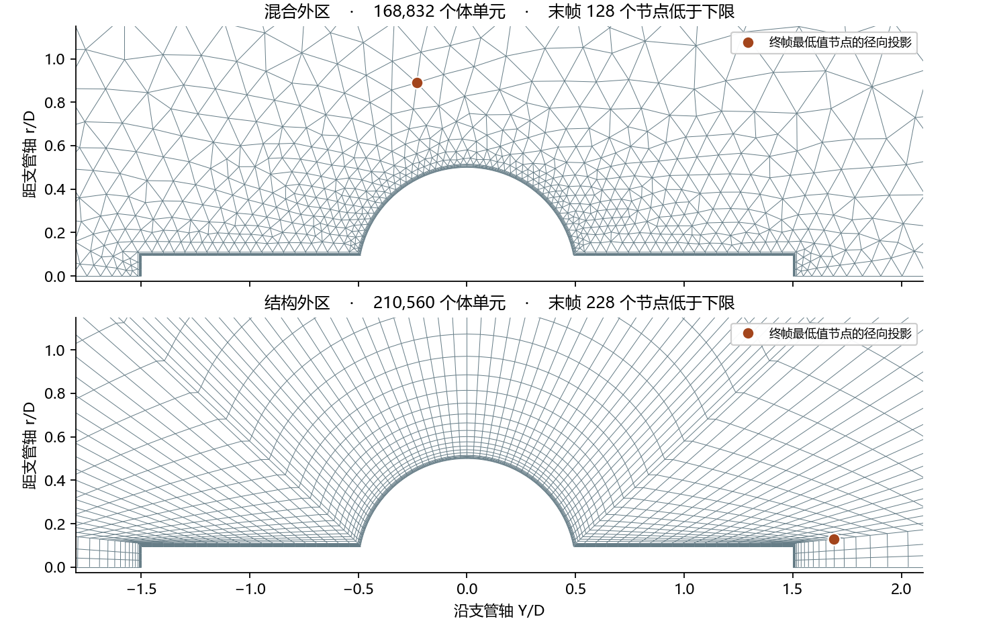

# 双支管银球的全周体网、原面映射与首次求解

Short Test 65 名义双支管装置已建立流体体网并实际启动 SU2。**网格和原面映射通过，两次冷态求解均在第一段后退出验收。** 相对 v324，新增同时有合格壁压和热流的原面为 **0 面、0 m²**。本轮解决了接头窄三角面与黏性网格的对应问题，也排除了“仅把混合外区换成此次结构外区就能消除主温差标量越界”的路线。两份实际终帧留存，壁面热流、热峰、总放热和七站 Nu 均未发布。[网格与计算回执](evidence/receipts.zip) · [事前计划及更正](PLAN.md)

## 计算对象与五个壁面分区

采用两侧各外伸 1D 的名义自由短管，两端封闭且在空气中。两处端盖作为本对照的湿壁，单独承担边界条件和面积。真实实验支管的末端位置和温度仍未知。沿用 D = 12.7 mm、Re = 882、来流 1.237488 m/s，空气温度 310.99444 K。球面给定表 III 极角温度，管外壁和端盖给定赤道值 352.92778 K，接头共享球面的给定节点温度，第一排管片内过渡。温差标量以 90 K 归一化，零对应环境温度。此稳态分支的不可压层流、恒物性和强壁温标量沿用光滑球基线。[几何身份](../v324/RESULTS.md) · [试验表与测量定义](../v321/SOURCE.md)

| 分区 | v324 原面数 | 原面积 / mm² | 求解壁片数 | 求解壁面积 / mm² |
|---|---:|---:|---:|---:|
| 外露银球 | 4,624 | 494.103524 | 3,072 | 496.683616 |
| +Y 管壁 | 13,864 | 98.497847 | 1,280 | 98.153431 |
| −Y 管壁 | 13,864 | 98.497847 | 1,280 | 98.153431 |
| +Y 端盖 | 64 | 4.662318 | 192 | 4.662318 |
| −Y 端盖 | 64 | 4.662318 | 192 | 4.662318 |

本名义工况的原面分母为 **700.423854 mm²**，包含两端盖。原装置几何账中球面与管侧壁合计仍为 691.099217 mm²。实验的球体量热只对照外露银球。新网的银球面积比原网大 0.522%，单管外壁小 0.350%。方位共有 64 档，球面母线 48 段；所有方位的流动自由度独立。五层近壁网共用，首层对当地求解壁面的法向距离为 **25.37–25.40 µm**，球心到远场边界顶点为 14D。两种网格的所有单元和单元面锥体均通过正体积检查，内面均有方向相反的两侧，壁面和远场闭合。

## 如何将求解壁片载荷返回原面

6,016 个求解壁片与 32,480 个原面形成 **54,527 对**分区内交叠。首次使用经纬坐标直线连接原顶点时，8 个接头附近的原球面发生投影翻折，最差源壁片覆盖误差 0.128729。该准备任务停止于映射，未启动求解器。修正后，球面用扇区中心投影将空间直边映为直线，原面权重由真实三角形上的交叠面积决定，边缘源片的投影边界取实际接缝。管壁在方位和距接缝至端盖的归一位置上交叠；端盖按实际平面扇形面积处理。

对温度、压力等面平均量，用目标份额加权；对瓦数，用源份额分摊，再除以目标实际面积得到热流密度。两种份额分别检查归一，最大误差为 5.33 × 10⁻¹⁴、2.11 × 10⁻¹⁵。独立程序在三维原面直接以球心锥面裁剪，复算 **21,519 对球面交叠**，与目标份额最大差 7.63 × 10⁻¹⁴。五区独立正负制造载荷的最大功率差为 2.61 × 10⁻²¹ W，无跨区串移。交叠处最小法向余弦 0.98489，抽样位置距离最大 0.004479D（56.9 µm）；此距离大于首层法向厚度，空间误差仍需另行评价。[独立复核](evidence/verification.json) · [交叠数据](../../../cases/short_sphere/supportedTransfer65.npz)

交叠文件中的 `target`、`source` 为从零开始的目标三角面与源壁片编号，MATLAB 查面号时加 1。`targetFraction`、`sourceFraction` 分别为上述两种份额，`targetArea`、`nativeArea` 以 m² 计。区域编号 1–5 与表格行序相同。`nativeCorners` 为从零起算的 `nativeWallXYZD` 行号，轴上三角面有一个重复角点；壁及首层坐标均以 D 归一化。

## 两次原生推进实际停在何处

| 同工况、同一壁面与近壁层 | 混合外区 | 结构外区 |
|---|---:|---:|
| 节点 / 体单元 | 101,122 / 168,832 | 214,344 / 210,560 |
| 完成的稳态迭代 | 200 | 200 |
| 保存帧 100 的最小主标量 | −8.494 × 10⁻¹⁰ | −1.160 × 10⁻⁴ |
| 终帧 199 的最小主标量 | −8.449 × 10⁻¹⁰ | −1.096 × 10⁻⁴ |
| 终帧低于 −10⁻¹² 的节点数 | 128 | 228 |
| 连续末 20 行六项对数 RMS 的最差值 | −4.041 | −4.110 |
| 原生推进耗时 / 进程族峰值 | 64.44 s / 0.80 GiB | 119.78 s / 1.52 GiB |

两次均从各自的冷态和相同的物理边界出发。程序保存了周期文件及终帧，并报告原生正常退出，但主标量越界，两段均未取得可接续回执；末窗残差也尚未达到 −8。混合外区的 128 个越界节点距最近壁节点 0.419–4.908D，结构外区相应范围为 0.155–1.143D。两组壁、首层坐标、温界和交叠数组逐项一致。换外区后越界幅度增大，数据尚不能区分对流离散、非正交扩散和隐式更新的各自影响。没有进行热反力释放或同态热量平衡，也没有将稳态迭代换算为飞行时间。[两网保存帧、原始残差与进程](evidence/receipts.zip)

## 工作台与复现

在 **Short 银球 · Test 65 → 查看双支管几何与外露面积 → 流体体网与计算状态** 中，可以切换两套外区网、查看全域或 +Y 管根，核对对应的接受状态。**从几何生成所选体网** 在新的本地任务目录中实际建网。MATLAB 从正常侧栏重建混合体网，其 SU2 网格与实际启动输入逐字节一致，交叠数组与随代码交付的数据逐项一致。页面显示的是几何和失败诊断，未添加该工况的压力或热流云图。[工作台核对](evidence/verification.json)

从项目根目录执行 `python scripts/shortSupportMesh.py outputs/short_grid_new --outer hybrid` 可以重建混合体网，`--outer structured` 生成对照体网。用 `python scripts/shortSupportCase.py outputs/short_solve_new --prepared outputs/short_grid_new` 启动同一冷态工况。两条命令的新任务目录应未被使用；本机已有的失败阶段不作续算源。新装机需项目固定的网格运行环境和 SU2 逐点壁温驱动。[建网入口](../../../scripts/shortSupportMesh.py) · [条件检查与求解入口](../../../scripts/shortSupportCase.py)

基线 v324 `387a8efd7302da006b06649f50ddd040d9530c2d`。首版映射失败准备耗时 7.50 s，保留原网后重新检查和生成映射耗时 8.42 s，结构网准备耗时 12.55 s。工作台专项验收含真实重建耗时 34.70 s，峰值约 1.89 GiB，使用 v324 已发布前端。编辑、归档和独立复核未计入物理推进时间。原始输入和场分别保存在 `outputs/v325_validation/prep02`、`prep03`、`run01`、`run02`；GitHub 附两种子午网、完整交叠、配置、历史和小型回执。[当前下一项](NEXT_DECISION.md)
