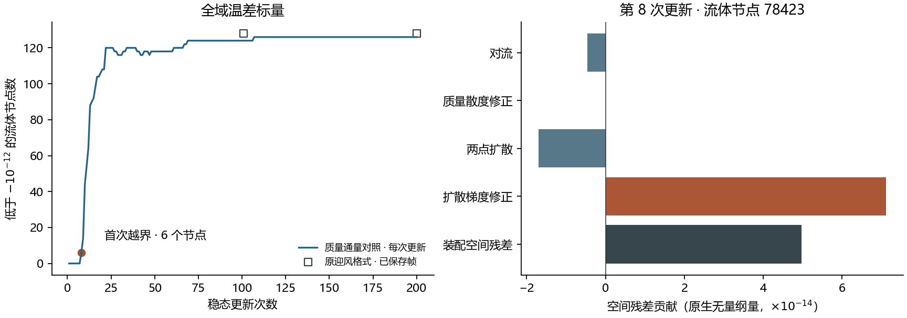

# Short Test 65 银球的标量通量对照

**名义双支管试件共 32,480 个原面，面积 700.423854 mm²。本次新增同时有合格壁压与热流的原面为 0 面、0 m²，五区仍全部待解。** 同一混合网从同一冷态启动，仅切换 SU2 的标量对流格式。单独让内部标量迎风通量使用流动求解器的质量通量，未能消除温差标量越界。独立回放将首次越界定位到第 8 次稳态更新，并在最低值节点核实了各项残差与实际更新方向。[事前计划](PLAN.md) · [工作台数据](../../../cases/short_sphere/supportedFlux65.json)

试件取自 Short 1958 年的民用强迫对流试验。球径为 12.7 mm，来流 1.237488 m/s，Re = 882。名义几何将两根支管各外伸一个球径并封闭，管侧壁和端盖给定球面赤道温度。实验提供外露银球的量热及一条测线上的七站局部换热，未提供支管伸长量、端部温度或逐面压力。本版没有满足比较条件的新热流，未做七站误差评定。光滑球和双支管的覆盖分别统计。[试验来源](../v321/SOURCE.md) · [支管建模假设](../v325/RESULTS.md)

## 同工况下发生了什么

基线为 v325 提交 `54e777db026d04fe4a2095eff29f8d79e9362635`。主运行使用相同的 101,122 个体网节点、原壁温、固定物性和 SU2 8.6.0 流动驱动。两个配置的字节差异只有 `CONV_NUM_METHOD_SPECIES` 一项，均保留 `SPECIES_CLIPPING=NO`。下表的 θ = (T − T∞) / 90 K，验收下限为 −10⁻¹²。内部迭代号从 0 起，终帧 199 对应第 200 次更新。

| 保存帧 | 原迎风格式最低 θ | 原格式低于下限节点 | 质量通量对照最低 θ | 对照低于下限节点 |
|---|---:|---:|---:|---:|
| 100 | −8.49367 × 10⁻¹⁰ | 128 | −7.08141 × 10⁻¹⁰ | 124 |
| 199 | −8.44896 × 10⁻¹⁰ | 128 | −7.11835 × 10⁻¹⁰ | 126 |

两份主运行的压力、三分量速度及弱焓在上述共同帧逐值相同。对照终帧的最低温差约 −6.41 × 10⁻⁸ K。数值很小，仍超出了事前登记的容差。末 20 行的六分量最大对数残差按 p、u、v、w、h、标量排序为 −6.514、−6.136、−6.174、−6.059、−4.041、−6.478，均未达到 −8。原生程序正常写完 200 次迭代并退出，上层检查在读取 100 号帧时拒绝该段，保留失败回执。没有进入热稳定、壁反力和守恒积分阶段。逐面壁热流、热峰和全表面放热仍未知。[原始历史及两方案回执](evidence/receipts.zip)



## 首次越界为何指向扩散修正

两次从冷态执行的只读回放均复现普通驱动的全部 200 行六分量历史。100、199 号帧中，回放与普通驱动的全场最大绝对差分别为 1.11 × 10⁻¹⁶、5.55 × 10⁻¹⁷。两回放的极值轨迹和第一次越界时的全节点前后值逐字相同。在第 8 次更新，6 个流体节点首次低于下限。最严重的原生体节点 78423 位于 (X,Y,Z)/D = (0.130502, −0.231209, 0.879771)，距最近壁面节点 0.419294D。该点由 −9.73504 × 10⁻¹³ 更新至 −1.90477 × 10⁻¹²，实际增量为 −9.31266 × 10⁻¹³，松弛因子为 1。[复核代码](verify_flux.py)

| 节点 78423 的八条相邻边 | 空间行贡献，原生无量纲量 |
|---|---:|
| 对流迎风 | −4.58064 × 10⁻¹⁵ |
| 质量散度修正 | +6.05384 × 10⁻¹⁸ |
| 两点沿边扩散 | −1.69630 × 10⁻¹⁴ |
| 非正交梯度的扩散修正 | +7.11958 × 10⁻¹⁴ |
| 原生装配的总空间残差 | +4.96582 × 10⁻¹⁴ |

各边按原生节点号和方向重建后，合计与原始装配一致。该节点的扩散梯度修正决定了总空间行的符号。隐式右端为 −4.96582 × 10⁻¹⁴，对角为 0.0407394，非对角项乘实际邻点增量之和为 −1.17236 × 10⁻¹⁴。矩阵行乘实际增量为 −4.96629 × 10⁻¹⁴，右端减此乘积的余差为 +4.63 × 10⁻¹⁸。实际增量还受邻点联立更新影响。这个分解仅涵盖首次越界的最低值节点，终帧其余节点的具体机制仍待核实。[八条边、矩阵和首次节点小表](evidence/receipts.zip)

该节点八条边的流动质量通量与标量使用值逐条相同。在同期 1,346 个远场边界节点，标量使用内侧密度乘特征外态速度在有向面积法向上的投影，流动使用边界 FDS 数值通量。两者的带符号和分别为 0 和 −0.0198195，单节点最大绝对差为 0.000173517。这些是早期稳态迭代的无量纲通量读数，收敛后的质量与热量收支仍待检验。

在这个旧场上，逐边将梯度修正幅值限制为两点项幅值，8 条边中有 5 条受限，目标节点的总空间行变为 −8.82168 × 10⁻¹⁵。这项离线计算只回答“该项能否改变局部残差方向”。下一版需要真实推进才能知道节点温度及全域结果。[候选方法与准入检查](NEXT_DECISION.md)

## 工作台、复现与资源

在“查看双支管几何与外露面积”中打开“流体体网与计算状态”，选择“混合外区 · 质量通量对照”。橙点显示首次越界最低值节点绕支管轴的径向投影。状态行给出算法、终帧最低标量、越界节点数和合格面积，悬停可查看对应开尔文温差与原格式读数。MATLAB 已实际切换三项、逐项切换三档视图、核对源网格线及标记，再返回原几何页。重建仍使用 v325 已验收的混合或结构建网入口。[完整 MATLAB 页面](../../../addShortSupportGridTab.m) · [界面验收脚本](check_flux_ui.m)

| 过程 | 墙钟时间 | 采样内存峰值 |
|---|---:|---:|
| 主推进，4 线程 | 63.06 s | 820 MiB |
| 两个观察对象编译及链接 | 合计 35.91 s | 759 MiB |
| 首次越界全场回放 | 65.63 s | 806 MiB |
| 目标节点通量回放 | 66.99 s | 801 MiB |
| MATLAB 侧栏专项核对 | 24.30 s | 1.73 GiB |

编辑、独立复核与证据归档均与原生推进计时分开。本机以项目根目录为工作目录。换用尚未占用的输出目录，可执行下列命令复现主对照；这个工况预期会留下越界失败回执并以失败状态返回。

```powershell
python scripts/shortSupportCase.py outputs/short65_flux_new --prepared outputs/v325_validation/prep02/prepared --species-convection BOUNDED_SCALAR
```

本机已有原场时，运行 `python docs/validation/v326/verify_flux.py` 可独立复核发布读数。两套旧任务的接续回归确认，未指定格式时沿用原登记，更换格式会被拦截，无合格回执的阶段不会启动新计算。GitHub 包含小型原始数据和指纹清单；大场、编译缓存和观察驱动留在 E 盘，未随本版备份。新装机需复用或按既有建网与构建流程恢复依赖。观察构建采用固定 SU2 源包（LGPL 2.1），本版只归档诊断插桩配方。同期未提交的其他工作台与研究修改未纳入发布。[证据清单压缩包](evidence/receipts.zip) · [观察构建](build_probe.py) · [回放入口](replay.py) · [接续回归](check_resume.py)
