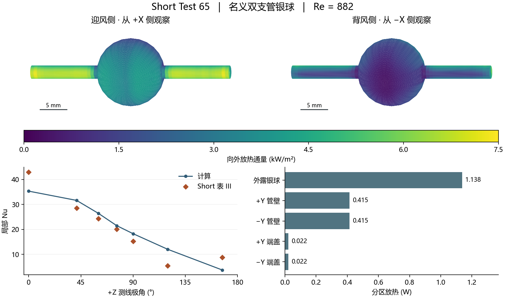

# Short Test 65 名义双支管银球的单工况全表面结果

**相对 v328，本次新增 32,480 个同时有计算壁压和热流的原面，共 0.000700423853595 m²，占本试件完整湿表面的 100%。** 这个分母包括外露球面、两根支管外壁及两个湿端盖。两份端点的壁面与远场物理收支均通过 0.5% 门槛。联合实验验证面积仍为 0 m²。外露银球的平均热流折合整球功率比试验量热高 38.43%，局部热峰仍待网格敏感性检验。[全原面清单与七站数据](../../../cases/short_sphere/supportedSurface65.zip) · [事前合同](PLAN.md)

## 物理工况与解的身份

计算取冻结工况 Re = 882、D = 12.7 mm、空气速度 1.237488 m/s、环境温度 310.99444 K，来流指向 −X。两根赤道支管沿 ±Y 方向，各名义外伸 1D，末端封闭且暴露于空气。球面给定 Short 表 III 的极角壁温，支管及湿端盖给定赤道温度，接头使用实际共享壁节点。本结果为不可压、恒物性层流稳态基流；实验中的支管实际末端条件、入口湍动、尾迹统计及网格误差影响仍待量化。给定壁温和首层流体温度独立列出，固体温度解、外缘温度与恢复温度保持未知。[试验测量定义](../v321/SOURCE.md) · [名义装置](../v324/RESULTS.md)

## 全域求解与物理守恒

沿用 v328 节点余量通量修正、低阶隐式预测及 SU2 8.6.0 原生 FGMRES/ILU。唯一的物理离散改动是把流动远场 FDS 连续性通量同时送入标量迎风项、散度项及其隐式对角。每次装配逐顶点核对计算域、迭代、边界标记、原节点号和有向法向；入口采用给定零温差，出口采用节点温差。600 次稳态更新共核对 **807,600 个远场顶点记录**。两个端点的 1,346 个远场节点均无质量通量数值或符号差异。101,122 个体网节点全程满足温差界限；末 20 行 p、u、v、w、弱焓、温差方程的最大 log₁₀ RMS 分别为 −11.679、−11.325、−11.355、−11.265、−9.206、−12.224。[源端与消费端适配](build_shared.py) · [逐次原生回执与边界明细](evidence/receipts.zip)

| 物理量 | 600 次更新后 | 再延续 20 次后 |
|---|---:|---:|
| 定温湿壁向空气放热 / W | 2.011093623 | 2.011093630 |
| 标量实际远场输出 / W | 2.011093591 | 2.011093607 |
| 远场减壁面 / nW | −32.54 | −22.34 |
| 差额绝对值占壁放热 / % | 0.000001618 | 0.000001111 |

两次快照分别执行逐节点释放壁行和实际限幅修正重组。无限幅释放反力与直接从内部边重建的壁行最大误差为 2.72 × 10⁻¹⁹ W/节点以内。守恒门槛直接比较上表的物理功率；散度源单列，第一个端点为 +23.01 nW。相对 v328 同次终帧，压力、三分量速度和弱焓逐值相同，温差标量最大绝对差为 5.55 × 10⁻¹⁷。这一改动消除了流动与标量远场载热的约 12.87 mW 口径差。实际再推进 20 次后，壁放热相对变化为 3.33 × 10⁻⁹。[先前收支差](../v328/RESULTS.md)

## 五区压力、热流和局部热峰

| 原面分区 | 面数 | 面积 / mm² | 向外放热 / W | 最大向外热流 / W·m⁻² |
|---|---:|---:|---:|---:|
| 外露银球 | 4,624 | 494.103524 | 1.137520 | 4,222.6 |
| +Y 管外壁 | 13,864 | 98.497847 | 0.414695 | 7,199.5 |
| −Y 管外壁 | 13,864 | 98.497847 | 0.415361 | 7,242.3 |
| +Y 湿端盖 | 64 | 4.662318 | 0.021621 | 5,756.7 |
| −Y 湿端盖 | 64 | 4.662318 | 0.021897 | 5,840.1 |

全表面相对环境壁压为 −1.67343 至 +1.66816 Pa。原清单中热流采用正值入壁，范围为 −7,242.25 至 −348.06 W/m²。最大放热出现在 −Y 管迎风侧、靠近端盖的区域。首端点按浮点值排序为原面 25,055，中心约 (1.214, −18.021, −0.100) mm。该处有 8 个原面的放热密度距最高值小于 10⁻⁶ W/m²。追加 20 次后最高值落在同一局部区域的 31,841 号面。两端点逐面压力最大变化为 3.27 × 10⁻⁸ Pa，热流最大变化为 9.12 × 10⁻⁵ W/m²；现有网格不能把峰位进一步解释到唯一三角形。

以冻结终帧的表压及环境压力计算绝对壁压。给定壁温和首层温度由同一批壁节点及其对应的真实首层流体节点取得。将节点反力按质心与边中点组成的对偶面积分配给 6,016 个壁片；压力和温度按面积平均。使用 v325 的 54,527 对分区内几何交叠，将壁片瓦数按源份额分配，除以每个原面的实际面积得到热流。强度量按目标份额加权。接缝共享节点的反力按其实际相邻面积分担，这一分配仍有空间误差。独立复核从公开交叠文件的坐标重新匹配壁节点和首层，用多边形三角扇及稀疏矩阵重组全部原面。绝对压力最大差为 0，热流最大差为 6.37 × 10⁻¹² W/m²。各区及整件功率均与源壁片的相应积分一致。[逐面映射](map_surface.py) · [独立复核](verify_surface.py) · [交叠依据](../v325/RESULTS.md)

## 与七站及量热的对照

将真实 +Z 测线的七个极角射线与原生球面环的弦相交，按两端节点插值热流与壁温，用当地表温的导热系数换算局部 Nu。导出表给出角度、插值节点、权重、对应原面编号和该原面的面平均热流。

| 极角 / ° | 试验 Nu | 计算 Nu |
|---:|---:|---:|
| 0.0 | 43.0 | 35.32 |
| 41.3 | 28.6 | 31.62 |
| 60.2 | 24.3 | 26.40 |
| 75.8 | 20.1 | 21.53 |
| 90.0 | 15.3 | 18.28 |
| 119.8 | 5.5 | 12.04 |
| 166.7 | 8.8 | 3.77 |

七站 RMSE 为 **4.65 Nu**。试验量热按支管占面积作了修正，因此只将外露银球平均热流折合到解析整球面积。所得 **1.166536 W** 对应试验 **0.842673 W**，偏差为 **+38.43%**。支管和端盖功率只计入整件数值热量账。七站共用整体量热标定，文献未提供逐站置信区间及全表面壁压测量。[Short 原论文](https://doi.org/10.7907/6CZB-AW27) · [原试验读数](../../../cases/short_sphere/test65.json)

## 工作台与复现

运行 `rocketAeroHeatWorkbench`，在 **Short 银球 · Test 65** 选择 **查看双支管全表面与七站** 或 **从冷态复算双支管全表面**。两种路径均在同一工作台完成验收。云图、五区热峰探针、相对压力截面曲线、联合字段 CSV 以及七站 CSV 均已核过。X = 1.37 mm 的试验截面导出了 72 条对应原面的真实记录。侧栏冷算会创建独立任务目录，在守恒和热稳定通过后载入自己的终帧。实测冷算终帧 SHA 与首次运行相同，两份 32,480 行面表逐值一致。[本机离线三维工作台](../../../outputs/v329_validation/ui01/workbench/index.html) · [完整 MATLAB 读数入口](../../../loadShortSupportSurface.m)

基线 v328 `e826ffe75ad75d3046cdf0f781cbd92fc8f537ae`，SU2 源包与许可沿用 v328。编译及链接共 33.09 s。三个采用的冷态阶段耗时 69.50、62.88、52.05 s，追加推进、控制、观察和释放共约 52 s；原生阶段峰值约 0.83 GiB。归档 GUI 专项核对用时 49.22 s，含真实复算的第二次 GUI 全流程用时 305.88 s，峰值 3.29 GiB。第二次求解只核对正常入口，未重复计面积。首次后处理复核时试图再次创建已存在的热量回执，写入被拒且未生成面表。随后从原回执与两端点原始场只读重建，求解阶段无需重跑。编辑、后处理与归档时间和求解计时分别记录。

从 GitHub 下载代码与随附小数据，在 MATLAB 可直接查归档。仅用 Python 标准库也可运行 `python docs/validation/v329/verify_published.py` 核对覆盖、分区积分、七站和两个端点。冷算需要本机登记的 SU2 编译/运行环境、v317 的逐点温界主入口及 v325 已生成的混合网与冷态。在恢复这些依赖的机器上，执行 `python scripts/shortSupportShared65.py outputs/short65_new` 即可计算并生成全表面包。大场留在 E 盘，发布回执中登记位置与 SHA；源码与压缩逐面数据随标签同步。[正常计算入口](../../../scripts/shortSupportShared65.py) · [公开核对程序](verify_published.py) · [下一决定](NEXT_DECISION.md)
