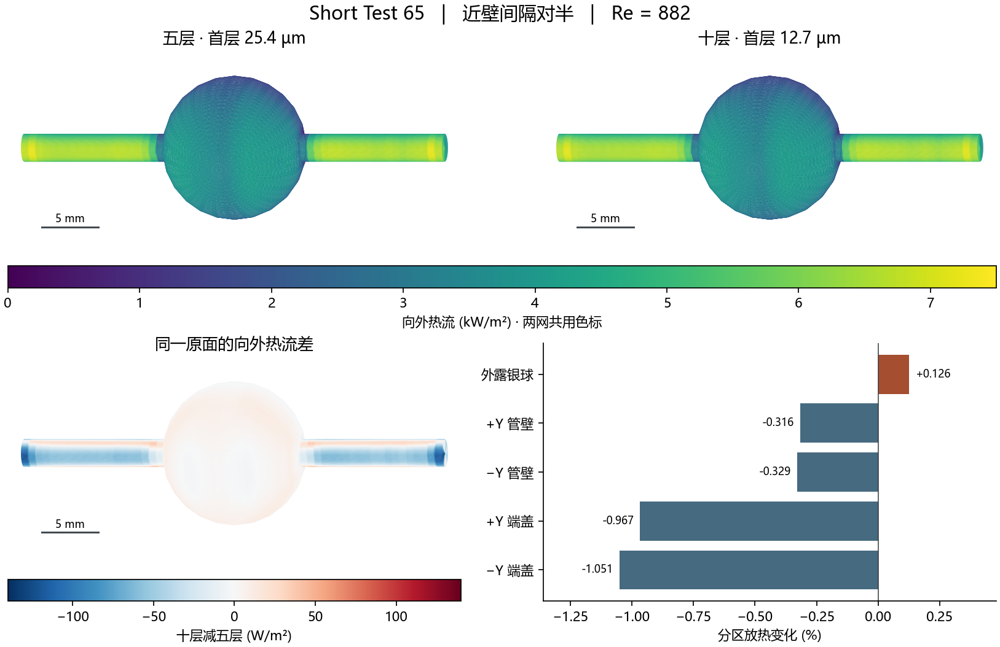

# 双支管银球近壁间隔对半后的全表面对照

**在同一民用试件、同一流动工况和同一组 32,480 个原面上，五层网到十层网的整件放热由 2.011094 W 变为 2.009415 W，变化 −0.0834%。** −Y 管迎风侧靠近端盖的热峰由 7.242 降至 7.160 kW/m²。归一到论文量热口径的外露银球功率偏差从 +38.43% 变为 +38.61%。这次只改变近壁法向分辨率，加密带来的变化不足以解释现有量热偏差。两网均已覆盖完整湿壁 0.000700423853595 m²，相对 v329 新增几何覆盖 **0 面、0 m²**。逐面压力与热流的联合实验验证面积仍为 0 m²。[事前计划](PLAN.md) · [细网逐面数据及七站](../../../cases/short_sphere/supportedFine65.zip) · [粗细网对照数据](../../../cases/short_sphere/supportedNearWall65.json)

## 实际改变的网格和输入

固定 Short Test 65，Re = 882、D = 12.7 mm、−X 来流 1.237488 m/s、给定球面极角壁温、两根名义支管和湿端盖的赤道温度。原五个壁法向间隔各插入一个几何中面；法向第一层为 12.685–12.700 µm，粗网为 25.369–25.400 µm。重复读取原生 SU2 网格，确认 30,080 个旧近壁单元分别对应两个细网单元，新增 29,770 个中点。138,752 个外区单元的有序连接全部对应。最外近壁接口、14D 远场、6,016 个壁片、逐壁温界和 54,527 对五区交叠均逐项核对；内面成对、单元及组成它的面锥体体积均为正。[结构复核](check_grid.py) · [准备和运行回执](evidence/receipts.zip)

| 网格 | 节点数 | 单元数 | 首层法向距离约值 | 首层壁面单位估算范围 |
|---|---:|---:|---:|---:|
| 五层 | 101,122 | 168,832 | 25.4 µm | 0.035–0.724 |
| 十层 | 130,892 | 198,912 | 12.7 µm | 0.014–0.371 |

两套层流表面输出的原生 `Y_Plus` 字段均为零。表中的估算改用实际输出的壁面摩擦系数向量，在各壁片角点投影到其切平面，乘入相应首层法向距离，以 Re × (Δn/D) × √(|Cf,t|/2) 换算。角点及棱边使用各自壁片的方向。压力值与坐标已逐壁节点核对。[估算实现](wall_units.py) · [原生字段与估算回执](evidence/wall_units.json)

细网从自己的冷态完成 600 次更新。全域没有超过登记容差的温差节点，末 20 行 p、u、v、w、弱焓、温差方程的最大 log₁₀ RMS 依次为 −10.735、−9.513、−10.094、−9.981、−8.254、−9.628；同窗未限幅温差 RMS 最大 2.35 × 10⁻¹⁰。首端点壁放热 2.009415407 W，远场输出 2.009354376 W，差额绝对值占 0.003037%。再延续 20 次，壁放热 2.009407769 W，远场输出 2.009366648 W，差额 0.002046%。两端点均通过原 0.5% 门槛，壁放热变化 0.000380%，低于热稳定限值 0.2%。独立释放壁行及 460,682 条内部边的重组通过，单步观察与普通驱动的全场差为零。粗网复用 v329 已通过的原结果。[基线与物理量定义](../v329/RESULTS.md)

## 哪些区域对近壁网格更敏感

| 区域 | 五层放热 / W | 十层放热 / W | 相对变化 | 五层峰值 / W·m⁻² | 十层峰值 / W·m⁻² |
|---|---:|---:|---:|---:|---:|
| 外露银球 | 1.137520 | 1.138958 | +0.126% | 4222.6 | 4226.5 |
| +Y 管壁 | 0.414695 | 0.413382 | −0.316% | 7199.5 | 7119.9 |
| −Y 管壁 | 0.415361 | 0.413996 | −0.329% | 7242.3 | 7160.1 |
| +Y 湿端盖 | 0.021621 | 0.021412 | −0.967% | 5756.7 | 5631.5 |
| −Y 湿端盖 | 0.021897 | 0.021667 | −1.051% | 5840.1 | 5709.5 |

整件积分中，球面和支管的变化部分抵消。按面积计，同面热流绝对差的中位数、95% 和 99% 分位分别为 **4.71、45.10、79.29 W/m²**，最大 130.57 W/m²。壁压绝对差的相应分位数为 0.000572、0.01075、0.01306 Pa，最大 0.02277 Pa。分位数取累积原面面积首次达到指定比例处的值。分区完整分位数见发布数据。

在首端点，粗细网排序最高的原面均为 **25,055**，向外热流降幅 1.13%。考虑相邻原面上的近似并列峰值，将各自峰值 99% 以上的原面组成近峰区。粗网含 109 面，0.773947 mm²；细网含 108 面，0.766847 mm²。这 108 面全部位于粗网近峰区，两分布交集占并集面积 99.08%。两次计算中热峰均落在 −Y 管靠近端盖的迎风侧。第二个端点另做全表面核对，细网追加 20 步的最大局部热流变化为 0.0606 W/m²。所有近峰面号可由发布小表查回。[同面统计程序](compare.py)

## 实验对照与精度边界

| +Z 测线极角 | 实验 Nu | 五层 Nu | 十层 Nu |
|---:|---:|---:|---:|
| 0° | 43.0 | 35.32 | 35.33 |
| 41.3° | 28.6 | 31.62 | 31.67 |
| 60.2° | 24.3 | 26.40 | 26.47 |
| 75.8° | 20.1 | 21.53 | 21.56 |
| 90° | 15.3 | 18.28 | 18.28 |
| 119.8° | 5.5 | 12.04 | 12.02 |
| 166.7° | 8.8 | 3.77 | 3.77 |

七站的 Nu 均方根误差从 4.651 变为 4.659。仅用外露球面平均热流折合整球，功率从 1.166536 W 变为 1.168012 W，试验量热为 0.842673 W。背风两站的偏差依然方向相反。这个对照量化了本段加密的影响，尚不能给出整体空间收敛阶，或把其余偏差唯一归因于支管温界、稳态尾迹、壁面切向分辨率或外域。[原试验及测量定义](../v321/SOURCE.md) · [Short 原论文](https://doi.org/10.7907/6CZB-AW27)

## 工作台、复核与运行代价

在 **Short 银球 · Test 65 → 双支管 · 近壁网格对照** 打开本次结果。三维页主值为细网；可在变量菜单切到五层热流或表压，两档共用色标，十层减五层的差值以零为色标中心。探针和截面始终使用同一物理面编号。`近壁网格敏感性` 页展示五区功率、近壁两网的热峰及七站曲线。五层独立算例仍可从原选项打开。首层流体温度随各网真实首层给出，两网的首层采样位置不同。[本机三维对照页](../../../outputs/v330_validation/ui01/workbench/index.html)

归档页已通过实际 MATLAB 侧栏验收，所有发布字段、四种对照变量、两组共同色标、五区探针、72 条截线导出记录及全表面 CSV 均已核对。独立方法以粗网壁坐标和原首层的中点定位细网首层，再从原生释放壁反力和同态边通量重算。与细网面表逐行比较，绝对壁压差为零，热流最大绝对差为 6.37 × 10⁻¹² W/m²。固体壁温、外缘温度和恢复温度继续保持未知。

基线提交为 `79e25c448e4402e130221d455e9643995c4d68f9`。复用 v329 的远场通量与数值配置，网格身份及运行节点数由新准备回执绑定。建网约 9.37 s，独立网格检查约 3.89 s，编译和链接合计 27.20 s。三个实际 200 次阶段耗时 71.06、73.14、68.47 s，端点附加计算合计 67.08 s，原生进程族峰值约 1.06 GiB。MATLAB 对照页验收用时 61.70 s，峰值约 3.40 GiB。开发、归档和独立读数和物理推进分开计时；没有重算粗网流场。

用 Python 标准库运行 `python docs/validation/v330/verify_pair.py` 可独立核对公开小包。恢复 v329 的固定环境及粗网准备资产后，`python scripts/shortSupportShared65.py outputs/short65_fine_new --near-wall` 从冷态运行十层网。如细网准备或专用驱动未缓存，入口会先生成并核对。使用 `--completed` 可对已收敛的细网任务重新核算导出。本机原始数据在 `outputs/v330_validation`；GitHub 随版本交付压缩面表和小型复核证据，大型场登记哈希并留本地。[公开复核入口](verify_pair.py) · [下一决定](NEXT_DECISION.md)
