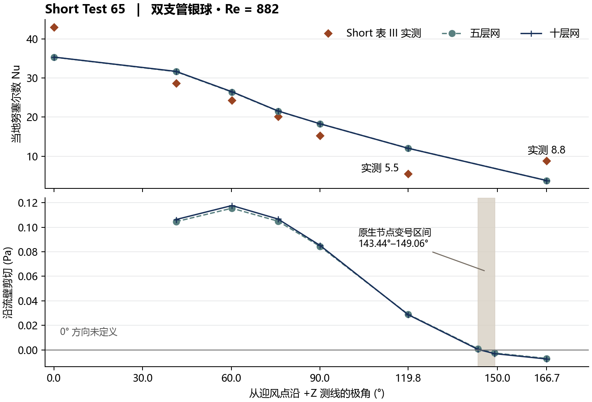

# 双支管银球背风测站与热峰的近壁流向

**在 Short Test 65 的两套稳态解中，119.8° 测站的近壁流动顺向，166.7° 测站反向。** 各站的壁剪切与首层速度同号，各自所在球面及其三个共边邻面也给出相同判断。沿 +Z 测线从迎风点向后，唯一一对发生顺逆变化的相邻原生节点位于 143.4375° 和 149.0625°。两网得到相同区间。实验在这两站测量了局部换热，流向取自数值解。[事前计划](PLAN.md) · [七站、五区、热峰与双网交集](../../../cases/short_sphere/supportedDirection65.json)

相对 v330，新增同时求得壁压和热流的面积为 **0 面、0 m²**。本版解决了背风两站在当前解中分别处于哪一侧、热峰附近能否识别反向的问题。试件原有 32,480 面、700.423854 mm² 的壁压与热流全覆盖，细网整件放热 2.009415 W，逐面壁压与热流联合实验验证面积为 0 m²。冻结工况为 Re = 882，球径 12.7 mm，来流沿 −X，速度 1.237488 m/s。支管外伸长度与热边界沿用名义设定。[完整试件与热边界](../v329/RESULTS.md) · [实验装置与测量定义](../v321/SOURCE.md)

## 背风两站与热峰

| 测站 | 原面号 | 剪切沿流分量，五层 / 十层 (Pa) | 首层速度沿流分量，五层 / 十层 (m/s) | Nu，五层 / 十层 / 实测 |
|---|---:|---:|---:|---:|
| 119.8° | 970 | +0.02902 / +0.02874 | +0.03782 / +0.01873 | 12.04 / 12.02 / 5.5 |
| 166.7° | 918 | −0.00699 / −0.00745 | −0.00911 / −0.00485 | 3.77 / 3.77 / 8.8 |

表中读数取自试验射线与原生测线弦的交点。工作台三维探针给出原三角面平均值，例如十层网 970、918 号面的剪切沿流分量分别为 +0.03118、−0.00688 Pa。两网首层流体节点的壁面距离分别约为 25.4、12.7 µm。0° 测站的顺流基方向退化，两项沿流分量均留空。其余四个中间测站均判顺向。细网在第一个背风站高估换热、第二站低估换热，外露球面折合量热仍高 38.61%。这两个各自位于不同流向区的误差有待解释。[热流、功率与七站实验误差](../v330/RESULTS.md) · [Short 原论文](https://doi.org/10.7907/6CZB-AW27)

两网最大放热均在 −Y 管的 25,055 号面。十层网该面的沿流剪切为 +0.03588 Pa、首层沿流速度为 +0.02332 m/s。三个共边邻面中两个顺向，31,904 号面上的来流切向投影退化。按每套网自身峰值的 99% 取近峰集合，五层 109 面中 90 面顺向、19 面未判定，十层 108 面中 90 面顺向、18 面未判定。两套集合及各自外侧一圈共边邻面中，符合双指标反向判据的面数均为零。细网近峰集合跨两根支管，+Y 管占 45 面、−Y 管占 63 面。18 个未判定面全由来流投影退化引起；粗网另有一面受源壁片棱边影响。[逐面分量与原因标志](../../../cases/short_sphere/supportedDirection65.zip)

## 反向区域及其放热

| 原面集合 | 五层反向面积 (mm²) | 十层反向面积 (mm²) | 十层反向面数 | 十层反向区放热 (W) |
|---|---:|---:|---:|---:|
| 外露银球 | 13.020 | 13.428 | 304 | 0.006362 |
| +Y 管壁 | 14.549 | 15.770 | 2,221 | 0.027889 |
| −Y 管壁 | 14.549 | 15.912 | 2,241 | 0.028231 |
| +Y、−Y 湿端盖 | 0 | 0 | 0 | 0 |
| **合计** | **42.118** | **45.110** | **4,766** | **0.062482** |

两套网共同判为反向的 4,396 面占 42.118 mm²，覆盖五层网的全部反向面。交集面积占并集的 93.37%，十层网额外辨认出 2.992 mm²。按原面的共边连通，两套网均得到八个反向分量，球面四个，每根管壁各两个。球面四个分量中各有两个孤立原面。该统计描述受当前拒判规则限定的局部投影，三维分离线和再附线的拓扑仍未知。

五层网反向区放热 0.055766 W。十层网顺向、反向、未判定面积分别为 589.708、45.110、65.605 mm²，对应放热 1.772398、0.062482、0.174536 W。未判定面仍具有已算壁压及热流。两个端盖的全部 128 个原面均有棱边影响，方向全数未判定。原面表保持正热流入壁的约定，统计中的放热为向外功率。两网各分组均保留吸热及放热两列，本工况吸热均为零。[两网分区积分、原因与共边邻域](../../../cases/short_sphere/supportedDirection65.json)

## 计算与独立核对

复用 v329 与 v330 分别完成 600 次更新、通过稳态窗口和守恒核对的终帧。逐项核对终帧及同刻 VTK 指纹、原生正常结束日志、末窗残差、节点坐标和壁压。固定 SU2 版本的节点摩擦系数来自黏性应力的壁面切向分量，乘以该工况的动压 0.84344938 Pa 得到流体对壁面的切应力。首层三分量速度乘以实际来流速度。壁剪切与首层速度属于同一数值场，二者符号一致只构成交叉检查。[SU2 的壁面切向应力与系数](https://github.com/su2code/SU2/blob/7048fd35f56d4bf52e586429d6746a36a10255f8/SU2_CFD/include/solvers/CFVMFlowSolverBase.inl#L2606-L2628) · [动压基准](https://github.com/su2code/SU2/blob/7048fd35f56d4bf52e586429d6746a36a10255f8/SU2_CFD/src/solvers/CIncEulerSolver.cpp#L1018-L1030)

6,016 个壁片分别作切向投影与角点对偶面积平均，经 54,527 对同分区正面积交叠传递到原面，再投影到三角面切平面。顺流取 −X 在该平面上的单位投影。表中保存两种向量的有符号分量、切向模、分类和原因位。发布 CSV 中 Status 的 +1、−1、0 分别表示顺向、反向、未判定。界面对未判定显示缺值并列出原因。Flags 从最低位起依次为球面轴点邻面、切向来流退化、原面棱边、源壁片棱边、剪切近零、速度近零、双指标异号、跨片剪切异号、跨片速度异号。原因可以并存。[后处理源码](direction.py)

独立实现按坐标从终帧定位首层节点，细网首层用粗网壁点和粗网首层几何中点定位。由质心扇形重新构造角点权重，以两次叉乘重算投影并用稀疏矩阵传递。两套网各 32,480 面的分量和模最大绝对差均低于 2.8 × 10⁻¹⁶（分别以 Pa、m/s 计）。分类和原因位逐面一致。用独立共边搜索、球面名义切向和弦交点复核了分区积分、反向分量、热峰邻域、七站及变号区间。[独立复算](verify_direction.py) · [回执](evidence/checks.json)

## 工作台与复现

在 **Short 银球 · Test 65** 选 **双支管 · 近壁流向（十层）** 或 **（五层）** 并打开结果。默认云图为近壁流向。点选原面可在同一个探针查看压力、热流、方向、剪切与速度的沿流分量和切向模，以及方法和拒判原因。变量菜单可切换到连续量并用两网共同的色标比较。**七站近壁流向** 页在两种入口均可并列查看五层与十层测站值。[本机十层云图](../../../outputs/v331_validation/ui02/workbench/index.html) · [本机五层云图](../../../outputs/v331_validation/ui03/workbench/index.html)

基线为 v330 提交 `923acc184349702c31da1ff0da548ba1014d18ad`。未改动其他任务的前端。实际工作台验收使用已发布的 v330 网页，检查两档入口、WebGL 绘制、七站表、探针、五个新增字段及导出。各档 X = 1.37 mm 截面的 72 条导出读数和离线页的全部 32,480 面已与交付表核对。首次同时加载两套完整字段的界面超过 4 GiB，监督中止。改为每次加载一套三维场后，细网与粗网分别用时 63.0 s、57.4 s，进程族峰值分别为 3.61、3.66 GiB。首次后处理因本机 Python 3.7 的文本写入及清理接口兼容问题未产生完整回执，已保留该次输出，交付取自下一次完整运行。后处理用时 3.81 s，独立原始场核对用时 3.97 s。开发与制图另计，本轮 CFD 推进用时为零。[监督与验收回执](evidence/checks.json)

随 GitHub 发布的面表约 1.14 MiB。在项目根目录运行 `python docs/validation/v331/verify_direction.py --public` 可用小包复核分区、连通性及两网交集。有本机两份原生场时，去掉 `--public` 可完整重算核对。受预算监督的复现命令为 `python docs/validation/v331/run_check.py read myRead` 或 `python docs/validation/v331/run_check.py verify myVerify`。每次使用新的输出目录名。两套原场留在 E 盘，精确终帧及表面 VTK 指纹见网格对照回执。[输入指纹](../v330/evidence/wall_units.json) · [下一决定](NEXT_DECISION.md)
