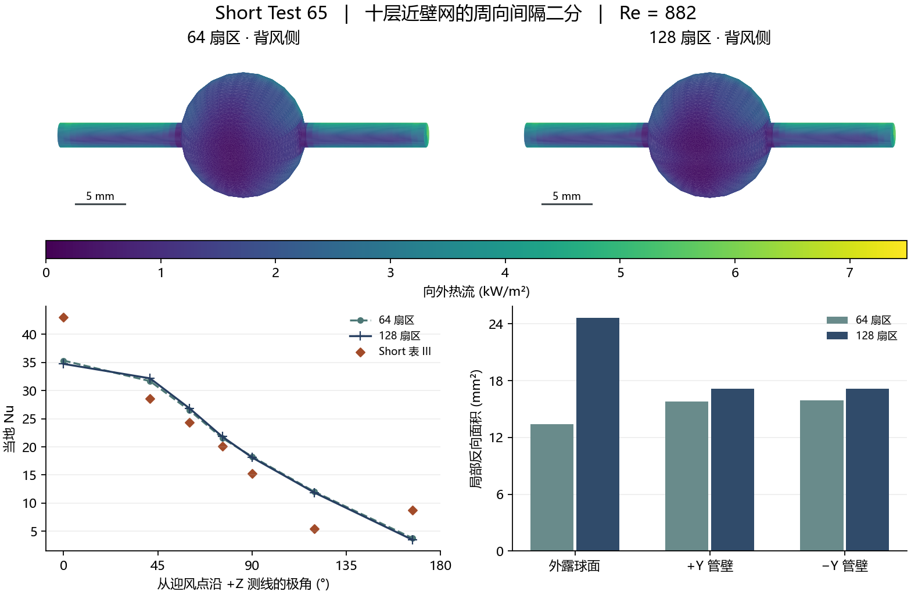

# 双支管银球在周向间隔二分后的全表面气动热

**同一 Short Test 65 试件从 64 增至 128 个周向扇区后，整件放热只降低 0.198%，背风侧的局部流向和换热对网格更敏感。** +Z 测线上，顺向转为反向的位置由 143.4375°–149.0625° 移到更靠迎风侧的 137.8125°–140.6250°。新的变号区间落在旧区间之外。整件功率稳定不足以判定局部流向已达到网格收敛。[逐面热流、压力及温度](../../../cases/short_sphere/supportedAngularSurface65.zip) · [区域与测站对照数据](../../../cases/short_sphere/supportedAngular65.json)

相对 v331，新增同时算出压力和热流的原面为 **0 面、0 m²**。128 扇区网从自己的冷态独立求得同一 **32,480 / 32,480 面、0.000700423853595 m²** 的稳态结果。本版量化了上一版无法从法向加密判断的切向离散影响，同时保留热峰、反向区和逐面结果的来源。逐面压力与热流联合实验验证面积仍为 **0 m²**。[事前计划](PLAN.md) · [64 扇区基线](../v331/RESULTS.md)

## 两处背风测站和热峰

| 测站或指标 | 64 扇区 | 128 扇区 | 实验 |
|---|---:|---:|---:|
| 119.8° 局部 Nu | 12.024 | 11.867 | 5.5 |
| 166.7° 局部 Nu | 3.769 | 3.473 | 8.8 |
| 七站 RMSE (Nu) | 4.659 | 4.888 | — |
| 外露银球平均热流折合整球量热 (W) | 1.168012 | 1.163586 | 0.842673 |
| 该量热相对偏差 | +38.61% | +38.08% | — |

实验中，从 119.8° 到 166.7°，Nu 回升 3.3；128 扇区的计算则从 11.867 降至 3.473。两套网在第一站都给出顺向流动，第二站都给出反向流动。128 扇区两个测站的沿流剪切分别为 +0.02528、−0.01098 Pa，真实首层沿流速度分别为 +0.01643、−0.00714 m/s。射线与该网自身的测线弦相交，墙面热流按论文的当地表温导热系数换算 Nu。实验没有同步的逐时刻测量或逐站 Nu 不确定度。[Short 表 II、III 及测量定义](../v321/SOURCE.md) · [原论文](https://doi.org/10.7907/6CZB-AW27)

两网热峰均在 −Y 支管的 **25,055 号原面**，向外热流由 7.1601 增至 **7.1769 kW/m²**，变化 +0.235%。按各自峰值的 99% 筛选，64、128 扇区分别有 108、107 个近峰面，两组交集占并集面积的 99.07%。加密后 89 个近峰面判为顺向，18 个未判定，峰值面与其共边邻面中均未检出双指标反向。[逐面近壁分量及原因标志](../../../cases/short_sphere/supportedAngularDirection65.zip)

| 区域 | 64 区放热 (W) | 128 区放热 (W) | 64 / 128 区反向面积 (mm²) |
|---|---:|---:|---:|
| 外露银球 | 1.138958 | 1.134643 | 13.428 / 24.636 |
| +Y 管壁 | 0.413382 | 0.413583 | 15.770 / 17.148 |
| −Y 管壁 | 0.413996 | 0.414048 | 15.912 / 17.148 |
| +Y 湿端盖 | 0.021412 | 0.021460 | 0 / 0 |
| −Y 湿端盖 | 0.021667 | 0.021700 | 0 / 0 |
| **整件** | **2.009415** | **2.005433** | **45.110 / 58.932** |

5,326 个原面在 128 扇区网的沿流壁剪切和首层速度上同时反向，覆盖全部原 4,766 个反向面。新增反向面积 13.822 mm²，其中约 11.209 mm² 位于球面。反向区放热 0.073080 W，其余顺向及未判定区分别放热 1.743851、0.188501 W。两个湿端盖的棱边影响按照原规则拒判流向，压力与热流均有计算。单个负投影仅标识局部反向，三维分离及再附拓扑仍待验证。同面热流绝对差的面积加权中位数、95% 分位及最大值分别为 26.89、129.07、244.56 W/m²，对应表压差为 0.06091、0.15138、0.21815 Pa。

## 实际改动的网格与物理条件

固定 Re = 882、球径 12.7 mm、沿 −X 的来流 1.237488 m/s、空气 310.99444 K、十个近壁间隔。球面取同一实验极角壁温函数，管壁和湿端盖取原赤道温度。全部 130,892 个旧体网节点在新网中有坐标完全相同的对应点。保留原有 64 边支管、端盖及两处接头；新湿壁和十层近壁沿弦插入中点。独立读回 SU2 文件后，旧壁片面面积与两个子片之和一致，每个旧体单元均对应两个子单元。现有 261,708 点、397,824 单元、12,032 个壁片、11,906 个湿壁点。首层法向间隔约为 12.685–12.700 µm，原面温界按各自网格取样，映射到相同原面后的最大平均壁温差为 0.01487 K。[网格生成](../../../scripts/shortSupportMesh.py) · [父子面独立核对](sector_grid.py)

14D 远场半径保持固定，新增的远场节点落在球面上，远区的周向分辨率同时提高。离散流体域体积由 11,416.603 增至 11,430.372 D³（+0.1206%）。新源壁片与原面有 **92,812 对同区交叠**；子片对每个原面的贡献加回旧父片，分数的最大差为 2.99 × 10⁻¹³。非均匀、带正负号的源壁片试载荷在全部五区闭合。旧 64 区路径也用原已发布输入复核，54,527 行交叠的所有数组与原文件逐值一致。[新交叠矩阵与壁节点](../../../cases/short_sphere/supportedAngularTransfer65.npz)

## 稳态、守恒及独立复核

SU2 8.6.0 不可压层流及有界温差离散沿用上一版，专用编译只把总节点数和远场节点数绑定到实际新网。每次更新逐个核对 2,690 个远场点的质量通量传递。冷态五段各 200 次。最终连续 20 行的 p、u、v、w、弱焓、温差 log₁₀ 残差上界依次是 −11.414、−10.911、−11.104、−10.989、−8.941、−11.379，无限幅温差 RMS 上界 4.25 × 10⁻¹²。低阶和实际阶段温差均在原界限内。[源端实现](../v329/build_shared.py) · [逐段原生回执与边界明细](evidence/receipts.zip)

| 端点 | 壁向外放热 (W) | 远场输出 (W) | 收支差绝对值占壁放热 |
|---|---:|---:|---:|
| 1,000 次更新后 | 2.005432653 | 2.005431569 | 0.0000541% |
| 再延续 20 次 | 2.005432584 | 2.005431795 | 0.0000393% |

两端点壁放热变化 0.00000348%，全表面最大局部热流漂移 0.00132 W/m²。独立释放壁行及 921,290 条内部边的修正通过核对，普通单步和观测步全场一致。用独立几何角点权重、原始释放反力和逐边通量重建全部原面，绝对壁压差为零，热流最大绝对差为 9.1 × 10⁻¹² W/m²；首层温度及给定壁温的最大绝对差为 2.3 × 10⁻¹³ K。两类沿流分量、模、分类、原因标志、七个测站及原生变号节点独立重算一致。固体壁温、外缘温度和恢复温度保持未知。[独立复算入口](verify_result.py)

## 工作台、代价与复现

在 **Short 银球 · Test 65 → 双支管 · 周向加密（128 扇区）** 打开新结果。热流云图和探针读取 128 扇区网的同一终帧，**64 与 128 扇区对照** 页并列给出五区功率、热峰、反向面积、两网七站 Nu 和测站流向。使用固定 v331 前端实际测试了入口、三维渲染和面元选择。导出的所有原面数值及 X = 1.37 mm 截面的 72 条热流记录已和发布面表核对。大型 CFD 场留在本机 E 盘，Git 交付小型结果、源程序及带指纹的运行回执。[本机离线三维页](../../../outputs/v332_validation/ui01/workbench/index.html) · [界面验收](check_sector_ui.m)

基线提交 `ae95222f3b16653275b14941d83bb5da981220b0`，已有并发前端与测试改动均未纳入。建网 16.06 s，独立网格检查 3.47 s，三个编译链接步骤合计 32.65 s。原生五段共 692.84 s，两个端点、控制和释放合计 141.81 s；原生进程族峰值 2.09 GiB。后处理和独立复算分别为 20.14 s、15.69 s，MATLAB 入口验收 57.53 s、3.73 GiB。以上各项均按各自进程计时，开发与归档另计。

直接复核发布数据可运行 `python docs/validation/v332/verify_result.py`。在已有固定 SU2 构建环境的项目根目录，运行 `python scripts/shortSupportShared65.py outputs/short65_angular_new --angular` 可从冷态重算新网的全表面。使用新输出目录名，添加 `--completed outputs/v332_validation/run01` 可复用本机已通过的端点重新生成面表、近壁场与两网对照。首轮命令行复读的面积加权均值因归约顺序出现不超过 7.2 × 10⁻¹⁴ 的差异，逐面数值一致。入口统一为登记的单线程后，热流压力表、测站表、流向表、端点汇总逐字节一致，比较数据的全部数值也一致；ZIP 容器包含各次生成的文件时间。用 `python docs/validation/v332/verify_result.py --run outputs/v332_validation/run01` 可从 E 盘原生帧和边通量独立核对。[命令行复读回执](evidence/replay.json) · [下一决定](NEXT_DECISION.md)
