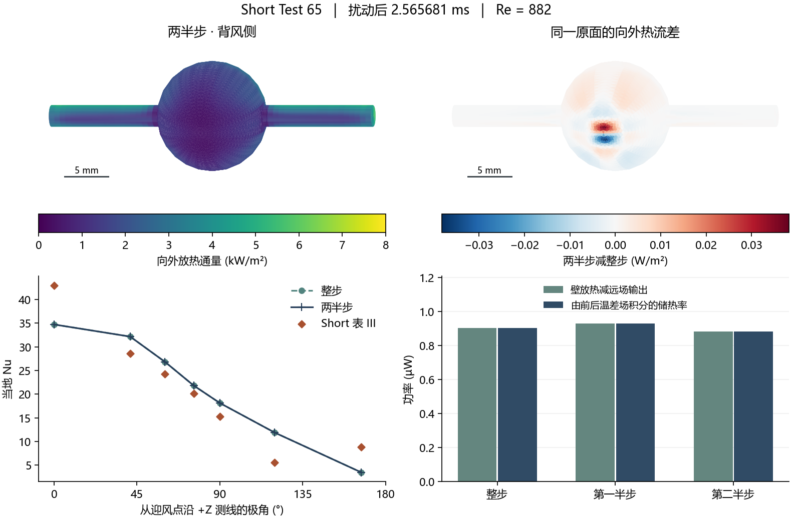

# 双支管银球在扰动后 2.565681 ms 的全表面结果

**同一初场经一个整步和两个半步，在 2.565681 ms 到达同一个物理时刻。** 两种步长均求出 Short Test 65 名义双支管银球全部 **32,480 / 32,480 个原面、0.000700423853595 m²** 的壁压和给定壁温下的对流热流。两半步整件向空气放热 **2.005432463 W**，与整步相差 **18.93 nW**。相对 v332，首次获得壁压及热流的几何面积为 **0 面、0 m²**；本轮首次在该带支管装置上完成带流体储热核对的物理时刻和时间步对照。逐面壁压与热流联合实验验证面积为 0 m²。[整步原面数据](../../../cases/short_sphere/supportedTime65Full.zip) · [两半步原面数据](../../../cases/short_sphere/supportedTime65Half.zip) · [事前计划](PLAN.md)

## 时间层、热峰与背风区

128 扇区、十层近壁网的稳态终帧来自 v332。保持球径 12.7 mm、Re = 882、沿 −X 的来流 1.237488 m/s、310.99444 K 环境和给定极角壁温。向离开银球和支管的尾迹加入紧支撑矢势的旋度，节点峰值为来流速度的 1%。初始场有 414 个节点的速度发生改变。全部湿壁、远场和支撑区域以外的节点逐值保持原态，压力、温差与弱焓初值也逐值核对。两支从同一份初场开始，BDF1 的 Δt U/D 分别为 0.25、0.125。每步有 360 次实际内更新，终点另有一次不推进流动和标量的装配读数。[已验收的稳态基流](../v332/RESULTS.md) · [初场和实际物理步](physical_step.py)

| 同一原面的差异 | 面积加权 RMS | 全表面最大绝对差 |
|---|---:|---:|
| 壁压 | 0.000003702 Pa | 0.00003006 Pa |
| 入壁热流 | 0.002655 W/m² | 0.03819 W/m² |

压力 RMS 为来流动压的 0.000439%，热流 RMS 和单面最大差分别为两半步热峰的 0.0000370% 和 0.000532%。首层流体温度的最大步长差为 0.00001694 K。两支热峰都在 −Y 支管的 **25,055 号面**，两半步向外热流为 **7.176913 kW/m²**。两支均有 107 个面达到各自峰值的 99%；其中 89 面的近壁流动顺向，18 面保留未判定。截断端盖、球面和管壁均计入五区分母。两半步外露银球、+Y 管、−Y 管、+Y 端盖、−Y 端盖分别放热 1.134642、0.413583、0.414048、0.021460、0.021700 W。[同刻步长及分区对照](../../../cases/short_sphere/supportedTime65.json)

两支在相同的 5,328 个面上得到壁剪切与首层速度同时反向，面积 **59.0146 mm²**。+Z 测线的流向变号仍位于 137.8125°–140.6250°。两半步在 119.8°、166.7° 的沿流剪切分别为 +0.02529、−0.01102 Pa，首层沿流速度为 +0.01643、−0.00717 m/s。该判据衡量相对当地切向来流的分量。固体壁温、外缘及恢复温度继续标为未知。

## 三个物理步的能量收支

| 物理步 | 扰动后时间 (ms) | 壁向空气放热 (W) | 远场输出 (W) | 流体储热率 (µW) |
|---|---:|---:|---:|---:|
| 整步 | 2.565681 | 2.005432482 | 2.005431579 | +0.903161 |
| 第一半步 | 1.282841 | 2.005432503 | 2.005431574 | +0.929244 |
| 第二半步 | 2.565681 | 2.005432463 | 2.005431579 | +0.883592 |

原生时间项以相邻物理层的温差、实际节点对偶体积和该步 Δt 装配。程序在强温界处理前后读取原生壁行，加入同一时刻的逐边限幅修正，并作独立释放壁行核对。使用 2,690 个真实远场节点上的共享质量通量重建远场输出。直接从 261,708 个节点的前、后温差场积分储热，并与原生加入时间项前后的方程行相减比较。三个端点的“壁放热减远场输出减储热”相对壁放热的差值绝对值均小于 5.7 × 10⁻¹¹。单独重组的离散装配收支保留质量散度源与自由行余量。第二半步与整步的储热率相差约 2.17%，两者的 BDF1 后向差分使用不同的前一时刻。[端点读数与独立释放核对](energy.py) · [公开边界明细、分块储热和原生回执](evidence/receipts.zip)

SU2 8.6.0 的静网恒密度 BDF1 已在标量方程与隐式对角中装配。v332 的稳态核对程序只重建空间行；本轮在诊断账中加入真实储热，保留原生更新、原伪步长限幅和空间离散。运行中自由节点的无限幅时空行与原生行逐点核对，最大绝对差 6.1 × 10⁻¹⁸。低阶与实际阶段的全域温差、强壁条件和边修正均通过。剔除终点读数行后，三个物理步各自最后 20 次真实内更新的六项 log₁₀ RMS 均低于 −11.82，无限幅时空残差 RMS 均低于 7.70 × 10⁻¹³。端点的额外装配记录流动状态和温差更新前后值，分别与保存帧核对。[专用编译及取样位置](build_time.py) · [上游原生 BDF1 项](https://github.com/su2code/SU2/blob/7048fd35f56d4bf52e586429d6746a36a10255f8/SU2_CFD/include/solvers/CScalarSolver.inl#L631-L729)

## 实验对照与资格

两半步在 119.8° 和 166.7° 的局部 Nu 分别为 **11.8671 和 3.4735**，实验为 **5.5 和 8.8**。七站 RMSE 为 4.8884 Nu，外露银球平均热流折合整球为 1.163586 W，比实测量热 0.842673 W 高 38.08%。与本次出发的稳态基流相比，两半步全表面最大局部热流变化只有 0.2325 W/m²。尾迹却已有可分辨的响应，在原扰动支撑区，两半步流速偏离稳态的最大值为 0.414% 来流速度。这个早期数值时刻通过了步长检查，实验没有同步的瞬时测量，发展后尾迹及周期平均仍未知。[实验测量定义](../v321/SOURCE.md) · [Short 原论文](https://doi.org/10.7907/6CZB-AW27)

## 工作台、复核和运行代价

在 **Short 银球 · Test 65** 的菜单中选 **双支管 · 2.566 ms（两半步）** 或 **（整步）**。三维页的工况行标出物理时间和步长。点选任一原面可同时核对压力、热流、给定壁温、首层温度、剪切、流向和方法。**同刻步长与储热** 页并列显示三个物理步的能量账、七站 Nu 和同刻误差。两支的 32,480 面、所有相关量与温度缺值、热峰和背风面探针，以及各自 X = 1.37 mm 截面的 72 条导出记录均已核对。验收使用隔离的 v332 离线前端。[本机两半步三维页](../../../outputs/v333_validation/ui01/half/workbench/index.html) · [本机整步三维页](../../../outputs/v333_validation/ui01/full/workbench/index.html)

独立后处理用另算的角点面积、释放壁行、逐边通量及源帧坐标重建两套全表面量。逐面绝对压力差为零，最大热流绝对差为 8.2 × 10⁻¹² W/m²。两份相同终时刻的终帧、两步各自的前一层、逐面近壁分量、原因标志和测站读数均分别核对。正常命令行入口从已完成三步读回复验，两份结果 ZIP 和比较 JSON 均逐字节复现。[独立复核](verify_time.py) · [复读指纹](evidence/replay.json)

基线提交为 `d460bfa1b4e1df32594078ea8a34b8efe316f938`。首次编译使用的通用变量接口缺少前一层密度访问器，改为上游同一方程使用的流动变量接口。首次整步的独立释放读数因五个冻结流动残差的 log₁₀ 为 −∞ 被读取器拒绝，原生进程正常退出。读取器现专门核对释放模式下的五个零流动残差、有限标量残差、冻结状态与原生行，真实推进的六项有限残差检查保持原样。保留原回执，从该次成功保存的整步及其释放现场接续，未重新推进整步。[执行记录](evidence/receipts.zip)

成功编译链接共 23.8 s；三个实际物理步含终点装配共 774.5 s，三次独立释放另用 114.8 s，原生进程族峰值约 2.22 GiB。原面映射 15.11 s、独立复算 20.64 s。两次 MATLAB 入口耗时 62.84、75.99 s，进程族峰值约 3.58、3.96 GiB。开发、归档与本表求解耗时分别计量；大场在本机 E 盘。

查看归档仅需要随版本发布的小包。重算可在菜单选择 **计算双支管 · 首个物理时刻**，或从项目根目录运行 `python scripts/shortSupportTime65.py outputs/short65_time_new`。这条路径依赖本机固定的 v332 原生稳态终帧、已准备网格和编译缓存。给命令加 `--completed outputs/v333_validation/run01` 可从已完成的三个实际时间步重新核对并导出。输出使用新目录名。运行 `python docs/validation/v333/verify_time.py` 和 `python docs/validation/v333/pack.py --check` 可在没有大型体场的情况下审核逐面步长差、原始壁反力、远场通量和按节点编号分块的储热。有原帧时加 `--run outputs/v333_validation/run01` 可逐节点、逐边重算。[下一决定](NEXT_DECISION.md)
