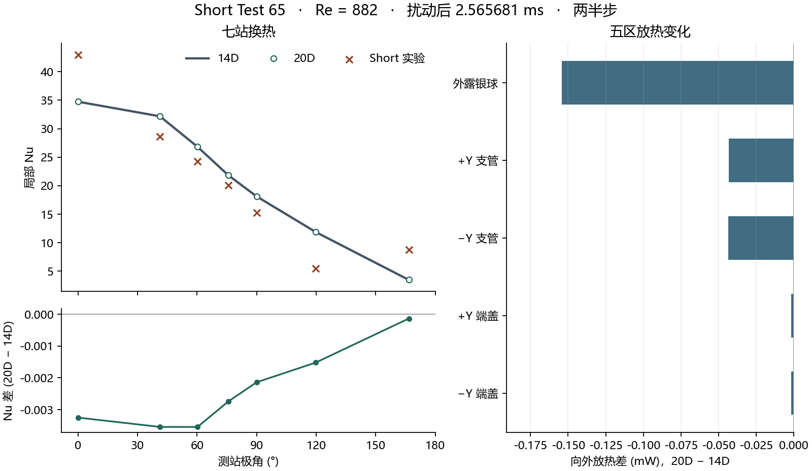

# 双支管银球从 14D 到 20D 的同刻外域对照

**将远场从 14 个球径移至 20 个球径，整件放热减少 0.24477 mW（0.01221%），外露银球折合量热偏差从 +38.0827% 变为 +38.0639%。** 这个变化量不足以解释现有实验偏差。对照对象为 Short Test 65、Re = 882 的名义双支管银球，在扰动后 2.565681445 ms 取各自的第二半步。两套网及两种步长均有所有 **32,480 个原面、0.000700423853595 m²** 的同刻壁压和热流。相对 v334 新增 **0 面、0 m²**，逐面两量联合实验验证面积为 0 m²。[原面逐区比较](evidence/comparison.json) · [事前计划](PLAN.md)

## 哪些区域受到了影响

| 第二半步的向外放热 | 14D (W) | 20D (W) | 20D 减 14D (mW) |
|---|---:|---:|---:|
| 外露银球 | 1.1346423 | 1.1344883 | −0.15404 |
| +Y 支管 | 0.4135827 | 0.4135394 | −0.04330 |
| −Y 支管 | 0.4140477 | 0.4140041 | −0.04369 |
| +Y 湿端盖 | 0.0214598 | 0.0214579 | −0.00188 |
| −Y 湿端盖 | 0.0216999 | 0.0216980 | −0.00187 |
| 整件 | **2.005432463** | **2.005187691** | **−0.24477** |

五区的放热变化均为负。入壁热流按正向入壁定义，第二半步的两域面积加权 RMS 差为 **0.36775 W/m²**，最大绝对差 **0.68468 W/m²** 位于参考面 26,019。相对环境壁压 RMS 差为 0.00031987 Pa，首层流体温度最大差为 0.00030623 K。两域热峰均在 −Y 支管的参考面 25,055，峰值向外热流从 7,176.913 变为 7,176.368 W/m²。20D 的两半步检出 5,329 个双指标反向面；与 14D 的差异来自外露银球的面 1,855（0.04422 mm²），该面由参与映射的分量混合而未判定，变为剪切和首层速度均反向。整步对照的反向面集合相同。[20D 整步面表](../../../cases/short_sphere/outer20/supportedTime65Full.zip) · [20D 两半步面表](../../../cases/short_sphere/outer20/supportedTime65Half.zip)

外露银球的放热按论文口径折合完整球面后为 **1.163428 W**，实验量热为 **0.842673 W**。七站换热 RMSE 由 4.88839 变为 4.88797 Nu，七站中最大的同站变化绝对值为 0.00355 Nu。119.8°、166.7° 两站的 20D 结果为 11.86554、3.47336 Nu，实验为 5.5、8.8 Nu。前者偏高、后者偏低，两种趋势均保留。结论限于当前温界、名义支管、低速层流模型和早期时刻。实物采用矩形射流设备，这轮试验只隔离数值远场距离。[装置及入口依据](SOURCE.md) · [七站测量定义](../v321/SOURCE.md)

## 计算与独立读回

三层外接网格保留原 261,708 个节点、397,824 个单元及其全部编号。原远场片成为内部界面，沿原射线外接三层，每层径向厚 2D，最外半径为 254 mm。20D 共 269,778 点、406,272 单元。两域的湿壁、十层近壁、测站、给定温度和原面交叠相同。独立核对体积、面锥正性、原网前缀和外接各层的连接。从 14D 合格稳态作共同区初猜，新增流体从均匀来流和零超温起步。20D 重新接受了 400 次稳态更新与追加 20 次的热稳定检查，首、末端点壁面与远场的功率差绝对值占比均低于 0.00072%。[网格实测](evidence/grid.json) · [独立体网校核](check_grid.py)

两种步长从 20D 自身的稳态帧重新施加与基线同定义的尾迹扰动。SU2 8.6.0 恒密度层流、BDF1、远场共享质量通量与有界温差离散沿用基线。一个整步及两个半步各做 360 次内更新与一次端点读数，每个终点有独立释放壁行。三个末窗的六方程 log₁₀ RMS 最大值均低于 −10，未限幅时空残差均小于 7.6 × 10⁻¹³。三个端点的物理收支相对差绝对值均小于 2.2 × 10⁻⁹。两半步末层全域储热率 +12.4611 µW；完整物理时间层与原生储热行分别积分。20D 两种步长的同面热流最大绝对差为 0.03830 W/m²。独立从释放壁节点反力、逐边限幅、真实体积与原始体场构造壁热流，同面最大差小于 9.1 × 10⁻¹² W/m²。[三步与小型原生证据](evidence/receipts.zip) · [独立重建](evidence/independent.json) · [步长比较](../../../cases/short_sphere/outer20/supportedTime65.json)

## 工作台与复现

从普通 STL 进入 **双支管银球 · Short Test 65**，网格页的 **远场半径** 可选 14D 或 20D。更换半径后重新绑定体网、确认边界与步长。20D 结果页的七站表并列实验、14D、20D 数值。三维变量中的 **20D 减 14D · 入壁热流** 和 **20D 减 14D · 相对环境壁压** 支持点选、局部截面和按文件面号导出。完整面表标明参考帧、主帧、两套体网及差值单位。选择新算时使用本机所选外域的已验收稳态基流，初始扰动与真实时间步由程序生成。

两个早期 MATLAB 窗口分别在 4.006、4.003 GiB 触发预设的 4 GiB 内存停止条件。第二次已确认快照接收成功，首次 WebGL 绘制回执尚未返回。区域证据页现将完整网格传一次，后续变量、面元或色标切换只传显示状态。首次传输中合并重复的逐面说明，MATLAB 保留原值及完整导出账本。最终两次五步窗口分别使用 2.98 GiB（米制整步）和 3.05 GiB（重排、转向的毫米两半步），耗时 47.16、45.98 s。每个分支均逐行核对 32,480 个文件面及 72 行差值截线，最大面热流差值读回误差 1.84 × 10⁻¹² W/m²。新算按钮已在进程启动边界核对派发；原生计算与三步复读另外实际执行。[米制验收](evidence/ui_full.json) · [毫米验收](evidence/ui_half.json) · [失败、成功及归档复读](evidence/runs.json) · [本机 20D 三维页](../../../outputs/v335_validation/ui03/half/workbench/index.html)

新网生成 11.22 s，独立几何校核 9.03 s，两套驱动编译与链接共 52.53 s。稳态及其控制、观察、独立释放共 405.7 s。三个实际物理步含端点装配共 705.6 s，三次独立释放另用 102.8 s。原生进程族最高约 2.29 GiB；逐面压力、热流、近壁方向、储热及原始体场的独立复核 22.89 s。开发与读文献时间未单独计时。[资源和运行记录](evidence/runs.json)

源代码与小型归档随 GitHub 发布。完整体网、编译驱动、稳态场、周期场和物理终点在本机 `outputs/v335_validation/outer01`。只取 Git 版本可运行 `python docs/validation/v335/pack_receipts.py` 核对原生回执、释放反力、远场输运、分块储热和两域逐面比较。具备本机固定运行环境时，可运行 `python scripts/shortSupportOuter65.py outputs/short_outer_new` 从冻结的 20D 稳态基流新算。加 `--completed outputs/v335_validation/outer01/time` 复读已完成的三个物理步。本轮两套 14D 及两套 20D 结果包、各自的步长比较 JSON 均从原生终帧复读后逐字节复现。若要重建 20D 基流，可在同一个新目录顺序运行 `docs/validation/v335/run_outer.py` 和 `docs/validation/v335/physical_outer.py`，所需的 14D 稳态及固定编译环境见[准备程序](outer_grid.py)。[下一项](NEXT_DECISION.md)
