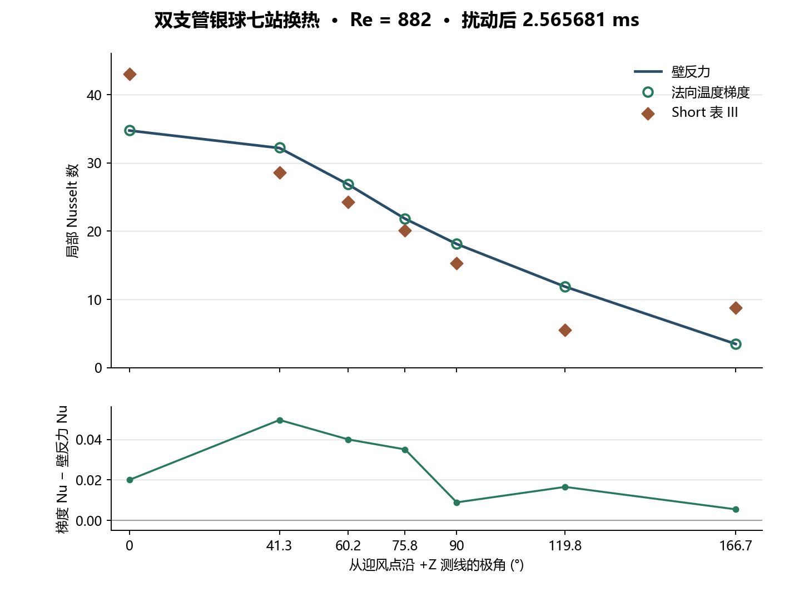

# 双支管银球七站的壁反力与近壁温度梯度

**在 Short Test 65 的七个测站，更换热流提取方法后，单时刻的局部 Nu 最多变化 0.050。背风两站相对实验仍一高一低。** 对照采用 Re = 882、14D 远场、128 扇区、十层近壁网以及扰动后 2.565681 ms 的两个半步终点。程序已能直接从本次体场求七站法向梯度，并在原工作台和离线三维页显示。相对 v336 新增壁压与热流交集 **0 面、0 m²**。试件已有 32,480 / 32,480 面、0.000700423853595 m² 的压力和热流，联合实验验证面积为 0 m²。[事前计划](PLAN.md) · [五组源帧与逐层节点数据](../../../cases/short_sphere/stationGradients65.json)

| 极角 (°) | Short 表 III 的 Nu | 壁反力 Nu | 梯度 Nu | 梯度入壁热流 (W/m²) |
|---:|---:|---:|---:|---:|
| 0 | 43.0 | 34.7352 | 34.7552 | −3418.76 |
| 41.3 | 28.6 | 32.1724 | 32.2220 | −3179.26 |
| 60.2 | 24.3 | 26.8271 | 26.8671 | −2662.45 |
| 75.8 | 20.1 | 21.8178 | 21.8529 | −2175.01 |
| 90 | 15.3 | 18.1209 | 18.1298 | −1809.75 |
| 119.8 | 5.5 | 11.8671 | 11.8836 | −1191.34 |
| 166.7 | 8.8 | 3.4735 | 3.4789 | −349.30 |

119.8° 的方法差为 +0.01652 Nu，原主解比实验高 6.36705 Nu。166.7° 的方法差为 +0.00544 Nu，原主解比实验低 5.32650 Nu。两种方法与实验的七站均方根误差分别为 4.88839 和 4.89650 Nu。同一测线上，两个数值方法均预测 119.8° 的局部换热高于 166.7°，实验次序相反。全表面功率仍由原守恒主解积分，为 2.005432463 W。七个离散点不能给出整件或整球的梯度积分；本版也没有取得新的压力实验数据。[全表面主解与量热](../v336/RESULTS.md) · [逐站差和模板敏感性](evidence/comparison.json)

## 实际取样及换算

采用模型的 Y = 0、+Z 子午线，从 +X 迎风点起计角。实验表 III 给出极角，周向方位沿用项目对试验布置的假设。程序在每站使用原壁反力的两个节点和弦插值位置，沿名义球面外法线，与实际体网中逐层相连的边求交。每层重新求温度插值权重及 SI 距离。在该测线上，近壁层与球面归属均唯一；测线离两侧管根接缝所在平面的距离至少 6.23 mm。管根处另有棱边和接缝，七站均未采样该处。名义球面法线与截面内壁弦的垂线在各站相差 0 至 2.675°。[几何和方位依据](../v324/RESULTS.md)

主对照用壁点与前两个流体点作非等距二次求导。正热流入壁，取 `q_in = k_film dT/dn`，其中法线从壁指向流体，膜温导热系数为 0.02867799 W/(m·K)。Nu 用向外热流乘球径，再除以当地壁温导热系数及壁面与来流的温差。两半步分支七站的首层法向距离为 12.6899–12.7038 µm。原始线温梯度在 CSV 中按 K/m 单列；它来自探针的温度响应，表 III 的 Nu 另经整体量热标定。论文未报告各站 Nu 的独立误差条。[原始测量定义](../v321/SOURCE.md) · [Short 原文](https://doi.org/10.7907/6CZB-AW27)

## 空间、时间和算法核对

| 保存场 | 最大两方法差 (Nu) | 一层与二次模板最大差 (Nu) | 较宽与原二次模板最大差 (Nu) |
|---|---:|---:|---:|
| 64 扇区、五层稳态 | 0.13665 | 0.18497 | 0.27256 |
| 64 扇区、十层稳态 | 0.10326 | 0.07583 | 0.02340 |
| 128 扇区、十层稳态 | 0.04961 | 0.07793 | 0.02730 |
| 128 扇区、十层、同刻两个半步 | 0.04961 | 0.07793 | 0.02730 |

较宽模板取壁点和第 2、4 层。64 扇区的五层到十层稳态对照仅改法向间距，七站梯度 Nu 最大改变量为 0.06582；119.8° 与 166.7° 处分别为 −0.01411 和 −0.00101。十层网从 64 到 128 扇区时，七站最大变化为 0.67546 Nu。同一 128 扇区网的两个物理步长在同一时刻最大相差 0.000066 Nu。这些是本次网格及模板下的差值，空间离散总误差仍未知。

独立程序读取五份实际体场，逐节点核对位置和温度，以二维线性系统重求交点，再用缩放后的多项式系数求壁面导数。还检查了升温、降温、零壁面导数和断开层连接的情形。本次共审核 **35 组测站剖面**。给定已发布的小型节点数据即可运行 `python docs/validation/v337/verify.py`，加 `--volumes` 可从 E 盘体场再核对节点。[独立复算](verify.py) · [采样实现](../../../scripts/shortSupportStationGradient.py)

## 工作台和交付

v336 独立安装的三步原体场也用本版入口复读了一次。验收时在内存中加载更新的三个 Python 模块，原安装源码及源路径保持可追溯，耗时 59.80 s。生成的梯度文件与旧安装路径的结果逐字节相同；原完成回执中已有的每一项都与复读结果相等。[独立安装复读](check_install.py)

普通 STL 五步工作台的结果页在七站表上方增加“测站对照”，可切换实验与主解、两种 Nu、两种入壁热流及法向取样。CSV 保留源帧、STL 面号、给定壁温、前两层流体温度和距离、法向梯度、导热系数、热流算法与取样状态。算例菜单的“五区热量与七站”页增加梯度曲线。导出的离线三维页可在侧栏展开“七站换热对照”并下载同一 CSV。20D 沿用自己的结果；本次对照仅匹配 14D 正确的源帧、温界、网格及原测站表。[本机离线三维页](../../../outputs/v337_validation/ui02/workbench/index.html) · [窗口与导出核对](evidence/workbench.json)

以 v336 为基线，用独立目录中的冻结前端和本次 MATLAB 代码验证了五种已归档的保存场、真实任务重开、方法切换、导出和受损源拒收。新算路径在发布完成回执前从本次体场生成梯度文件。原生复读沿用真实时间层与释放壁行。五组体场采样耗时 10.28 s，原生旧安装路径复读与生成对照耗时 49.33 s，独立节点与数值复算耗时 9.28 s，最终工作台验收耗时 48.45 s、进程族峰值 2.71 GiB。没有新增流动求解步；开发耗时未独立计时。[过程回执](evidence/runs.json) · [下一项](NEXT_DECISION.md)
