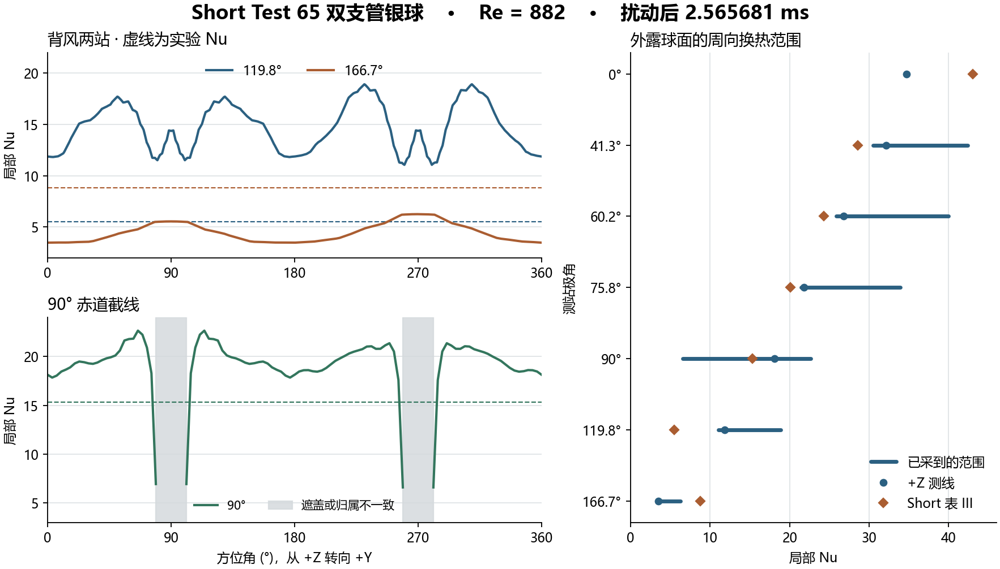

# 双支管银球七站的周向换热

**在同一方位比较时，119.8° 站的换热始终强于 166.7° 站。** Short Test 65、Re = 882、14D、扰动后 2.565681 ms 的两个半步终点，两站均有完整 360° 的外露球面。逐区间计算得到 `Nu(119.8°) − Nu(166.7°) ≥ 4.839`；实际取到的最小差为 4.84491，位于方位 280.00466°，对应标准 STL 面 2089 和 2036。实验两站分别为 5.5 和 8.8，差为 −3.3。在这个瞬时场上，试验方位不确定性解释不了两站的反序。[判据及独立复核](evidence/comparison.json) · [实验原表](../v321/SOURCE.md)

相对 v337 新增同时获得压力与热流的原面为 **0 面、0 m²**。该试件已有 32,480 / 32,480 面、0.000700423853595 m² 的压力与热流，整件向空气放热 2.005432463 W。联合逐面实验验证面积仍为 0 m²。本版从同一份已核验壁反力得到周向曲线，排除了一个具体的实验对照差异来源。试验表只有极角，+Z 是项目沿用的名义测线。[基线及法向梯度对照](../v337/RESULTS.md) · [事前计划](PLAN.md)

## 七个极角

极轴为 +X，方位从 +Z 朝 +Y 增加。下表为实际取得的 Nu 范围。极值面号对应标准 STL，共享位置列出代表面。区间内部的连续包围、热流极值、方位、全部参考面定位读数与缺项状态见曲线包。0° 为唯一迎风点。[完整曲线和区间](../../../cases/short_sphere/stationAzimuth65.zip)

| 极角 | 实验 Nu | +Z 测线 Nu | 全周已采到的 Nu 范围 | 最小 / 最大值所在参考面 |
|---:|---:|---:|---:|---:|
| 0° | 43.0 | 34.735 | 34.735 | 164 / 164 |
| 41.3° | 28.6 | 32.172 | 30.502–42.369 | 3425 / 2309 |
| 60.2° | 24.3 | 26.827 | 25.855–39.984 | 3405 / 101 |
| 75.8° | 20.1 | 21.818 | 21.428–33.948 | 3390 / 272 |
| 90° | 15.3 | 18.121 | 6.600–22.638 | 4462 / 255 |
| 119.8° | 5.5 | 11.867 | 11.057–18.908 | 2253 / 1717 |
| 166.7° | 8.8 | 3.473 | 3.473–6.250 | 3106 / 2200 |

六条非退化截线中，只有 90° 赤道有球面缺口。两段方位为 **78.870°–101.130°** 和 **258.870°–281.130°**，合计 44.520°。其中约 29.596° 命中管壁、14.630° 命中湿端盖、0.294° 属于原网与计算网命中区域不同；几何接缝点单独标记。其余 315.480° 有外露球面读数。遮盖处的管壁、端盖仍计入全表面功率。靠近接缝的最小值从外露侧的实际内点取得。没有跨缺口连线或补值。

## 如何取样和证明排序

从第二半步的同态节点入壁功率除以集总对偶面积，得到壁节点热流。按实际湿壁四边形的 0–2 对角线分片，在射线与三角面的交点插值热流和给定壁温。按当地壁温导热系数计算 `Nu = −q_in D / [k(Tw)(Tw − T∞)]`。同一射线与原 STL 独立求交以确定面号和区域。曲线是节点场的点值，三维探针仍显示该原面的守恒面均值。七个 +Z 读数均与 v337 的壁反力测站值吻合。[生产取样程序](../../../scripts/shortSupportAzimuth.py)

求出等极角锥面与两套网格各三角边相交的方位，加入整度点并保留每个开区间的内部读数。背风两站共用切分。开区间内命中面固定，重心插值的分子、分母可分别用常数和正弦、余弦表示。对区间端点及内部驻点取界，再与节点凸包相交，给出热流、壁温和 Nu 的保守包围；边界点单独求交。整圈的数值下界 4.83907 来自所有区间及边界。共保存 **10,041 条定位记录**。

独立复核直接读取 v336 独立安装的释放壁行、逐边修正和保存的温度场，用另一种角点对偶面积算法重建节点热流。采用射线平面交点与面内坐标核对记录，另检查 8,036 个区间内有效读数。最大热流差为 **7.05 × 10⁻¹² W/m²**。第二项证明单独把 360° 分为 1,440 个 0.25° 窗，用方向偏移和各三角形的球面半空间对每窗可能命中的三角面作保守筛选，再以其全部节点包围热流与温度。得到独立的共同方位差下界 **3.93718 Nu**。两个下界分别报告，均对应存储的离散场和明确的插值定义。[独立复核实现](verify.py)

## 工作台和复现

在 14D 两半步的结果页选择 **查看七站周向换热**。可比较背风两条曲线或选择单站，切换局部 Nu、入壁热流，点击曲线或移动方位滑块读取数值。桌面曲线中的 STL 面号可定位到同一工作台的原面探针。离线三维页的侧栏也可展开周向图或下载含帧和 STL 指纹的 CSV。实际窗口已分别验证标准面序的发布归档以及反序 STL 的本地任务重开。两个窗口的 10,041 行均已与计算包逐项比较，切换整步后会撤下该半步曲线。[本机离线三维页](../../../outputs/v338_validation/ui02/workbench/index.html) · [窗口和 CSV 验收](evidence/workbench.json)

普通入口分别从既有安装和独立安装复读原生三步并生成相同字节的曲线包，耗时 63.88 s 和 76.48 s。独立几何、反力及整圈包围复核耗时 9.81 s，峰值 177.8 MiB。最终归档窗口及完整导出验收耗时 74.48 s、峰值 2.94 GiB。此次复用已有物理步，新增流动求解步数为零。开发和文档耗时未独立计时。只取 Git 版本可运行 `python docs/validation/v338/verify.py` 核对归档分区、极值和排序，具备已登记的大型体场时加 `--volumes` 可独立重建。[运行回执](evidence/runs.json) · [下一项](NEXT_DECISION.md)
