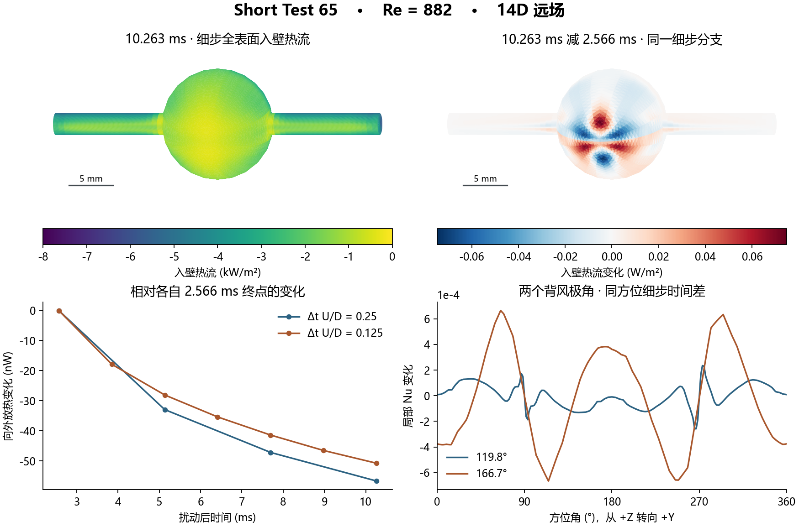

# 双支管银球在 10.262726 ms 的全表面瞬时解

Short Test 65 名义试件的 **32,480 / 32,480 个原面**均有计算壁压和给定壁温下的对流热流，总面积 0.000700423853595 m²。细时间步的整件向外放热 **2.005432412 W**，相对同一分支 2.565681 ms 的结果减少 **50.78 nW**。两种步长均将热峰定位到 −Y 支管 25,055 号面。新增几何覆盖 **0 面、0 m²**。这次取得了新的物理时刻，并检验了早期尾迹演变能否解释两处背风测站与实验的偏差。[两支逐面数据与时间链](../../../cases/short_sphere/later1/supportedTime65.json) · [原始实验定义](../v321/SOURCE.md) · [事前计划](PLAN.md)



## 同一时刻的场量和五区积分

球径 12.7 mm，Re = 882，来流沿 −X，速度 1.237488 m/s，空气温度 310.99444 K。试件两侧短支管各外伸一个球径，两个端盖均为湿壁。球面温度沿实验极角插值，支管和端盖取名义赤道温度。使用既有 14D 外域、128 周向扇区和十层近壁网。整步和半步分别从各自的真实早期终帧接续，四个整步与八个半步都到达一个对流时间。两条链的 Δt 分别为 2.565681、1.282841 ms。[几何与名义边界](../v325/RESULTS.md) · [共同扰动初场和 BDF1 方法](../v333/RESULTS.md)

| 细步终点的原面量 | 最小值 | 最大值 | 来源 |
|---|---:|---:|---|
| 表压（Pa） | −1.577866 | +1.591034 | SU2 不可压层流末帧，按面积映射到原面。加环境压力后绝对壁压为 98,765.820–98,768.989 Pa |
| 入壁对流热流（W/m²） | −7,176.913 | −347.322 | 强温界处的同态壁反力及逐边修正，经独立释放壁行复核，按面守恒分配 |
| 给定壁温的面均值（K） | 352.379237 | 353.150000 | 已施加的温度边界 |
| 首层流体温度（K） | 348.736817 | 352.995325 | BDF1 终点的首层流体标量，换算温度后映射 |

热流正方向指向壁内，本次所有面均向空气放热。固体求解壁温、边界层外缘温度和恢复温度保持未知。[细步全表面包](../../../cases/short_sphere/later1/supportedTime65Half.zip) · [独立场量重建与极值面号](evidence/comparison.json)

| 实际外表面 | 面数 | 晚时刻细步放热（W） | 比同一分支早时刻的变化（nW） |
|---|---:|---:|---:|
| 外露银球 | 4,624 | 1.134642297 | −44.937 |
| +Y 管壁 | 13,864 | 0.413582728 | −1.700 |
| −Y 管壁 | 13,864 | 0.414047739 | −3.930 |
| +Y 端盖 | 64 | 0.021459791 | −0.096 |
| −Y 端盖 | 64 | 0.021699857 | −0.121 |

## 时间变化与步长差

| 原面量 | 细步晚减早，面积 RMS | 细步晚减早，最大绝对差 | 晚时刻整步对半步，最大绝对差 |
|---|---:|---:|---:|
| 表压（Pa） | 0.00003494 | 0.00021065，面 1097 | 0.00002048 |
| 入壁热流（W/m²） | 0.010486 | 0.074779，面 926 | 0.011259 |
| 首层流体温度（K） | 0.00000464 | 0.00003311，面 926 | 0.00000497 |

两支在晚时刻的整件放热相差 13.02 nW。步长对照的表压 RMS 为来流动压的 0.000338%，热流 RMS 为热峰的 0.0000226%。细步分支的原扰动尾迹区域内，两时刻流速矢量变化的体积加权 RMS 为来流速度的 0.1744%，最大变化为 0.3803%。该局部速度场发生了可测的演变，壁面响应较小。[同面早晚差值](../../../cases/short_sphere/later1/timeDifference.zip) · [体场独立复算](evidence/comparison.json)

## 实验对照

| 极角 | 实验 Nu | 2.565681 ms 细步 Nu | 10.262726 ms 细步 Nu |
|---:|---:|---:|---:|
| 0° | 43.0 | 34.735232 | 34.735232 |
| 41.3° | 28.6 | 32.172401 | 32.172412 |
| 60.2° | 24.3 | 26.827083 | 26.827100 |
| 75.8° | 20.1 | 21.817832 | 21.817859 |
| 90° | 15.3 | 18.120948 | 18.120974 |
| 119.8° | 5.5 | 11.867054 | 11.867063 |
| 166.7° | 8.8 | 3.473496 | 3.473120 |

沿 +Z 名义测线，七站 RMSE 从 4.888387 变为 4.888453 Nu。晚时刻细步对整个共同方位的区间计算给出 `Nu(119.8°) − Nu(166.7°) ≥ 4.83875`；整步下界为 4.83879。以 1,440 个独立角窗从原场包围同一差值，两支下界均超过 3.9375。实验差为 **−3.3**。延长到这个时刻仍解释不了两站的反序。单个对流时间内的扰动响应只支持这段时间的结论；实验没有与该扰动同步，发展后尾迹和长时均值仍待证。[细步周向曲线](../../../cases/short_sphere/later1/stationAzimuth.zip) · [整步周向曲线](../../../cases/short_sphere/later1/stationAzimuthFull.zip)

只积分外露银球，再按其平均热流折合完整球面积，细步得到 1.163586 W。Short 表 II 量热值为 0.842673 W，数值偏高 **38.08%**。管壁和端盖的热量已单列。实验缺少逐面壁压及热流的联合测量，联合实验验证面积为 **0 m²**。该民用试件独立记账。[Short 论文第二部分，表 II、III](https://doi.org/10.7907/6CZB-AW27)

## 计算、原始证据与复现

准确基线为 v338 `3935850822bf743f197350e70b5a7d2c27603311`。新增三个整步、六个半步，每步完成 360 次实际内更新、一次冻结端点装配和独立释放读数。九步相对能量收支差的最大绝对值为 3.03 × 10⁻¹¹ 以下。细步终点的壁放热 2.005432412208 W、远场输出 2.005431599666 W、空气储热率 +0.812539 µW。由体场、对偶体积和独立壁行重建后，两个分支的最大原面热流读回差均低于 10⁻¹¹ W/m²。[原生历史、分块储热与源字节](evidence/receipts.zip) · [独立验证](verify_later.py)

从米制 `supported_m.stl` 进入五步工作台，选 14D，在边界页选择 **10.262726 ms · 1 D/U** 以及时间步长。计算页可读取归档、重开已完成目录，或从本机的 2.565681 ms 任务接续。起点留空时程序先生成早期场。结果页支持七站的两时刻对照、周向换热、原面拾取和压力、热流、首层温度的时间差；两支差场各物理量共用以零为中心的色标。[试件 STL](../../../cases/short_sphere/supported65.zip) · [安装依赖](../v336/INSTALL.md)

在项目根目录运行以下命令。第一条只读随 Git 发布的小包。后两条分别从本机早期结果进行真实接续，及从完整原生场重新读回；输出目录使用新名字。

```powershell
python docs/validation/v339/verify_later.py
python scripts/shortSupportLater65.py outputs/short65_later_new --from-job outputs/v338_validation/reread01
python scripts/shortSupportLaterExport.py outputs/short65_later_read --run outputs/v339_validation/later01/run --reread
```

实窗分别使用标准 STL 的晚时刻半步归档、反序 STL 的晚时刻整步本地任务，以及早时刻归档。两组晚时刻各核对 32,480 行壁面 CSV、72 行截面 CSV、两种面号、七站、三项差场的探针及固定色标。切换时刻会清除旧结果；尝试按早时刻打开晚时刻任务时，工作台拒收。独立复读全部新物理层后，两个原面包、两套周向曲线、同面差、梯度和完成回执与初次导出逐字节相同。仅下载 Git 即可在 MATLAB 中打开版本归档。[本机可旋转三维页](../../../outputs/v339_validation/ui_half/workbench/index.html) · [实窗与导出核对](evidence/workbench.json)

九次求解合计 48.00 分钟，独立释放合计 6.71 分钟。含起点检查及首次映射，任务目录记录的经过时间约 57.42 分钟。最大求解进程组约 2.22 GiB。独立物理层复读用时 161.63 秒，从原场重建并对照两个分支用时 63.81 秒；两个晚时刻窗口的显示、导出各用时 56.47 和 74.78 秒。开发及文档工时未单独计时。本轮大型体场、检查点和窗口副本在本机 `outputs/v339_validation`，排除指向既有数据的共享硬链接后，目录独占文件约 3.29 GiB。发布包含完整原面小包及运行证据。恢复逻辑另核对了完整、部分及受损回执，已登记的物理步原样保留。[资源与终态回执](evidence/runs.json) · [下一项功率边界](NEXT_DECISION.md)
