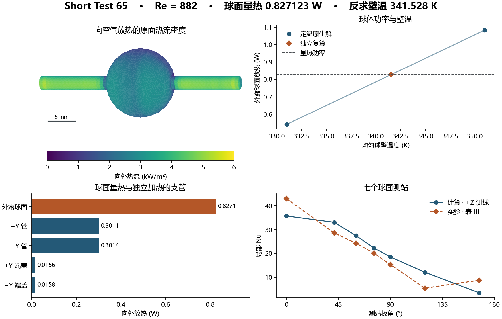

# 球体量热功率下的双支管银球全表面解

在 Short Test 65 的 Re = 882 工况下，给定**球体加热功率 0.827123193 W**，程序反求的均匀银球壁温为 **341.527781 K**。独立稳态计算将 4,624 个外露球面的对流放热积分为 **0.827116501 W**，比输入低 6.69 µW，相对差 −0.000809%。Short 报告的平均表温为 352.927778 K，计算低 **11.4000 K**。热平衡闭合达到了 0.02% 的事前门槛，实验温度对照仍有明显偏差。[量热定义](../v321/SOURCE.md) · [事前计划](PLAN.md) · [两个括区及候选的原场复核](evidence/comparison.json)

相对 v339，此试件新增同时获得壁压和热流的几何覆盖为 **0 面、0 m²**。本版首次给外露球面的 **0.000494103524 m²** 求出了功率约束下的集总壁温。其余 27,856 个管壁及端盖面采用随球温的名义补偿边界。五区全部 **32,480 面、0.000700423854 m²** 均有壁压、对流热流与首层流体温度，逐面压力与热流联合实验验证面积为 **0 m²**。[全表面场及七站 CSV](../../../cases/short_sphere/calorimetry65.zip)



## 功率和温度的含义

Short 表 II 的 0.842673109 W 已将外露银球的电量热结果按 1.0188 折算到完整球面积。撤销这一次修正后，按作者的量热解释取实际外露银球功率为边界。两侧支管各有补偿加热，程序分别积分其管壁和端盖的功率。试件仍采用两侧各外伸一个球径的名义短管；实验支管全长、沿程温度和独立损失分量未知。计算均匀银球的准稳态热平衡，固体内部温度分布与瞬态响应待求。[论文第二部分，印刷页 60–63、77–78](https://doi.org/10.7907/6CZB-AW27) · [几何口径](../v324/RESULTS.md)

| 独立原生工况 | 湿壁温度（K） | 外露银球放热（W） | 再推进 20 次后的球面放热（W） |
|---|---:|---:|---:|
| 低温端 | 330.994444 | 0.541779306 | 0.541779237 |
| 高温端 | 350.994444 | 1.083571319 | 1.083567616 |
| 功率插值候选 | 341.527781 | 0.827116501 | 0.827116396 |

两端分别采用相对来流 +20 和 +40 K。两支逐面热流除以各自温差后的最大差为 0.007684 W/(m²·K)，首层流体超温按同一方法归一化后的最大差为 3.20 × 10⁻⁶。对两个球面功率作割线插值得到候选温度，第三次计算重新施加均匀温界、推进全部原生方程，并独立释放壁行。三个工况均从 v332 同网稳态出发，新温界与各自的数值初场单独保存，压力和速度的初始值按点核对。没有使用实验七站 Nu 来调整候选温度。[计算入口](../../../scripts/shortSupportPower65.py) · [原生证据包](evidence/native.zip)

**物性仍有实验温度依赖。** 三次试算都使用 v332 的恒物性。空气温度为 310.994444 K，导热系数 0.028677994 W/(m·K) 取自实验平均表温所定的膜温 331.961111 K。反求温度对应的膜温为 326.261113 K，同一关联给出 0.028248682 W/(m·K)，低 1.497%。此差值仅衡量导热系数的变化。单独计算壁温并未消除这一输入依赖。[物性定义](../../../scripts/shortSphere65.py) · [下一项](NEXT_DECISION.md)

## 全表面分布与实验测站

| 区域 | 面数 | 向空气放热（W） | 模型中的温度身份 |
|---|---:|---:|---|
| 外露银球 | 4,624 | 0.827116501 | 量热平衡求出的均匀壁温 |
| +Y 管壁 | 13,864 | 0.301104716 | 随球温给定 |
| −Y 管壁 | 13,864 | 0.301442848 | 随球温给定 |
| +Y 湿端盖 | 64 | 0.015625732 | 随球温给定 |
| −Y 湿端盖 | 64 | 0.015800534 | 随球温给定 |
| 整件 | 32,480 | **1.461090332** | 五区守恒积分 |

表压为 −1.577865 至 +1.591034 Pa，绝对壁压为 98,765.820 至 98,768.989 Pa。入壁热流为 −5,225.797 至 −250.355 W/m²，负值表示热从壁面传给空气。主端点与追加 20 次后的热峰都在 **−Y 支管参考面 31,841**。首层流体温度为 338.476175–341.416856 K。压力来自不可压层流终场；热流由同态释放反力和内部边修正重建，再按五区面片交叠保守分配；首层温度来自对应流体节点。原生面表中的 `wallInputK` 是提供给第三次流体求解的数值温界。工作台及导出的原面表按上表分别标识球面求解温度、支管和端盖的给定温度。[原场和峰值面号](evidence/comparison.json)

| 极角 | 实验 Nu | 计算 Nu |
|---:|---:|---:|
| 0° | 43.0 | 35.690 |
| 41.3° | 28.6 | 33.032 |
| 60.2° | 24.3 | 27.477 |
| 75.8° | 20.1 | 22.288 |
| 90° | 15.3 | 18.508 |
| 119.8° | 5.5 | 12.128 |
| 166.7° | 8.8 | 3.557 |

七站在 +Z 名义测线上从同一离散端点取样，局部 Nu 使用当地球温的导热系数与相对来流温差。RMSE 为 **4.9232 Nu**。119.8° 和 166.7° 两个背风站的排序仍与实验相反。实验局部 Nu 共享球体量热标定；本轮功率本身用于约束温度，不能据此给模型赋予逐面精度。[原始表值及测量定义](../../../cases/short_sphere/test65.json)

## 使用与复现

运行 `rocketAeroHeatWorkbench`，加载[双支管银球的米制 STL](../../../cases/short_sphere/supported65.zip)，确认朝向并选择 14D 试件体网。在边界页选择 **球体量热功率 · 准稳态**。计算页可以新算、读取版本归档或重开已有任务。结果页可点选球面、管壁和端盖，查看温度身份、逐面算法、热流、压力及七站。离线页支持三维拾取、截面和七站 CSV。[本机三维工作台](../../../outputs/v340_validation/ui_archive/workbench/index.html) · [安装依赖](../v336/INSTALL.md)

```powershell
python docs/validation/v340/verify.py
python scripts/shortSupportPower65.py outputs/short65_power_new
```

第一条使用版内证据，独立核对三次真实计算、六个端点的球面功率和全域收支、候选的原面场及七站。第二条在新目录执行计算。没有历史流场的安装沿用试件已有的建网、编译及内部稳态建场入口。当前两个等温端点只用于 Test 65 的冻结工况。大型原场及检查点保存在 `outputs/v340_validation/power02`。

v339 基线提交为 `eeff6cce24c5d8e07428fbadd6190f8be728ea51`。首次直接换温界时，旧驱动退出码为 3，未保存合格步。旧源码要求非均匀温界的固定最大超温。新分支逐候选编入登记的准确温度，逐一检查 11,906 个壁节点，保留原方程、上下界和收支门槛。两次 +40 K 的初场指纹一致。旧程序和首次失败现场留存。[原生绑定与停止条件](NATIVE.md) · [新驱动](../../../scripts/shortSupportUniformDriver.py)

标准面序和反序 STL 均通过真实窗口的归档读取或本地任务重开。每个窗口独立核对 32,480 行原面表、72 行截面、七站、温度身份、热峰及离线页。参考面 31,841 和 31,777 的向外热流只差约 3.5 × 10⁻¹¹ W/m²；共有 107 面达到峰值的 99%。使用导入 STL 的实际三角面积保持每面瓦数后，文件网最大值为 5,225.819 W/m²，对应参考面 31,777，反序文件号为 704。两种测度的峰都位于 −Y 管壁。首次窗口检查误把显示字段上的文字标记当作逐面状态数组；改为分别读取显示状态与证据账本后，两组窗口均验收通过。[窗口、面积与导出](evidence/workbench.json)

三个合格温界的主要稳态段分别推进 400、600、600 次，每支另有 20 次稳定性检查。稳态与追加段合计 20.03 分钟，控制、取样和独立释放合计 5.81 分钟，编译与链接 1.26 分钟。成功任务从创建至完成回执约 30.50 分钟，最大原生进程组内存约 2.09 GiB。独立打包与原场复核用时 40.61 秒，两个合格窗口分别用时 57.06 和 64.59 秒。开发与报告工时未单独计时。本轮验证目录的独占文件约 4.86 GiB，已排除外部共享硬链接。[运行及失败回执](evidence/runs.json)
