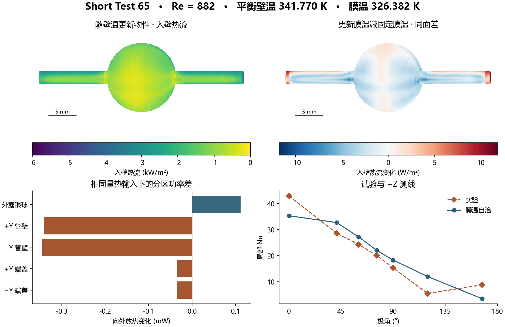

# 用银球量热功率同时确定壁温和膜温导热系数

Short Test 65 的外露银球输入 **0.827123193 W**，得到集总壁温 **341.7704 K**、空气膜温 **326.3824 K**、导热系数 **0.0282578503 W/(m·K)** 和 Pe **620.0932**。主端点的球面放热积分为 **0.827228166 W**，追加 20 次更新后为 **0.827229229 W**，相对目标分别高 0.01269% 和 0.01282%，均在事前 0.02% 的门槛内。壁温相对固定膜温的 v340 升高 **0.2426 K**，仍比实验平均值 352.9278 K 低 **11.1574 K**。本轮消除了选取热输运参数时对实测壁温的依赖；膜温处理只能解释现有温差中的一小部分。[独立复核与同面差](evidence/comparison.json) · [固定膜温参考](../v340/RESULTS.md) · [事前计划](PLAN.md)

新增同时有壁压及热流的几何覆盖为 **0 面、0 m²**。本工况全部 **32,480 面、0.000700423854 m²** 具有计算壁压、对流热流和首层流体温度。4,624 个外露球面共用一个量热平衡壁温；27,856 个管壁和端盖面采用与球体同温、独立供热的名义边界。独立的固体内部温度、外缘和恢复温度均未求得。逐面压力与热流联合实验验证面积为 **0 m²**。[面元场和测站包](../../../cases/short_sphere/calorimetryFilm65.zip) · [温度与源帧记录](../../../cases/short_sphere/calorimetryFilm65.json)



## 四个实算温界

每个候选使用 `Tf = (T∞ + Tw)/2`。以 K 为温度单位，空气导热系数取 `k = 0.0241 (Tf/273.15)^1.5 (273.15+194)/(Tf+194)` W/(m·K)。Pe 取 `ρ cp U D / k`。弱焓方程的无量纲热导和有界温差标量的扩散系数皆取该候选的 1/Pe。保留从来流湿度和压力得到的密度、湿空气比热及由 Re 确定的黏度。每一次原生求解使用自己的常物性；整个外部迭代随候选更新物性。[输运公式及配置核对](../../../scripts/shortSupportFilmProperties.py) · [上一版物性来源](../v321/SOURCE.md)

| 工况 | 候选壁温（K） | k（W/(m·K)） | Pe | 球面放热（W） | 相对功率误差 |
|---|---:|---:|---:|---:|---:|
| 低温端 | 330.994444 | 0.027849366 | 629.1885 | 0.533517082 | −35.4973% |
| 高温端 | 350.994444 | 0.028605394 | 612.5593 | 1.082126471 | +30.8301% |
| 第一次割线候选 | 341.698093 | 0.028255118 | 620.1532 | 0.825123842 | −0.24172% |
| 第二次割线候选 | 341.770414 | 0.028257850 | 620.0932 | 0.827228166 | +0.01269% |

首个内部候选的功率未达到根的容差，程序把它作为新下界，再按实际功率作割线。最终 1/Pe 为 **0.001612660742**。四个温界分别完成 600、400、200、200 次主要稳态更新，各自另加 20 次和独立释放检查。31 份实际配置涵盖稳态段及控制、早晚取样和释放阶段。每份核对两项输运系数、原来的其余离散设置及实际进程的输入指纹。固定迭代长度用于保存完整末窗，六分量对数残差、无限幅方程、正性及收支仍按原门槛验收。[原生配置、分块证据和历史](evidence/native.zip)

本机首个热解使用 v332 已通过审核的压力和速度。内域有界温差置零、弱焓取环境初值，壁节点施加本次均匀超温。后续使用本轮上一个实际终帧作数值初值，缩放温差及弱焓后重新推进全部方程。删去或替换试验表温、局部 Nu 等测量列后，来流和候选超温生成的物性相同。独立按 +20 K 生成的冷初场、261,708 点体网和五区映射均已核对。本轮完整四候选计算使用前述历史动量初场，冷态检查止于网格及初值。[输入依赖检查](evidence/inputs.json) · [计算入口](../../../scripts/shortSupportFilm65.py)

## 五区原面结果

| 区域 | 面数 | 向外放热（W） | 相对 v340 的变化（mW） |
|---|---:|---:|---:|
| 外露银球 | 4,624 | 0.827228166 | +0.111665 |
| +Y 管壁 | 13,864 | 0.300764090 | −0.340626 |
| −Y 管壁 | 13,864 | 0.301098390 | −0.344458 |
| +Y 湿端盖 | 64 | 0.015591720 | −0.034013 |
| −Y 湿端盖 | 64 | 0.015765906 | −0.034628 |
| 整件 | 32,480 | **1.460448272** | **−0.642060** |

两个模型指定了相同的球面功率，球面一行的积分差等于两个数值解各自闭合误差之差。整件功率还包含补偿支管和端盖的独立供热。最终 k 相对上一版降低 **1.4650%**。同面入壁热流差的面积加权 RMS 为 **4.0153 W/m²**，最大绝对差为 **11.7689 W/m²**，位于 −Y 端盖参考面 32,480。表压范围为 −1.577865 至 +1.591034 Pa，两种处理的同面最大表压差只达 3.52 × 10⁻¹¹ Pa，符合本工况恒密度、无浮力的动量模型。首层流体温度为 338.68096–341.65809 K。参考网放热峰为 **5.21459 kW/m²**，位于 −Y 管壁参考面 25,055。[原面量极值与时间窗复核](evidence/comparison.json)

| 极角 | 实验 Nu | 固定膜温 Nu | 自洽膜温 Nu |
|---:|---:|---:|---:|
| 0° | 43.0 | 35.690 | 35.361 |
| 41.3° | 28.6 | 33.032 | 32.731 |
| 60.2° | 24.3 | 27.477 | 27.228 |
| 75.8° | 20.1 | 22.288 | 22.073 |
| 90° | 15.3 | 18.508 | 18.324 |
| 119.8° | 5.5 | 12.128 | 12.007 |
| 166.7° | 8.8 | 3.557 | 3.518 |

七站局部 Nu 取 +Z 名义测线上的壁反力，换算时采用当地壁温处的导热系数，区别于输运方程使用的膜温导热系数。RMSE 从 **4.9232** 变为 **4.8882 Nu**。两处背风站的排序仍与实验相反，稳态层流、名义支管和试验测量定义等影响尚未分解。[实验表 II–III 与测量方法](https://doi.org/10.7907/6CZB-AW27)

## 使用与复现

在 MATLAB 打开 `rocketAeroHeatWorkbench`，导入[米制试件 STL](../../../cases/short_sphere/supported65.zip)，确认朝向并采用 14D 试件体网。在边界页选择 **球体量热 · 随壁温更新物性**。计算页可以新算、读取归档或重开本地任务。三维页可显示同一原面的热流差，七站表并列固定膜温和新解，CSV 同时保存膜温、k、Pe、参考源帧及温度身份。[本机三维工作台](../../../outputs/v341_validation/ui_final/workbench/index.html)

```powershell
python docs/validation/v341/verify_film.py
python scripts/shortSupportFilm65.py outputs/short65_film_new
```

第一条核对 Git 归档，第二条从本机试件输入运行一次新的完整计算。原始体场和检查点在 `outputs/v341_validation/film01`。准确基线为 v340 `1723c29c161c983886ed12bd11f2b49a57a34f0d`。[源码与证据验收](verify_film.py) · [下一决定](NEXT_DECISION.md)

工作台按实际 STL 三角面积保持各面瓦数。文件网上并列峰值为 **5,214.609 W/m²**，对应参考面 **24,991 和 25,119**，均位于 −Y 管壁。保留两个面号后，以较小的参考面号作代表。标准 STL 中定位文件面 24,991，反序 STL 中定位文件面 7,490，两者指向同一物理面。两次真实窗口各核对 32,480 行面元、72 行差场截面、七站对照、输入与求解壁温身份、共用参考源及离线色标；切回固定膜温后，原自洽任务被拒收。[实窗和导出核对](evidence/workbench.json)

主求解器及其监督流程用时 28.52 分钟，其中稳态段含追加 20 次共 16.01 分钟，控制、观测与释放共 7.22 分钟，编译和链接共 1.44 分钟。单个原生进程组内存峰值 2.09 GiB。独立原场审核 65.77 秒，冷网生成及输入核对共 24.47 秒，最终两个窗口分别 46.83 和 52.81 秒。开发和文档工时未单独计时。本轮验证目录独占文件约 5.92 GiB，排除了指向原资产的共享硬链接。[运行回执](evidence/runs.json)

发布前从 Git 暂存版本单独导出复核程序、试件输入和小型证据包，在没有本机体场的目录中复核了四个候选、两次最终功率积分、全部面元和七个测站，用时 2.58 秒。原始体场和检查点保存在本机。
