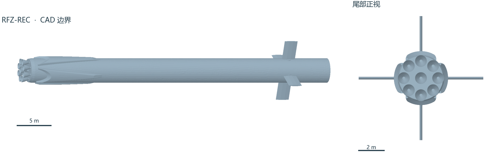

# RFZ-REC 在工作台中的几何与原面编号

本版首次将 DLR 可重复使用一级回收构型 RFZ-REC 的完整 STEP 实体边界接入工作台。相对 v341，新增同时有本项目壁压和热流的表面为 **0 面、0 m²**。现在可以从作者几何独立生成、重开并逐面定位本项目的输入；全体 **130,044 面、740.729003 m²** 均待求解，压力及热流的联合实验验证面积为 **0 m²**。此面积是完整 CAD 边界离散后的面积。作者计算另有人工封盖，参考场的积分责任面仍需逐区识别。[冻结几何](../../../cases/rfz_rec/geometry.json) · [204 个区域的原面清单](../../../cases/rfz_rec/cad_faces.csv)

## 几何、单位和编号

源文件是作者固定提交中的 `CAD/stp/RFZ-REC.step`，14,081,331 字节，SHA-256 为 `0442f31ef5cc0ffb0676879c17299da68245b35a3ac104d82d7d46419f2033db`。STEP 标注米，含一个闭壳实体。Gmsh 4.15.2 以米为输出单位离散其全部边界，保留作者 XYZ 和原点，X 正向指向一级前端。论文给出的 70 m 是带上面级的整箭长度。本次 REC 的轴向长度为 47.9000 m，横向两轴跨度均为 9.8000 m。[作者 CAD](https://github.com/rfz-model/RFZ_data/blob/3a174ee3d0b0626d6029e9608d862b674f3b266b/CAD/stp/RFZ-REC.step) · [论文第 2–4 页](https://doi.org/10.13009/EUCASS2023-018)

| 项目 | 验收结果 |
|---|---|
| CAD 分区 | 204 个边界面均有三角面，逐区记录核对使用的 CAD 面号、连续 STL 面号区间和两种面积 |
| 离散表面 | 65,024 个顶点，130,044 个原三角面，195,066 条无向边；1 个连通分量 |
| 拓扑与绕序 | 开放边、非流形边、重复面和零面积面均为 0；每条边由两个面反向使用 |
| 面积 | CAD 741.538401 m²，STL 740.729003 m²，相差 −0.1092% |
| 体积 | CAD 444.501537 m³，STL 有向体积 +443.112051 m³，相差 −0.3126% |
| 局部面积误差 | 按分区计算，最大相对差约 3.85%；例如第 19 区的 CAD 面积为 0.26379 m² |

区域号是此版本导入后的拓扑面编号。STL 文件面号从 1 开始，编号固定到发布的文件指纹。MATLAB 导入时逐一核对每个三角面的三个有序顶点，并从实际面元面积重新积分全部 204 区。两次独立建面得到逐字节相同的 STL 和分区表。[几何准备程序](../../../scripts/prepareRFZGeometry.py) · [MATLAB 原面绑定](../../../bindRFZGeometry.m)

## 论文对照范围

选 EUCASS 的 `deg190` 作为后续候选。该目录的三轴点数一致，无舵偏构型对应论文图 13 的 190° 对照。直接使用作者的 XYZ，量取每点到最近 STL 三角面的距离。全部 72,706 个点均参与，资料覆盖 Y 非负一侧。距离核对逐三角面计算，并用抽样穷举复查空间搜索。此次只读坐标。[作者数据](https://github.com/rfz-model/RFZ_data/tree/3a174ee3d0b0626d6029e9608d862b674f3b266b/Aerodynamics/Stage_1/EUCASS_2023) · [独立检查程序](check_reference.py) · [逐项统计](evidence/reference.json)

| 几何距离 | 结果 |
|---|---:|
| 中位数 | 0.267 mm |
| 第 95 百分位 | 7.786 mm |
| 第 99 百分位 | 112.611 mm |
| 最大距离 | 452.282 mm |
| 1 / 10 / 50 mm 以内 | 46,859 / 70,355 / 71,299 点 |

有 1,407 个参考点距离本版表面超过 50 mm。作者说明计算模型使用封盖，点云文件没有表面连接表。仍缺这些点与具体 CAD 面、人工封盖的归属证据。图 13 提供局部数值压力系数与热流；独立实验、全表面参考积分及逐面物理误差均待核实。几何距离不用于给物理量设容差。[作者的数据说明](https://github.com/rfz-model/RFZ_data/blob/3a174ee3d0b0626d6029e9608d862b674f3b266b/Aerodynamics/Stage_1/EUCASS_2023/readme) · [项目对公开文件的核查](../../research/rfz_public_surface_fields_20261124.md)

## 在工作台打开

在 MATLAB 运行 `rocketAeroHeatWorkbench`，选择 **输入模型 → 打开 DLR RFZ-REC**。点击表面后，窗口下方显示三角面编号、所属 CAD 面号和两种离散面积。也可以从 **选择 STL 文件** 打开本机 [RFZ-REC_m.stl](../../../outputs/rfz_rec_geometry/RFZ-REC_m.stl)，尺度取 1。改变尺度后，原米制分区资格随输入失效。

命令行入口为 `python scripts/prepareRFZGeometry.py`，使用 Windows 项目的 Python、NumPy、SciPy 及固定 Gmsh。可用 `--step` 指定同一份已下载的作者 STEP，或用 `--out` 另建目录。默认优先使用本机作者文件；首次缺少 STEP 或 Gmsh 时按固定来源获取。STL 与大型原件保存在 E 盘，Git 包含完整 MATLAB 源码、准备程序、几何指纹、分区表和小型验收证据。[工作台入口](../../../rocketAeroHeatWorkbench.m) · [验收程序](check_workbench.m) · [下一决定](NEXT_DECISION.md)

## 实际运行与修正

基线为 v341 `ae3c1fc9131fb6b89f6d8cabcaac2624562a931e`。最初两次建面分别用时 11.97 秒和 11.67 秒；几何点云检查 2.59 秒。已有安装中的工作台验收用时 29.72 秒。此次科研运行均为几何处理，流场求解耗时为零。开发和资料阅读未单独计时。[运行记录及源码指纹](evidence/runs.json)

首次空目录试用时，原下载器仅收到 Gmsh 的前 22,412,528 字节。第二次试用遇到 STEP 读取超时。现对两种文件按明确字节区间下载、保留完整片段，按固定总长和 SHA-256 验收。修正后，独立目录从头取得 STEP 用时 83.56 秒，从保留的中断前缀续传、核验并提取 Gmsh 用时 113.11 秒。最终安装包有 42,235,999 字节，原部分文件逐字节等于该包的前缀。[下载与异常响应回归](check_download.py)

随后从 Git 待发布内容独立导出项目，只接入上一步核验的 CAD 和 Gmsh。工作台按钮从空几何目录生成 STL，经普通加载入口重读，以标准面序生成实际 WebGL 画面。确认朝向、改变尺度、恢复米制并重开均通过，全程 41.22 秒。三组 CAD 面的探针通过消息回调核对，过期事件被忽略。前一次检查附加的整窗 `exportapp` 截图调用以“Export unsuccessful”终止。此处报告的插图由同一 STL 独立绘制，真实窗口另有渲染回执。[实窗证据](evidence/workbench.json) · [制图程序](plot_geometry.py)
