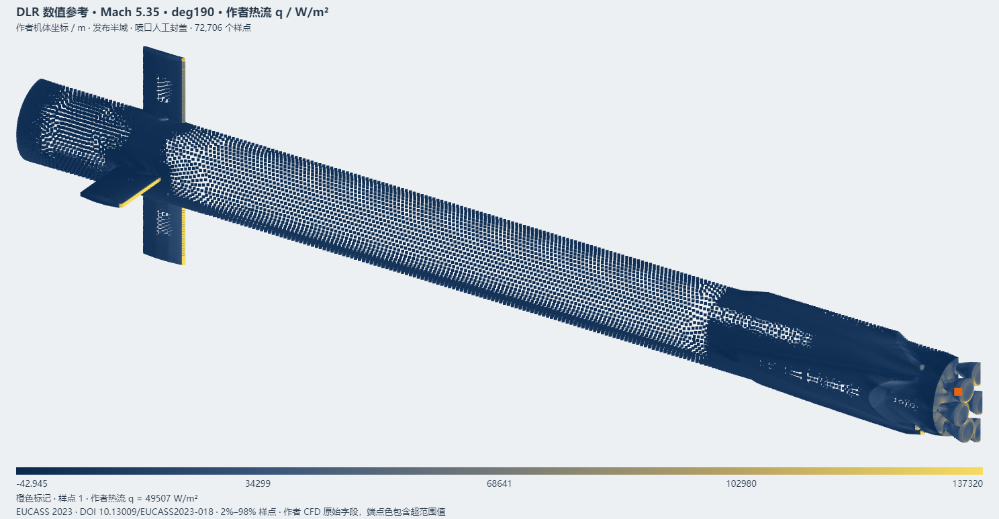

# Mach 5.35 作者压力与热流参考样点

DLR 的 EUCASS 2023 / deg190 发布物现可在同一工作台内查看。每个作者样点有坐标、压力、热流和壁温。工作台使用发布的 72,706 个点直接绘图，保留原始顺序、数值、作者坐标和人工封盖。相对 v346，RFZ 原面独立计算壁压和热流新增 **0 面、0 m²**。本版接通对照所需的参考场，项目独立场及同位置误差仍待取得。[作者原始数组](https://github.com/rfz-model/RFZ_data/tree/3a174ee3d0b0626d6029e9608d862b674f3b266b/Aerodynamics/Stage_1/EUCASS_2023/deg190) · [字段与输入口径](../../../cases/rfz_rec/deg190_reference.json)

| 作者原始字段 | 单位 | 全体样点范围 |
|---|---|---:|
| 压力 p | Pa | 25.968084 至 18,063.507361 |
| 热流 q | W/m² | −10,853.202032 至 437,468.683372 |
| 壁温 T | K | 300，最大数值偏差 5.69 × 10⁻¹⁴ |

这是作者在含人工封盖的半域上给定壁温所得的 CFD 数值场。72,706 行的存储坐标互异。热流中有 2,944 个负值，零值有 0 个。压力零点和热流正向仍待核实，因此显示、探针和 CSV 均保留原字段口径。图中橙色标出当前样点。点间空白保留了原始采样密度。完整 CAD 的内腔有独立边界身份，参考点数不能换算为原面计算面积。[独立全表核对](evidence/samples.json) · [实体壁与封盖依据](../v343/RESULTS.md)

## 打开与使用

在 MATLAB 运行 `rocketAeroHeatWorkbench`，打开[RFZ 完整 CAD 标准工况](../../../cases/rfz_rec/full_cad_input.json)，在 **计算 → 查看作者压力与热流样点** 中切换参考量。无需先生成空气体网。默认色标取样点的 2%–98% 范围，另有全范围和按变量保存的指定范围。端点色包括色标外的样点，查询和导出保留原数值。点击点云或输入样点号可同时查询 XYZ、p、q、T。样点号自 1 开始。PNG 保存当前视角、量名、单位、色标、选中点和来源，CSV 保存全部样点。[工作台](../../../rocketAeroHeatWorkbench.m) · [参考样点读取](../../../readRFZReferenceSamples.m)

读数组时优先复用本机已校验的作者文件。首次缺失时，从固定作者提交按需获取六个 NPY，共 3,490,656 字节，保存于 `outputs/rfz_reference/published_samples/<提交>/`。每次读取逐文件校验 SHA-256。新安装的首次获取和缓存回读已在独立目录中运行，所得两份表完全相同；单文件损坏被拒收。修改项目模型朝向或内壁给温后，参考页仍显示其发布时的坐标和 300 K 条件。退出后返回项目自己的原面温界。[实际窗口、缓存与拾取回执](evidence/ui.json)

## 验收

MATLAB 工作台导出的行号和六列双精度数，与从独立缓存以 NumPy 读取的 **436,236 个原值逐位相等**。参考图实际绘制 72,706 点、0 个三角面。实窗核对了负热流、首尾行号、量切换、指定色标和失效的旧探针消息。另在真实 WebGL 页面上向同一像素投影多个点，鼠标选择了最前点，同深度优先原顺序，点击背景未产生样点。返回项目网格后，130,044 个原面和 300–315 K 区分工况均正确显示，项目求解结果仍为空。[独立复核程序](verify_reference.py) · [实窗操作](check_reference_ui.m) · [像素拾取测试](check_point_pick.m)

基线 v346 `1fb6ba7faf4432887b594858f6948b4b497d59ed`。开发初次运行因 MATLAB 字节序查询写法不兼容而失败，已改为读取 `computer` 的第三个返回值。整窗截图也曾失败，正式 PNG 来自正在显示的 WebGL 画布。最终参考页与拾取实窗用时 45.86 秒，进程组峰值 2.14 GiB。冷缓存、下载及回读用时 23.83 秒。独立逐位核读 0.89 秒，原几何视图回归 17.81 秒。流场求解时间为零，开发归档未计时。原日志和完整 CSV 在本机 `outputs/v347_validation`，Git 保存源文件指纹、源码、小型回执和实际导出图。[运行回执](evidence/runs.json) · [事前计划](PLAN.md) · [下一决定](NEXT_DECISION.md)
