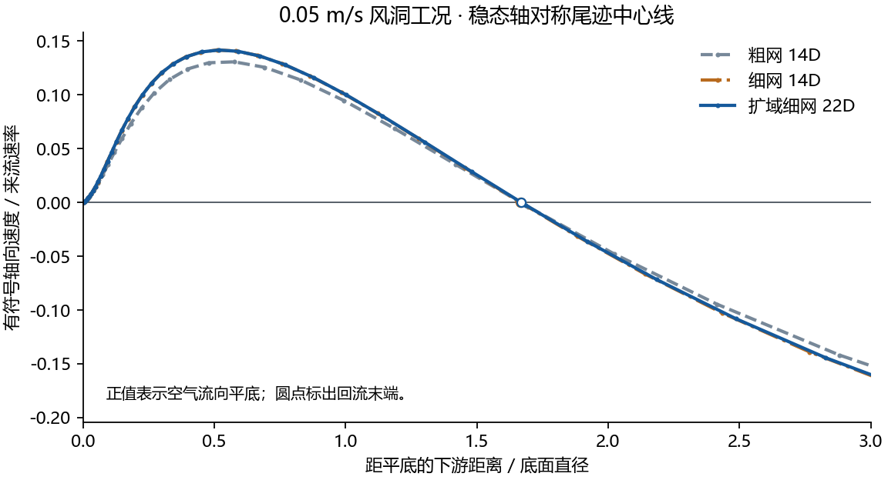

# 全周尾迹对照与本机资源

0.05 m/s 工况的全周动量网可以在本机运行。两次无扰动对照均写出了计划第一物理步的原生末帧，但都没有通过事前的联合残差与正性门槛。扰动初场已准备，扰动计算未启动。可用于判断非轴对称尾迹发展的物理观测时间为 **0 s**。工作台继续从已验收的稳态轴对称解提供全部 9,216 原面的壁压和热流。[实际运行回执](evidence.json) · [本机工作台](../../../outputs/v352_validation/audit_ui01/workbench/index.html)

## 已有流场中的回流

从三档 v350 终帧独立读取平底后方轴线速度。来流沿 −X，正轴向速度表示局部空气流向底面。对变号的相邻节点线性插值，粗网、细网、扩域细网的回流末端分别在底面下游 **1.667、1.667、1.670 个底径**。扩域细网对应约 **0.267 m**，最大反向流速约为来流的 **14.2%**。该网实际夹住零点的节点位于 1.481 和 1.686 个底径处。三条曲线是稳态轴对称结果，真实尾迹的周向偏转与振荡仍未知。[三网源帧和采样区间](baseline.json)

## 两次实际计算

以 48 个周向单元闭合真实流体域。径向和母线保留 14D 粗网，首末周向单元共用内面，轴线节点共用。全域有 190,106 个节点、186,624 个体单元。独立枚举全部体单元面后，仅实体壁和远场属于边界。原 STL 的 9,216 个三角形按周向与轴向带汇成 4,656 个对应片区；与体网壁面的最大相对面积差为 4.08×10⁻⁷ 以内。全周网准备耗时 6.97 s，峰值约 143 MiB。尾迹内 2,795 个节点含非零初始扰动，其最大值为来流速率的 1%，壁面与远场扰动均为零。[网格与两个初场](prepare_wake.py)

两次无扰动对照使用同一网格和同一初场 SHA，SU2 8.6.0、4 线程、BDF1、名义物理步长 0.600 s（0.1875 个底径对流时间）。每次执行至 360 个内迭代并保存终帧。表内残差为原生日志末 20 行各分量对数 RMS 的最大值。[运行合同](PLAN.md) · [物理步入口](physical_step.py)

| 无扰动支 | 压力 | X 速度 | Y 速度 | Z 速度 | 辅助焓 | 用时 | 进程峰值 |
|---|---:|---:|---:|---:|---:|---:|---:|
| MUSCL 重构 | +4.040 | +13.880 | +13.379 | +13.378 | +6.510 | 105.1 s | 1.18 GiB |
| 一阶对流 | −8.468 | −8.472 | −9.366 | −9.366 | −5.995 | 116.1 s | 1.14 GiB |

第一支的最小绝对压力为 −6.05×10¹⁴ Pa，读回程序在正性检查处退出，原生程序仍记录正常退出。第二支的最小绝对压力为 101324.99945 Pa，壁面速度为零，动量和压力达标，辅助焓未达 −8。两支均未被采用。正常退出、末帧存在及动量分量单独通过均未计作完成的物理时间。本轮没有实测每个**合格**对流时间的成本。仅按第二支消耗作算力估算，推进一个底径对流时间需要约 620 s 的无扰动单支预算，另有扰动对照、热输运及时间步核对的成本。

## 三维换热的资源限制

v350 的已验收热方程在子午面上守恒离散。若把扩域细热网按相同 48 格周向铺开，扣除共轴点后有 2,686,028 个节点。按一次四面体离散，约有 15,620,304 个单元。若沿用逐单元一次性装配，每单元 16 项，行、列均为 int64、系数为 float64，仅这三组数组就占 **5.59 GiB**，已超过每进程 4 GiB 预算，尚未包含稀疏矩阵和解向量。这是指定装配方式的容量计算，全周热求解没有发生 OOM。分块装配或使用原生输运内核的实际开销需另测。[按实际热网计数](wake_baseline.py)

## 主结果与复现

相对 v351，新获准的壁压、热流及两者交集分别为 **0 面、0 m²**，新增原面清单为空。默认稳态工况仍覆盖 0.935516891 m²，整件向外放热 0.873518 mW，联合实验验证面积 0 m²。三维页及壁压、热流的逐面范围明确标注稳态轴对称假设。工作台读取归档用时 5.62 s，六区拾取、X = 0.7 m 截面和 9,216 行联合导出通过。按变量的三份 CSV 也逐行核对了数值、单位和探针范围。[完整 MATLAB 查看器数据接口](../../../buildAerothermalViewerData.m)

本轮基线为 v351（`fe728cbf`）。网格、两份初场、两个原生末帧和原始失败记录位于本机 `outputs/v352_validation`，其中 `control01/executed` 与 `executed` 保存实际执行的原版脚本或计划。Git 收录小型回执、脚本与图，不含这些大型场。可用 `wake_baseline.py --flow-run` 和 `prepare_wake.py 输出目录 --flow-run` 指定由 v350 默认风洞工况冷启动生成的作业目录。现有非定常候选已经结束。[下一项](NEXT_DECISION.md)
