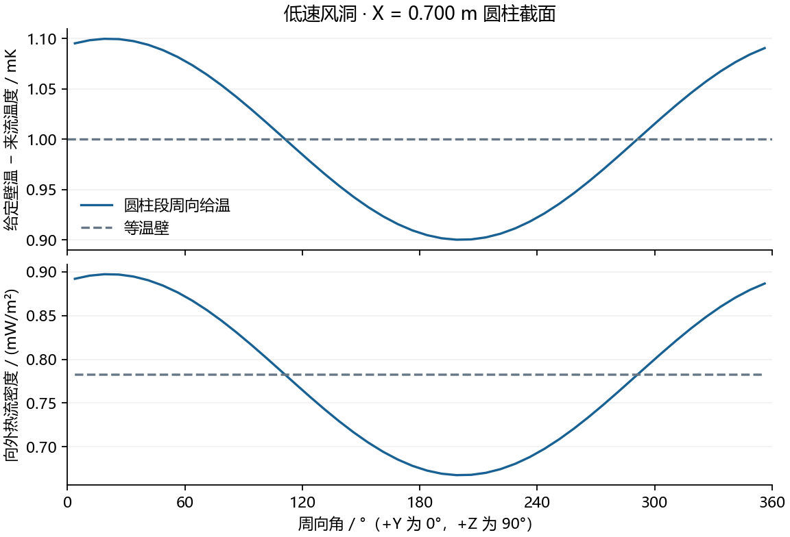

# 低速风洞的全周热输运

同一 0.05 m/s 来流、300 K 空气、300.001 K 等温壁下，48 方位热网算出的整件向外放热为 **0.873518 mW**。扩域细网含 **2,686,028 个独立温度自由度**，同时求解等温和两种周向给温对照时，进程峰值为 **452.5 MiB**。工作台在同一份 9,216 面结果中提供“入壁热流 · 全周热网复核”，可配合主热流使用统一色标。[工作台归档](../../../outputs/v353_validation/audit_ui01/workbench/index.html) · [定量验收数据](evidence.json)

## 解了什么方程

动量来自 v350 已验收的 SU2 恒密度不可压轴对称速度场。热输运采用稳态常物性对流扩散方程。子午面采用线性三角形、守恒流函数投影和低阶代数上风；每个子午控制面积沿周向划分为 48 个周期控制体。角向相邻单元通过傅里叶导热通量交换热量，共用轴线上的一个温度自由度。外界入流给定温度，外流用自然扩散边界，壁面强制给温。物理截面按扇区中心温度取样，实体壁热流由约束温度所需的离散壁反力按原三角形面积映射。[热算子及原面积分](../../../scripts/simpleLauncherAngularHeat.py) · [子午面装配](../../../scripts/simpleLauncherTemperature.py)

本工况速度无周向分量，算子的各个角向块相同，可用离散傅里叶变换分解为至多 25 个独立稀疏系统。零模态保留共享轴点，非零模态在轴线上为零。回到物理空间后，以相邻扇区的成对热流、各自由行、所有轴线贡献之和及远界收支检查解。小型独立校核还直接组装了 194 个自由度的整周矩阵，单个扇区的壁温变化激励了全部 25 个模态，直接解与分块解的最大无量纲温差为 6.66×10⁻¹⁶。[直接矩阵校核](check_periodic_blocks.py)

## 网格与原面结果

| 热网 | 独立温度自由度 | 等温整件放热（mW） | 实测峰值（MiB） | 三种给温及保存耗时（s） |
|---|---:|---:|---:|---:|
| 粗网 14D | 1,359,412 | 0.891509 | 278.2 | 3.92 |
| 细网 14D | 2,621,296 | 0.872925 | 434.3 | 7.39 |
| 扩域细网 22D | 2,686,028 | 0.873518 | 452.5 | 7.27 |

D 为箭身最大直径。上表时间从读取已保存的流场开始，含热场和面表存盘。粗细网整件功率差为 2.13%，细网扩域差为 0.068%。等温条件下，周向导热通量应为零，物理温度解应退化为同网格的轴对称解。三档网格中，两种方法的最大无量纲温差为 1.73×10⁻¹⁴ 以内，六区积分功率最大相对差为 8.5×10⁻¹⁴ 以内。扩域细网逐面热流面积加权相对 RMS 差为 8.92×10⁻⁸，面表保留按各自原三角扇片面积分配的数值。[计算及回读](run_control.py)

底盘从中心向外按半径四等分。扩域细网四个环带向空气放热依次为 **0.591、1.594、1.999、3.240 µW**，合计 **7.423 µW**。另从 v350 的二维壁反力按实际底半径积分，逐环带核对。全表面按原来的几何、面积和面号计算，鼻尖与底心均保留。[逐环带核算](evidence.json)

## 独立的非均匀给温试验

另在相同速度场上给圆柱段施加平滑的周向余弦壁温增量，峰值 0.0001 K，周向平均为零，其余各段沿用原等温壁。圆柱段 X = 0.700 m 的截面上，等温条件的向外热流约为 **0.7824 mW/m²**，非均匀给温后为 **0.6677–0.8971 mW/m²**。曲线来自真实截面交线，每个扇区内按线段长度平均。局部热流变化时，整件功率因该恒物性线性模型和零均值激励而保持一致。[截面核对](compare.py)

将给温旋转 90° 后，温度和壁反力随之移位。扩域细网的最大无量纲温差为 4.45×10⁻¹⁶ 以内。自由流体节点的最大周向温差约为 **0.1974 mK**。这一角向差异来自规定的热边界。真实尾迹的周向速度、非定常流体储热，以及同一物理时刻的非轴对称壁压与热流尚待求解。[非均匀给温试验的 9,216 面数据](circumferential_wall.zip)

相对 v352，等温工况新增独立全周热网复核 **9,216 面、0.935516891 m²**。原已计算壁压、热流及两者同面覆盖的净增分别为 **0 面、0 m²**，新增覆盖面清单为空。逐面压力和热流共同通过独立实验验证的面积仍为 **0 m²**。不同壁温的附加试验独立保存。

## 复现

本轮基线为 `7353f8bce7051afd2e53d02c30f09838a9095ba5`。用 MATLAB 的 `main` 在默认风洞试件上计算，程序会由本次扩域流场新算全周等温热流。读取归档则核对全周复核包、几何、来流、速度终帧、两份壁面表及整件功率。程序将热方程与专属温度场的来源写入探针及导出。[MATLAB 风洞入口](../../../runSimpleLauncherWindTunnel.m) · [完整查看器数据接口](../../../buildAerothermalViewerData.m)

从普通侧栏点“计算”到完整云图可读为 **343.99 s**，其中三次 SU2 原生求解合计 316.59 s。读取归档为 **5.99 s**。新算与归档的流动终帧、全周温度场与复核面表指纹逐一相同。两种路径均拾取六个区域，在 X = 0.700 m 截面回查 96 行，并使用发布版网页脚本导出、回查全部 9,216 行复核热流。联合壁压/热流导出也逐行核对。本次使用本机已有前端资源显示，其他任务的前端改动未随本次提交发布。[冷启动、归档与原生回执](workflow.json) · [逐面核对](check_exports.py)

三档研究热场、旋转后的温度、壁反力和逐面结果存于本机 `outputs/v353_validation/{coarse01,fine01,outer01}`。各自的 `fields.npz` 与 `wall.csv` 指纹在验收数据中。Git 收录小型面表、曲线、回执及完整源码，体场可从相同输入重算。复现三网对照用 `python docs/validation/v353/run_control.py <风洞原生作业目录> <coarse|fine|outer> <新输出目录>`。各次实际执行所用的计划与源文件 SHA 见相应进程回执。[交互核对](check_workbench.m) · [下一项](NEXT_DECISION.md)
