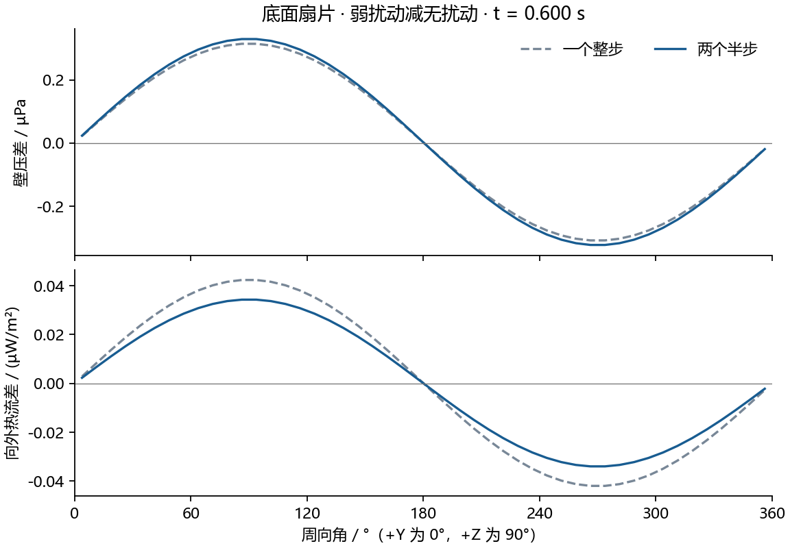

# 尾迹弱扰动后 0.600 s 的全表面结果

在 0.05 m/s、零攻角的固定风洞工况下，由构造初态推进到 **0.600 s**，全部 **9,216 个原面、0.935516891 m²** 均取得同一末时刻的三维壁压、入壁热流和首层流体温度。壁温给定为 300.001 K，空气为 300 K。主结果取两个半步的末值。全表面相对环境壁压为 **−0.541 至 +1.637 mPa**，入壁热流为 **−6.254 至 −0.177 mW/m²**。当前验收为 14D 粗网的启动瞬态数值结果。[本机三维工作台](../../../outputs/v354_validation/audit_solve01/workbench/index.html) · [完整原面数据](../../../cases/simple_launcher/wake/wind_tunnel.zip)

## 同一时间层的热量账

实体外壁向空气放热 **892.959437 µW**，同一末步远界净显热流出 **890.654326 µW**，流体显热增加率 **2.305112 µW**。另从前一时刻和当前时刻的全周温度直接积分，三点求积计算子午三角形内半径与温差的乘积，独立恢复了储热项。温度没有裁剪。首层流体温度为 300.000759–300.000999 K，固体内部温度未求解。[逐时刻独立核算](evidence.json)

| 表面区域 | 原面数 | 向空气放热（µW） |
|---|---:|---:|
| 球形鼻端 | 336 | 15.830 |
| 锥形头罩 | 1,920 | 272.787 |
| 圆柱箭身 | 4,896 | 520.257 |
| 收缩肩 | 480 | 17.482 |
| 较细尾段 | 1,536 | 59.439 |
| 平底 | 48 | 7.164 |

## 流动与热流的来源

基线为 v353（`ebc5f09b0add519f02fd4ff01c36d7904d291226`）。采用 v352 的完整 360° 粗体网与两份三维初始速度。对照初场由轴对称基流旋转得到；扰动初场在尾迹内另加峰值为来流 1% 的局部速度扰动。SU2 8.6.0 的运行日志明确标出不可压层流、关闭原生能量方程。源码 `CIncEulerSolver::LoadRestart` 在此配置下少读一个未知量，`CFlowIncOutput` 只在能量方程启用时输出焓。每个启动文件保留相同的节点号、坐标、压力与三速度，独立热方程承担等温壁条件。六次真实物理步均核查原生末帧和无滑移壁，四分量末 20 行的最大对数 RMS 均小于 −8。仅此恒密度、恒黏度、无浮力模型采用单向耦合。[物理步入口](run_flow.py) · [SU2 固定源码](https://github.com/su2code/SU2/blob/7048fd35f56d4bf52e586429d6746a36a10255f8/SU2_CFD/src/solvers/CIncEulerSolver.cpp)

显热初场来自 v353 粗网等温解。在全周独立热网上传递同一时间层的轴向、径向和周向速度，对相对基流的通量变化进行加权守恒投影。壁面不可穿透，远界按当时的流动交换质量；共享轴点按完整控制体闭合。扰动主帧的通量修正 L2 范数为总通量的 **0.0071%**，为其相对原基流通量增量的 **51.2%**。单独取扰动支减对照支，投影对这两支差值的修正约 **1.99%**。三个比例的分母不同。原三维显热残差保留不同方位间的耦合与周向平流；轴对称傅里叶分块只作预条件。时间项按 BDF1 积分，温度边界反力映射回原面，基底按径向面积积分。[质量通量传递](flux_transfer.py) · [显热时间步与原面映射](heat_step.py)

## 时间步敏感性

两支各完成一个 0.600 s 整步和两个 0.300 s 半步。扰动支在同一末时刻的整件放热差为 **0.00311%**；单面热流差按面积加权的相对 RMS 为 **0.304%**，壁压 RMS 差为 **1.36% 来流动压**。六区总放热的最大相对差为 **0.379%**，出现在球形鼻端。

底面有可分辨的早期数值响应。用扰动支减去同网、同时间步的无扰动对照，取底面 48 个原扇片的第一周向谐波。两半步给出的壁压幅值为 **0.326 µPa**，向外热流幅值为 **0.0342 µW/m²**。整步与两半步的复谐波差分别占两半步幅值的 **4.51%** 和 **23.50%**。总放热对步长的敏感性很小，局部弱热信号的幅值仍有明显步长影响。观察时间仅为 0.1875 个底径对流时间，不能由此判断发展后的尾迹形态。[逐扇片差量与审核](audit_time.py)

此瞬态工况相对 v353 新增计算壁压、热流及两者交集各为 **9,216 面、0.935516891 m²**。新增编号 1–9216，完整明细见发布面表。原稳态工况的覆盖净增为 0 面、0 m²。此瞬态没有同形同工况实测，联合实验验证面积为 0 m²。全周瞬态的空间、近壁与外域敏感性仍待检查。

## 使用与复现

在 MATLAB 运行 `main`，在边界条件页将“计算状态”选为“尾迹弱扰动后 0.600 s”，确认后选择计算或读取归档。相同的已验收本机动量帧可按指纹复用，按“计算”仍会重算六个显热步并重新核对原面及误差。缺少初场或动量帧时由程序从固定输入准备相应阶段。命令行 `python scripts/runSimpleLauncherWakeCase.py outputs/<新目录> --from-start` 明确要求从头准备并推进全部动量和显热。大型体场留在 E 盘，Git 保存小型完整面表、基准输入身份和代码。[计算入口](../../../scripts/runSimpleLauncherWakeCase.py) · [MATLAB 完整风洞接口](../../../runSimpleLauncherWindTunnel.m)

首次研究试算六步动量合计 **926.97 s**，六步显热合计 **94.50 s**。本机工作台复用动量并重新算热，点击到出图 **98.99 s**，直接读档 **5.90 s**。两种路径的流场、热场和原面表指纹一致。五个物理量各 9,216 行及两个 96 行截面均按同一时刻回读；切回稳态清除了原瞬态结果。单独验证了无缓存初场重建，耗时 42.30 s，恢复的网格、两份速度种子和初始温度场指纹相符。本轮没有重复计时无缓存的全流程。[工作台及无缓存初场回执](workflow.json) · [导出核对](check_exports.py)

首个热网读取因 193 个边界点的舍入误差停在插值检查处，最大距实际边界段为 5.33×10⁻¹⁵ 个最大直径。修正为沿原边界段双端取值后重跑，旧记录保留。首次界面验收读取带时间列的截面 CSV 时未显式指定分隔符，修正验收器后通过。复算界面的进程监督在退出后的五秒内尚记录一个 PID，原回执保留为未通过；随后核实该 PID 已消失，另据六个显热子进程的正常终态、源指纹和完整导出独立确认计算交付。其他任务正在编辑的网页代码未随本版发布。[下一项](NEXT_DECISION.md)
