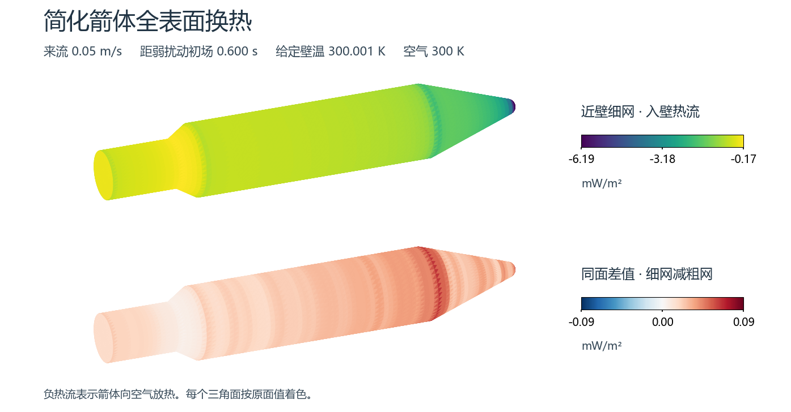

# 简化箭体在 0.600 s 的全表面近壁热网对照

0.05 m/s、零攻角、300 K 空气、300.001 K 给定壁温。尾迹初始弱扰动后 0.600 s，细热网算得箭体向空气放热 **0.868870422 mW**，粗热网为 **0.892959437 mW**，两者相差 **2.77%**（以细网为分母）。六区全部 9,216 个原面共 **0.935516891 m²**，包括收缩肩和整个平底。两套计算使用同一速度与压力终帧，逐面壁压相同，相对环境为 −0.541 至 +1.637 mPa。冷却工况的入壁热流为负，细网范围为 **−6.193 至 −0.172 mW/m²**。[交互工作台（本机）](../../../outputs/v355_validation/ui_read02/workbench/index.html) · [完整细网原面表](../../../cases/simple_launcher/wake/wake_heat_grid.zip)

## 哪些结果经得起近壁加密

只把热网壁面目标间距从 0.004D 降到 0.002D。实际贴壁边长中位数从 0.9702 降至 0.5018 mm，贴壁三角形法向高度中位数从 0.8492 降至 0.4143 mm。两网分别从同一粗网稳态速度重建自己的显热初场，再使用 v354 相同的六个三维速度时间层。流动外域 14D、周向 48 格、流体物性和全表面等温边界均相同。两套热网各比较无扰动和弱扰动分支，每支用一个整步及两个半步到达同一时刻。[事前门槛](PLAN.md) · [逐步记录](evidence.json)

| 原面区域 | 面数 | 粗网向外放热 µW | 细网向外放热 µW | 相差 |
|---|---:|---:|---:|---:|
| 球形鼻端 | 336 | 15.830 | 15.695 | 0.86% |
| 锥形头罩 | 1,920 | 272.787 | 268.002 | 1.79% |
| 圆柱箭身 | 4,896 | 520.257 | 503.697 | 3.29% |
| 收缩肩 | 480 | 17.482 | 17.073 | 2.40% |
| 尾段 | 1,536 | 59.439 | 57.564 | 3.26% |
| 平底 | 48 | 7.164 | 6.839 | 4.77% |

扰动支两半步末，逐面热流的面积加权相对 RMS 差为 **2.56%**，低于 5% 门槛。鼻端峰值在两网均落在 **9102 号面**，向外热流为 6.254 和 6.193 mW/m²，相差 **0.98%**。平底沿半径四等分，四个环带的放热差由内向外为 5.66%、5.20%、5.08%、4.22%，分别低于 10%。四个环带在热网的壁面反力上积分，原 STL 上的每个平底扇片则保存由底心到外缘的面积平均值。

细网整步和两半步的全件放热差为 0.00270%，热流面积加权相对 RMS 差为 0.308%。但把扰动支逐扇片减去无扰动支后，底面一阶周向热信号很小。细网两半步的向外热流复谐波幅值为 **0.03194 µW/m²**。粗细网复谐波差为 **7.06%**，细网整步与两半步的复谐波差为 **24.13%**，超过事前 20% 的辨识门槛。工作台保留原面读数，并注明此弱信号的幅相尚不能可靠辨识。[计算与积分程序](compare.py)

## 算法、热量收支和验证范围

壁压由 SU2 8.6.0 的三维恒密度层流动量计算提供。项目的三维显热方程使用守恒质量通量、周向周期输运及一阶隐式物理时间步，在给定等温壁上由离散方程的壁面反力求热流。细网温度自由度为 2,599,509。取同一步独立计量，箭体放热 **868.870422 µW**，远界净流出 **866.742085 µW**，流体储热率为 **2.128337 µW**。直接用相邻两帧温度对流体体积做三角形求积，六步均恢复了储热项。细网六步原方程相对残差最大 7.30×10⁻¹⁵；无量纲温度在 [0,1] 内。扰动终帧的第一层流体温度为 300.000761–300.000999 K；固体内部温度未求解。[原始时间层与传递算法](../v354/RESULTS.md) · [细热网准备与推进](refined.py)

相对 v354，此工况的壁压、热流及其交集覆盖净增均为 **0 面、0 m²**，新增编号集合为空。本轮在相同的 9,216 面上获得第二套近壁热网结果并量化了空间差异。瞬态动量网格、外域误差和同形同工况实验精度仍待核对。上述差值是两网敏感性；联合实验验证面积为 **0 m²**。该低速、无浮力研究工况单独计账。

## 在工作台中查看与复算

运行 MATLAB 的 `main`，选用简化箭体，确认原面网格。在边界条件页选择“尾迹弱扰动后 0.600 s”，再点“读取归档”或“计算”。结果页提供粗热网入壁热流、近壁细网入壁热流、细网减粗网差值。前两者可用同一比较色标，差值色标以零为中心。面元探针给出计算方法和取样范围。全表面压力与热流联合表沿用粗热网主结果，细网和差值可分别导出完整原面表。

“计算”在本机核对并复用已验收的速度帧，实际重新求了六个粗热步。近壁细网是本版独立算好并随版本发布的归档对照。只有几何、工况、粗热网与动量终帧及粗面表指纹一致，才将其配到新结果。两条入口均核对了六区拾取、三张各 9,216 行的热流表、三个 X = 0.7 m 的 96 行截面，以及 9,216 行压力与热流联合表。切回稳态后读回了原来的稳态场。[工作台核对](workflow.json) · [完整 MATLAB 接口](../../../runSimpleLauncherWindTunnel.m)

基线为 v354（`c9f0d13ba3ec57113053818c1257c918d4e98fbf`）。细热网及稳态初场准备耗时 7.99 s，六个新热步骤合计 **119.70 s**，单步峰值内存 **1.54 GiB**。这些时间只含数值运行。工作台实测从点击到出图，最终归档页 **6.54 s**，重新计算粗网并读取匹配细网对照 **99.25 s**。最后一次归档回归还核对了页面标题中粗细两项功率。两条入口的全表面导出和实际截面另以发布版网页代码逐面复核。[界面及复算回执](workflow.json)

大型体场与各进程的原始终态回执留在本机 `outputs/v355_validation/run01` 和相邻监督目录。可用 `refined.py` 对同一新目录依次执行 `prepare`、`pilot`、`remaining`，参数为基流作业目录、v354 六帧动量目录、v352 全周网目录和本次输出目录。用 `compare.py` 核算并导出对照包。代码与小型原面数据随版本交付，并发网页及 Harness 的修改另行维护。[下一项](NEXT_DECISION.md)
